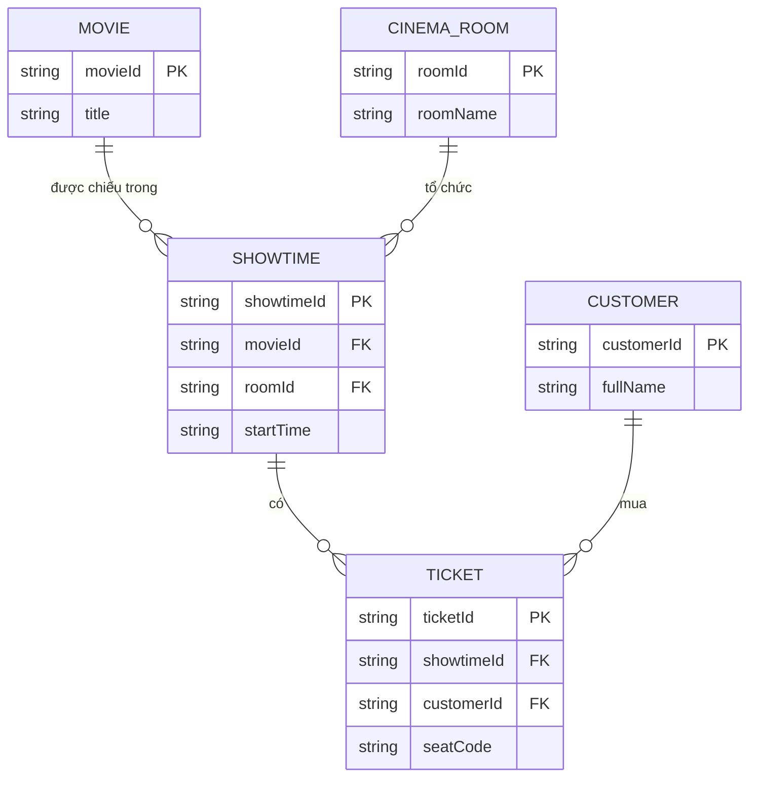
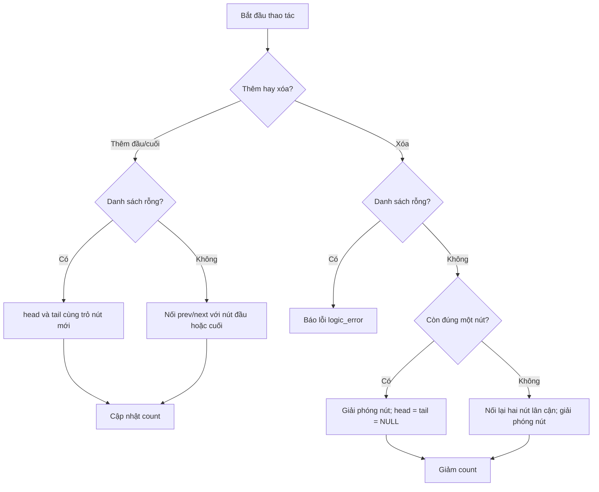
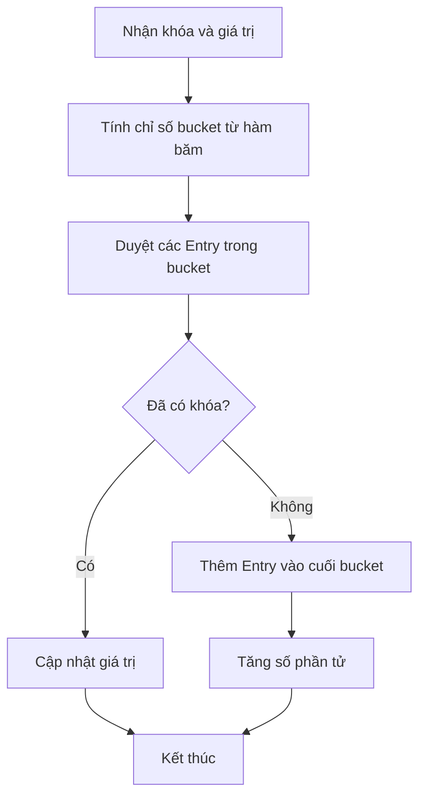
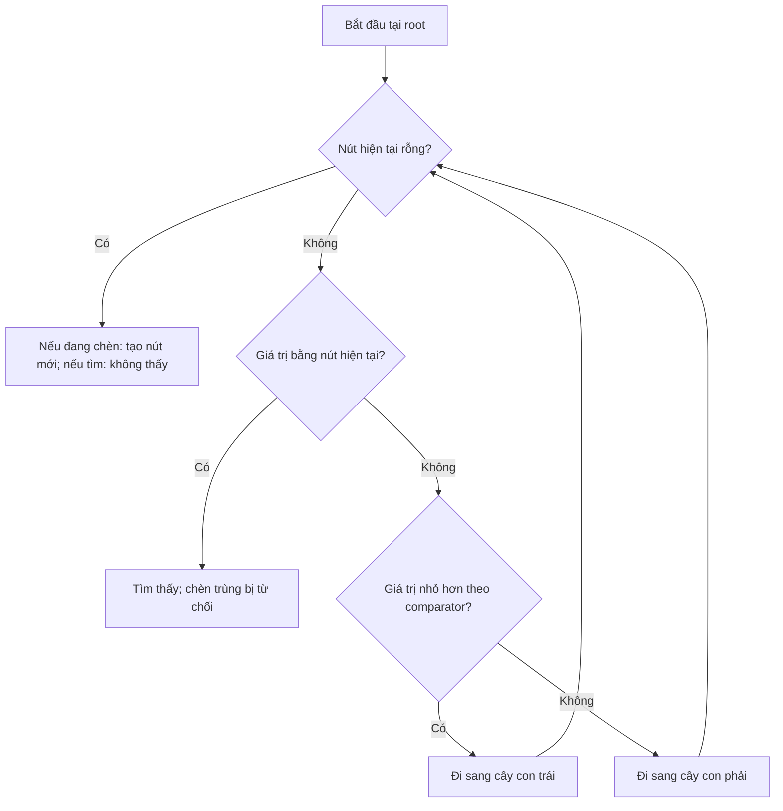
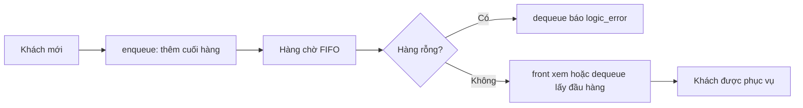
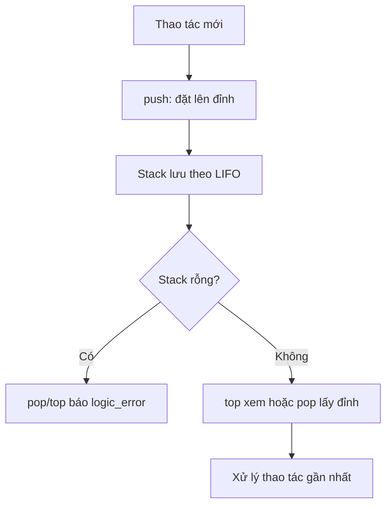
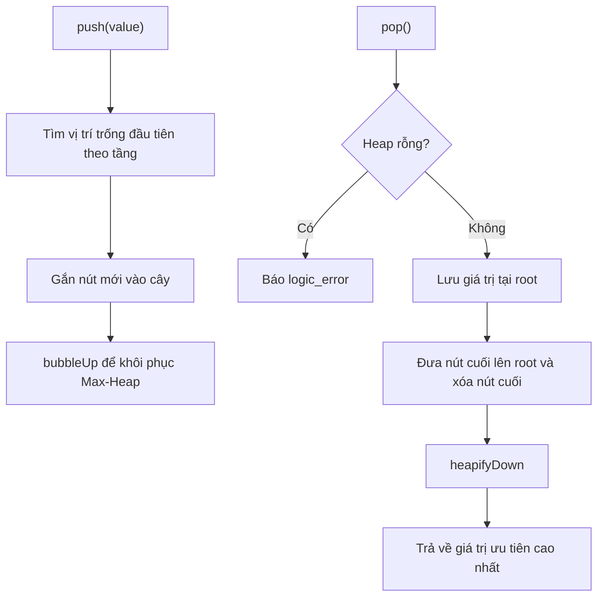
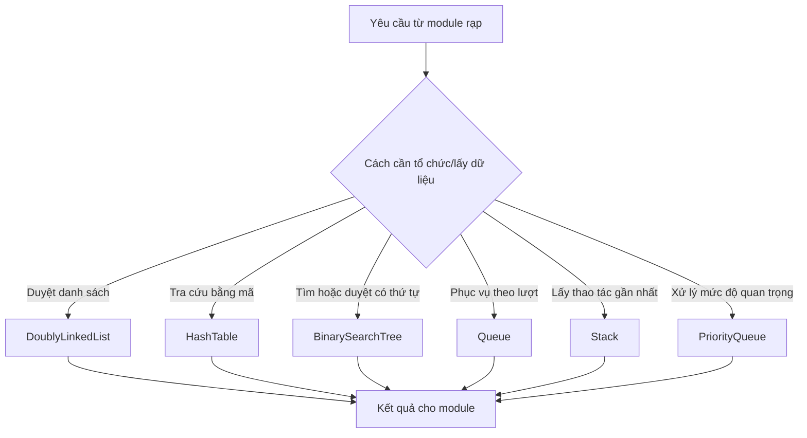

# Cẩm nang cấu trúc dữ liệu

Tài liệu này giải thích sáu cấu trúc dữ liệu được cài đặt trong `DataStructures/`, cách chúng hoạt động và ví dụ áp dụng vào bài toán quản lý rạp chiếu phim. Các sơ đồ được viết bằng Mermaid; GitHub và nhiều tiện ích Markdown trong VS Code có thể hiển thị trực tiếp.

> **Lưu ý:** ERD bên dưới là mô hình nghiệp vụ rạp chiếu phim để minh họa cách tổ chức dữ liệu. Dự án hiện chưa có lớp Model, cơ sở dữ liệu hay nghiệp vụ đặt vé. Các cấu trúc dữ liệu trong mã nguồn là những công cụ tổng quát để quản lý dữ liệu trong bộ nhớ, không tự tạo ra quan hệ ERD.

## 1. Bản đồ lựa chọn cấu trúc

| Nhu cầu | Cấu trúc phù hợp | Ví dụ trong rạp |
|---|---|---|
| Duyệt danh sách theo thứ tự, thêm/xóa ở hai đầu | `DoublyLinkedList<T>` | Danh sách phim đang chiếu |
| Tra cứu nhanh bằng khóa | `HashTable<Key, Value>` | Tìm phim theo mã |
| Lưu dữ liệu có thứ tự và tìm theo thứ tự | `BinarySearchTree<T>` | Duyệt mã phim tăng dần |
| Xử lý lần lượt theo nguyên tắc vào trước, ra trước | `Queue<T>` | Khách chờ tại quầy |
| Lấy thao tác gần nhất trước | `Stack<T>` | Lịch sử thao tác chưa xác nhận |
| Luôn xử lý công việc có độ ưu tiên cao nhất trước | `PriorityQueue<T>` | Yêu cầu bảo trì khẩn cấp |

Các lớp là template, vì vậy có thể lưu kiểu cơ bản hoặc kiểu do ứng dụng tự định nghĩa. Những kiểu tự định nghĩa cần cung cấp phép so sánh/so sánh bằng phù hợp với cấu trúc được sử dụng.

## 2. Sơ đồ ERD nghiệp vụ minh họa

Sơ đồ sau cho thấy các thực thể thường gặp và quan hệ giữa chúng. ERD chỉ mô tả dữ liệu nghiệp vụ, không phải sơ đồ cấu tạo nội bộ của các cấu trúc dữ liệu.



**Đọc sơ đồ:** một phim có thể có nhiều suất chiếu; một phòng có thể tổ chức nhiều suất chiếu; một suất chiếu có thể có nhiều vé; một khách hàng có thể mua nhiều vé. Mỗi vé trong ví dụ liên quan đến một suất chiếu và một khách hàng.

## 3. Danh sách liên kết kép — `DoublyLinkedList<T>`

Tệp: [`DataStructures/DoublyLinkedList.h`](../DataStructures/DoublyLinkedList.h)

### Nguyên lý và thành phần

Mỗi nút chứa dữ liệu `value`, con trỏ `prev` tới nút trước và `next` tới nút sau. `head` và `tail` lần lượt trỏ tới đầu và cuối danh sách; `count` lưu số phần tử.

```text
head                                              tail
  |                                                 |
  v                                                 v
NULL <- [prev | A | next] <-> [prev | B | next] -> NULL
```

Hai chiều liên kết cho phép đi xuôi và ngược. Danh sách rỗng có `head == NULL`, `tail == NULL`; khi chỉ có một nút, `head == tail`.

### Chức năng và độ phức tạp

| Hàm | Tác dụng | Độ phức tạp |
|---|---|---:|
| `pushFront(value)` / `pushBack(value)` | Thêm ở đầu/cuối | O(1) |
| `insertAt(index, value)` | Chèn tại vị trí; `index` được phép bằng `size()` để chèn cuối | O(n) |
| `removeFront()` / `removeBack()` | Xóa ở đầu/cuối | O(1) |
| `removeAt(index)` | Xóa theo vị trí | O(n) |
| `findIndex(value)` / `findIf(predicate)` | Tìm tuyến tính | O(n) |
| `at(index)` | Trả về phần tử theo vị trí | O(n) |
| `traverseForward(callback)` / `traverseBackward(callback)` | Duyệt xuôi/ngược | O(n) |
| `size()` / `isEmpty()` | Lấy số lượng/kiểm tra rỗng | O(1) |
| `clear()` | Giải phóng toàn bộ nút | O(n) |

Copy constructor tạo danh sách độc lập; copy assignment dùng bản sao tạm để không làm mất dữ liệu cũ nếu thao tác sao chép gặp lỗi.

### Sơ đồ thao tác thêm/xóa



### Ví dụ

```cpp
DoublyLinkedList<int> movieIds;
movieIds.pushBack(101);
movieIds.pushBack(102);
movieIds.insertAt(1, 99);
int firstId = movieIds.at(0);
movieIds.removeAt(1);
```

Vị trí không hợp lệ gây `std::out_of_range`; xóa đầu/cuối khi rỗng gây `std::logic_error`. Tìm không thấy trả về `-1`.

**Lưu ý:** truy cập vị trí và tìm kiếm không phải O(1); danh sách phải đi qua các nút. Luôn kiểm tra cả trường hợp rỗng và một phần tử vì chúng ảnh hưởng đến `head`/`tail`.

## 4. Bảng băm — `HashTable<Key, Value, Hash>`

Tệp: [`DataStructures/HashTable.h`](../DataStructures/HashTable.h)

### Nguyên lý và thành phần

Bảng băm dùng hàm băm biến khóa thành chỉ số bucket. Mỗi bucket là một `DoublyLinkedList<Entry>`, nhờ đó các khóa có cùng chỉ số vẫn được lưu độc lập (xử lý va chạm bằng chaining). Mặc định `Hash` là `std::hash<Key>`; có thể truyền kiểu hàm băm khác vào template.

```text
hash(key) % bucketCount
       |
       v
    bucket[i] -> [key A, value] <-> [key B, value]
```

`insert` cập nhật giá trị nếu khóa đã có, không tăng `size()`. `find` trả con trỏ tới giá trị hoặc `NULL` nếu không tìm thấy. Khóa cần hỗ trợ `==`; kiểu khóa cũng cần có hàm băm phù hợp.

### Chức năng và độ phức tạp

| Hàm | Tác dụng | Độ phức tạp |
|---|---|---:|
| `insert(key, value)` | Thêm mới hoặc cập nhật khóa | Trung bình O(1), xấu nhất O(n) |
| `find(key)` / `contains(key)` | Tra cứu khóa | Trung bình O(1), xấu nhất O(n) |
| `remove(key)` | Xóa khóa nếu tồn tại | Trung bình O(1), xấu nhất O(n) |
| `size()` / `empty()` | Lấy số phần tử/kiểm tra rỗng | O(1) |
| `clear()` | Xóa dữ liệu trong mọi bucket | O(n + bucketCount) |

Bảng hiện không tự tăng kích thước (rehash). Thời gian trung bình phụ thuộc vào phân bố của hàm băm; nếu nhiều khóa va chạm, thao tác trong bucket dài sẽ chậm hơn.

### Sơ đồ tra cứu và thêm



### Ví dụ

```cpp
HashTable<int, string> movies;
movies.insert(101, "Phim minh hoa");

string* title = movies.find(101);
if (title != NULL) {
    cout << *title << endl;
}
```

Với khóa tự định nghĩa, truyền một kiểu `Hash` có toán tử `operator()(const Key&)`; mọi khóa bằng nhau phải cho cùng kết quả băm.

## 5. Cây tìm kiếm nhị phân — `BinarySearchTree<T>`

Tệp: [`DataStructures/BinarySearchTree.h`](../DataStructures/BinarySearchTree.h)

### Nguyên lý và thành phần

Mỗi nút có giá trị, con trái và con phải. Theo quy tắc so sánh, giá trị nhỏ hơn nằm bên trái và lớn hơn nằm bên phải. Cây dùng `root` làm nút gốc. Mặc định so sánh bằng `operator<`; có thể truyền hàm so sánh riêng vào constructor.

```text
             20
            /  \
          10    30
```

Phần tử trùng bị từ chối (`insert` trả `false`). Khi dùng kiểu tự định nghĩa, kiểu cần `==` và phép so sánh đã chọn phải nhất quán với nhau.

### Chức năng và độ phức tạp

| Hàm | Tác dụng | Trung bình | Xấu nhất |
|---|---|---:|---:|
| `insert(value)` | Chèn nếu chưa tồn tại | O(log n) | O(n) |
| `contains(value)` | Kiểm tra tồn tại | O(log n) | O(n) |
| `remove(value)` | Xóa nút lá, một con hoặc hai con | O(log n) | O(n) |
| `traversePreOrder(callback)` | Duyệt nút-trái-phải | O(n) | O(n) |
| `traverseInOrder(callback)` | Duyệt trái-nút-phải (theo thứ tự tăng dần) | O(n) | O(n) |
| `traversePostOrder(callback)` | Duyệt trái-phải-nút | O(n) | O(n) |
| `size()` / `height()` / `clear()` | Đếm nút / chiều cao / xóa cây | O(n) | O(n) |

Xóa nút có hai con: thay giá trị bằng nút nhỏ nhất của cây con phải, sau đó xóa nút thay thế. Cây không tự cân bằng; nếu chèn dữ liệu đã sắp xếp, cây có thể thành dạng dây và thao tác tìm kiếm/chèn/xóa tăng lên O(n). Cây không hỗ trợ copy để tránh sao chép nông con trỏ sở hữu bộ nhớ.

### Sơ đồ tìm kiếm/chèn



### Ví dụ

```cpp
BinarySearchTree<int> roomIds;
roomIds.insert(20);
roomIds.insert(10);
roomIds.insert(30);
bool hasRoom = roomIds.contains(10);
bool removed = roomIds.remove(20);
```

## 6. Hàng đợi — `Queue<T>`

Tệp: [`DataStructures/Queue.h`](../DataStructures/Queue.h)

### Nguyên lý và thành phần

Hàng đợi tuân theo **FIFO** (vào trước, ra trước). Lớp dùng `DoublyLinkedList<T>` ở bên trong: thêm vào cuối bằng `enqueue`, lấy ở đầu bằng `dequeue`.

```text
dequeue/front                         enqueue
     |                                   |
     v                                   v
   [A] <-> [B] <-> [C]
```

| Hàm | Tác dụng | Độ phức tạp |
|---|---|---:|
| `enqueue(value)` | Thêm cuối hàng | O(1) |
| `front()` | Xem đầu hàng, không xóa | O(1) |
| `dequeue()` | Lấy và xóa đầu hàng | O(1) |
| `size()` / `empty()` | Lấy số lượng/kiểm tra rỗng | O(1) |
| `clear()` | Xóa toàn bộ phần tử | O(n) |

### Sơ đồ chức năng



### Ví dụ

```cpp
Queue<int> customers;
customers.enqueue(1);
int nextCustomer = customers.front();
int servedCustomer = customers.dequeue();
```

`front()` và `dequeue()` ném `std::logic_error` khi hàng đợi rỗng.

## 7. Ngăn xếp — `Stack<T>`

Tệp: [`DataStructures/Stack.h`](../DataStructures/Stack.h)

### Nguyên lý và thành phần

Ngăn xếp tuân theo **LIFO** (vào sau, ra trước). Đỉnh ngăn xếp ở đầu danh sách liên kết kép; `push` thêm đầu, `pop` lấy đầu.

```text
top
 |
 v
[C]  <- push/pop
 |
[B]
 |
[A]
```

| Hàm | Tác dụng | Độ phức tạp |
|---|---|---:|
| `push(value)` | Thêm lên đỉnh | O(1) |
| `top()` | Xem đỉnh, không xóa | O(1) |
| `pop()` | Lấy và xóa đỉnh | O(1) |
| `size()` / `empty()` | Lấy số lượng/kiểm tra rỗng | O(1) |
| `clear()` | Xóa toàn bộ phần tử | O(n) |

### Sơ đồ chức năng



### Ví dụ

```cpp
Stack<string> history;
history.push("Them phim");
string lastAction = history.top();
history.pop();
```

Stack chỉ là cấu trúc lưu trữ; ví dụ này không triển khai hoàn tác giao dịch bán vé.

## 8. Hàng đợi ưu tiên — `PriorityQueue<T>`

Tệp: [`DataStructures/PriorityQueue.h`](../DataStructures/PriorityQueue.h)

### Nguyên lý và thành phần

Lớp dùng **Max-Heap** dạng cây liên kết, không dùng mảng: theo mặc định, giá trị lớn hơn có độ ưu tiên cao hơn. Mỗi nút lưu `value` và các con trỏ `left`, `right`, `parent`; `root` giữ phần tử ưu tiên nhất. Có thể truyền comparator để định nghĩa thứ tự cho kiểu khác.

```text
             9  <- top/pop
            / \
           6   7
          /
         2
```

Heap luôn là cây gần hoàn chỉnh và thỏa mãn nút cha có độ ưu tiên không thấp hơn con. Khi thêm, nút mới được đặt tại vị trí trống đầu tiên theo từng tầng rồi đẩy lên (`bubbleUp`). Khi lấy phần tử đầu, giá trị nút cuối thay gốc; nút cuối bị bỏ đi và giá trị gốc được đẩy xuống (`heapifyDown`).

| Hàm | Tác dụng | Độ phức tạp theo cách cài đặt hiện tại |
|---|---|---:|
| `push(value)` | Thêm và điều chỉnh heap | O(n) tìm vị trí trống + O(log n) điều chỉnh |
| `top()` | Xem phần tử ưu tiên nhất | O(1) |
| `pop()` | Lấy phần tử ưu tiên nhất | O(n) tìm nút cuối/cha + O(log n) điều chỉnh |
| `size()` / `empty()` | Lấy số lượng/kiểm tra rỗng | O(1) |
| `clear()` | Giải phóng cây | O(n) |

Khác với heap lưu bằng mảng, phiên bản cây liên kết này phải duyệt theo tầng để tìm vị trí thêm và nút cuối khi xóa; vì vậy các thao tác thêm/xóa là O(n) trong cài đặt hiện tại. `T` cần hỗ trợ sao chép và gán; mặc định còn cần `>` để so sánh. Copy bị vô hiệu hóa vì lớp trực tiếp sở hữu các nút.

### Sơ đồ chức năng



### Ví dụ

```cpp
PriorityQueue<int> maintenanceTasks;
maintenanceTasks.push(2);
maintenanceTasks.push(5);
int urgentTask = maintenanceTasks.top();  // 5
int processedTask = maintenanceTasks.pop();
```

`top()` và `pop()` ném `std::logic_error` khi hàng đợi ưu tiên rỗng. Với kiểu đối tượng, truyền hàm comparator vào constructor để xác định phần tử nào được ưu tiên hơn.

## 9. Cách đọc sơ đồ chức năng tổng hợp

Sơ đồ tổng hợp dưới đây nối các nhu cầu nghiệp vụ với cấu trúc thích hợp. Đây là gợi ý thiết kế, không phải luồng nghiệp vụ đã được triển khai trong dự án.



## 10. Ví dụ kết hợp các cấu trúc trong hệ thống

- Danh sách phim trong một màn hình có thể lưu bằng `DoublyLinkedList<Movie>`.
- Tra cứu `Movie` theo `movieId` có thể dùng `HashTable<string, Movie>`.
- Nếu cần duyệt mã phim theo thứ tự, lưu khóa hoặc đối tượng có comparator trong `BinarySearchTree<T>`.
- Khách tới quầy có thể được thêm vào `Queue<Customer>`.
- Các thay đổi tạm thời có thể được ghi vào `Stack<Operation>` nếu ứng dụng cần lịch sử LIFO.
- Yêu cầu bảo trì có thể được đưa vào `PriorityQueue<Task>` với comparator theo mức ưu tiên.

Nên chọn cấu trúc theo thao tác cần thực hiện thường xuyên. Không cần lưu cùng một dữ liệu trong tất cả cấu trúc nếu nghiệp vụ không cần.

## 11. Lỗi thường gặp và cách tránh

1. **Dùng sai quy tắc thứ tự:** xác định rõ `==`, comparator và hàm băm phải nhất quán với khóa/đối tượng.
2. **Bỏ qua cấu trúc rỗng:** `removeFront`, `removeBack`, `Queue::front/dequeue`, `Stack::top/pop` và `PriorityQueue::top/pop` có thể báo lỗi khi rỗng.
3. **Quên cập nhật liên kết:** khi sửa danh sách kép, cập nhật cả `prev`, `next`, `head`, `tail` và `count`.
4. **Cho rằng BST luôn cân bằng:** cây thường có thể suy biến nếu chèn dữ liệu theo thứ tự; bản cài đặt hiện tại không tự cân bằng.
5. **Cho rằng PriorityQueue này có push/pop O(log n):** heap được lưu dạng cây liên kết và tìm nút bằng duyệt theo tầng, nên chi phí thêm/xóa tổng thể là O(n).
6. **Sao chép nông con trỏ:** `BinarySearchTree` và `PriorityQueue` chủ động cấm sao chép; không tự sao chép các con trỏ sở hữu nút.
7. **Dùng con trỏ từ `HashTable::find` sau khi phần tử bị xóa:** con trỏ kết quả chỉ nên dùng khi phần tử còn tồn tại và không bị xóa.

## 12. Biên dịch ví dụ dự án

Từ thư mục gốc, có thể biên dịch chương trình minh họa:

```bash
g++ -std=c++11 -Wall -Wextra -pedantic main.cpp -o CinemaDataStructures
```

Trong PowerShell trên Windows, chạy:

```powershell
.\CinemaDataStructures.exe
```
