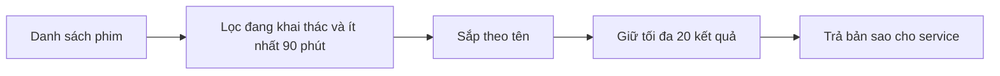
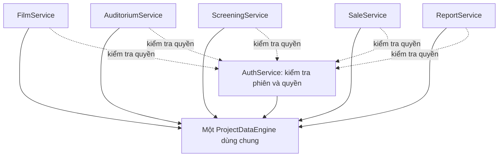

# KIẾN TRÚC PROJECT

## Cinema Management System - C++ / Qt Widgets

Mã nguồn chia theo trách nhiệm cho dự án môn học C++/Qt offline, không giữ
cây package Java hoặc các layer chưa dùng. Qt chỉ là lớp giao diện; nghiệp
vụ và dữ liệu không được đặt trong widget.

## 1. Cây thư mục

```text
.
├── README.md
├── CMakeLists.txt
├── docs/
│   ├── requirements/           # BRD, SRS, use case
│   ├── design/                 # Kiến trúc, dữ liệu, ERD
│   │   └── wireframes/         # HTML, ảnh, kiểm tra wireframe
│   ├── reviews/                # Rà soát yêu cầu
│   └── product/                # Giải thích sản phẩm và Mermaid
├── data/
│   ├── demo/                   # Seed TXT, không phải dữ liệu vận hành
│   └── backup/
├── resources/                  # Vị trí dành cho tài nguyên
├── src/
│   ├── CinemaApplication.cpp   # Điểm khởi động, nối các thành phần
│   ├── DataStructures/         # Cấu trúc dữ liệu tự xây dựng
│   ├── controller/             # Nhận yêu cầu UI, chuyển kết quả/lỗi
│   ├── entity/                 # Đối tượng nghiệp vụ
│   ├── enums/                  # Vai trò và trạng thái
│   ├── repository/             # Cổng truy cập dữ liệu chung
│   │   ├── ProjectDataEngine.h/.cpp
│   │   └── txt/                # Đọc, lưu và phục hồi TXT
│   ├── service/                # Quy tắc nghiệp vụ và phân quyền
│   ├── util/                   # Xử lý ngày giờ dùng chung
│   └── ui/                     # Giao diện Qt
│       ├── mainwindow/
│       ├── dialog/
│       └── widget/
├── tests/                      # Kiểm thử core và Qt
└── build/                      # Kết quả build cục bộ
```

Cây chỉ giữ thư mục đang có mã. Không cần `config`, `dto`, `exception`,
`shared`, repository interface hay Qt model riêng khi chưa có nhu cầu.
Dữ liệu vận hành nằm tại thư mục Qt chọn hoặc đường dẫn `--data-dir`,
tách khỏi seed.

## 2. Trách nhiệm từng layer

### `entity/`

Các đối tượng nghiệp vụ thuần C++:

```text
Film
Auditorium
Seat
Screening
SaleTransaction
Ticket
User
```

Entity không biết Qt Widget, không đọc file và không tự mở dialog.

### `enums/`

Các trạng thái dùng chung:

```text
UserRole
RecordStatus
ScreeningStatus
PaymentStatus
TransactionStatus
TicketStatus
```

### `repository/ProjectDataEngine`

Đây là cổng truy cập dữ liệu duy nhất mà service được phép sử dụng.

```text
ProjectDataEngine
├── search/query chung
├── lookup theo ID trả về bản sao model
├── command thêm/sửa và commit bán vé
└── điều phối TxtDatabase hoặc storage adapter
```

Service không đọc TXT, không duyệt `DoublyLinkedList`, không gọi `HashTable` và
không giữ con trỏ tới entity bên trong database. Các cấu trúc dữ liệu và index
chỉ là chi tiết nội bộ của data engine.

`query<T>(QuerySpec<T>)` dùng cùng một thuật toán cho cả 7 loại entity. `where`
là điều kiện lọc (có thể kết hợp nhiều trường), `orderBy` là comparator thứ tự
nghiêm ngặt, và `limit = 0` nghĩa là không giới hạn. Thiếu `where` nghĩa là lấy
tất cả; thiếu `orderBy` giữ thứ tự lưu. Giới hạn được áp dụng sau lọc/sắp xếp;
giới hạn âm bị từ chối bằng `std::invalid_argument`.

Kết quả là `DoublyLinkedList<T>` chứa các bản sao độc lập. Service được duyệt
kết quả này, không được duyệt danh sách nguồn của database. Callback nhận
`const T&` và không được giữ địa chỉ bản ghi sau khi query kết thúc.
V1 sắp xếp ổn định bằng insertion sort O(m²). `aggregate<T>(AggregateSpec<T>)`
gom nhóm bằng `HashTable` nội bộ, trả bản sao `AggregateRow` gồm `key`, `count`,
`total`, và kiểm tra tràn số nguyên.

Ví dụ một nhu cầu tra cứu: lấy tối đa 20 phim đang khai thác, thời lượng từ
90 phút, sắp theo tên. Service xác định điều kiện, engine thực hiện chung:



### `repository/txt/`

Triển khai repository bằng file TXT. Đây là nơi được phép sử dụng:

- `DoublyLinkedList<T>` làm danh sách dữ liệu chính.
- `HashTable<int>` làm chỉ mục mã định danh.
- `BST<T>` làm chỉ mục suất chiếu theo thời gian.
- `Matrix2D` để đọc/tạo sơ đồ ghế.
- Core dùng adapter I/O tách biệt; có thể dùng `QFile`/`QSaveFile` khi gắn Qt, hoặc stream chuẩn trong bước kiểm thử Qt-free.

Repository không được quyết định người dùng có được bán vé hay không.

### `service/`

Chứa nghiệp vụ tương ứng Use Case:

```text
AuthService
FilmService
AuditoriumService
ScreeningService
SaleService
ReportService
```

Service gọi `ProjectDataEngine`, kiểm tra quyền và áp dụng Business Rules.
`SaleService` là nơi duy nhất được phép hoàn tất giao dịch bán vé.
Các tra cứu nghiệp vụ đang nằm trong `FilmService` và `ScreeningService`; chỉ
tách `QueryService` riêng khi các truy vấn liên-aggregate tăng đủ lớn.

Bộ sáu service MVP có cặp header/implementation riêng trong `src/service/`:
`AuthService`, `FilmService`, `AuditoriumService`, `ScreeningService`,
`SaleService`, `ReportService`. Kiểu request/result nằm cạnh service dùng
chúng. `ServiceSupport.h/.cpp` chỉ chứa tiện ích chung về thời gian, mã định
danh, kiểm tra đăng nhập và tra lịch; không chứa các lớp service.

| Service | API và trách nhiệm hiện có |
|---|---|
| `AuthService` | Login/logout, session không chứa mật khẩu, kiểm tra quyền bằng dữ liệu tài khoản hiện tại, tạo/cập nhật/list tài khoản; không cho vô hiệu hóa quản lý cuối cùng |
| `FilmService` | Tạo mới/cập nhật riêng, xem chi tiết, danh sách theo tên/mã và trạng thái, search chung; chặn sửa thời lượng phim đã có lịch và ngừng phim còn lịch tương lai |
| `AuditoriumService` | Lưu phòng cùng toàn bộ ghế, xem phòng/ghế; chặn đổi sơ đồ đã có lịch và ngừng phòng còn lịch tương lai |
| `ScreeningService` | Tạo nháp/mở bán, tự tính thời lượng + 15 phút, từ chối xung đột, đổi trạng thái, lọc suất mở bán chưa bắt đầu theo ngày/phim/phòng |
| `SaleService` | Preview không ghi dữ liệu, xác nhận thanh toán, lấy người bán từ session và thời gian từ đồng hồ nội bộ, phát hành ID/vé, tra cứu giao dịch/vé và sơ đồ ghế |
| `ReportService` | Chỉ quản lý được xem doanh thu theo phim, lọc thời điểm giao dịch/phim/suất, COUNT/SUM qua engine, tỷ lệ lấp đầy theo sức chứa vật lý của phòng |

Mọi service dùng cùng một `ProjectDataEngine` và cùng một `AuthService`:



Gọi `dataEngine.open(error)` thành công trước khi tạo và sử dụng service.
Các lệnh trả `bool` và thông báo lỗi; phương thức đọc trả danh sách/seat map
ném `std::runtime_error` khi chưa đăng nhập, không giả vờ trả kết quả rỗng.
Controller phải bắt lỗi này. Kết quả đọc là bản sao, không cho UI sửa nguồn.

Mật khẩu mới dùng yescrypt qua `libcrypt` có sẵn trên Linux. Dữ liệu seed cũ
lưu mật khẩu rõ được đổi sang hash ngay khi đăng nhập thành công; nếu lưu hash
thất bại thì không tạo session. `initializeManager()` chỉ cho phép tạo quản lý
đầu tiên khi bảng User hoàn toàn rỗng; chế độ triển khai `--setup-admin`
tách khỏi đăng nhập và cho phép cấp riêng quyền bán vé (mặc định không cấp).
Không có mật khẩu mặc định; chưa có
backend crypto Windows.

`SaleRequest.paymentConfirmed` mặc định `false`. Request không nhận `sellerId`
hoặc thời điểm bán từ UI. Bỏ trống mã suất/giao dịch để service tự sinh và kiểm
tra trùng; mã vé sinh từ mã giao dịch. Preview không tạo vé, giữ ghế hay doanh
thu. `ServiceClock` chỉ được inject tại composition root/test cho hai service
suất chiếu và bán vé; mặc định dùng đồng hồ hệ thống, giờ địa phương.

Lệnh `saveUser/saveFilm/saveAuditorium/saveScreening` và commit bán vé tự lưu.
Các API `add*` cũ của engine chỉ thêm vào RAM và còn được giữ để tương thích;
service không sử dụng chúng. Không thay đổi hoặc xóa giao dịch/vé đã phát hành.
MVP dùng sơ đồ chữ nhật với nhãn hàng A-Z; chưa có sửa lịch chéo bảng tự động
hoặc tạo sơ đồ ghế bất quy tắc. Đã nối các controller/Qt cho xác thực, phim,
tài khoản, phòng/ghế, suất/giá, bán vé, tra cứu và báo cáo; manager vào tổng
quan, staff vào quầy vé. `OperationsController` nối Screening/Sale/Report.
Ứng dụng giữ `QLockFile` trên thư mục dữ liệu để chặn hai phiên cùng ghi.
`--prepare-demo --data-dir <thư-mục-trống>` tạo sáu suất ngày mai/ngày kia,
ba giao dịch và sáu vé mẫu; không ghi đè dữ liệu đã có.

Tài liệu sản phẩm và hướng dẫn vấn đáp theo mã: `docs/product/README.md`.

`MinimumServicesTest.cpp` kiểm thử luồng nghiệp vụ, phân quyền, mật khẩu,
ranh giới lịch, thanh toán, duplicate sale, báo cáo, lỗi ghi và startup recovery.

### `controller/`

Lớp điều phối giữa Qt và service. Controller nhận input từ giao diện, gọi service và trả về DTO/kết quả lỗi dễ hiển thị.

Ví dụ:

```text
AuthController
FilmController
ScreeningController
SaleController
ReportController
```

Controller không được tự tính doanh thu hoặc tự ghi TXT.

`AuthController.h/.cpp` là adapter C++ không phụ thuộc Qt cho khởi tạo quản lý,
login/logout và đọc session. Controller bắt `std::exception` và trả lỗi cho UI;
không duy trì một bản session riêng, không đọc TXT trực tiếp.

`FilmController.h/.cpp` gọi `FilmService`, chuyển exception thành lỗi cho UI.
`create()` từ chối mã đã tồn tại; `update()` từ chối mã không tồn tại, không
âm thầm upsert. `save()` cũ vẫn giữ để tương thích. `list()` lấy ID khớp qua
search chung của engine, dùng HashTable tự xây để lọc, rồi gọi `query<Film>()`
theo trạng thái và sắp xếp mã phim. Không thêm thuật toán search riêng.

`FilmPage` trong `ui/widget/` có danh sách, tìm kiếm mã/tên bằng
Enter hoặc nút Tải lại/Tìm, lọc tất cả/đang/ngừng khai thác, xem chi tiết,
thêm/sửa và xác nhận ngừng khai thác. Form sửa khóa mã phim. Kết quả nghiệp vụ
dùng `DoublyLinkedList<Film>`; QTableWidget chỉ giữ các giá trị hiển thị.
Nhân viên chỉ đọc; quyền ghi được kiểm tra ở service kể cả khi form đang mở
và quyền bị thu hồi. Validation/lỗi lưu giữ form mở, không báo lưu thành công.
Search hiện là Contains, không phân biệt hoa thường ASCII, chưa có fuzzy/Unicode.

`AccountPage` có đúng hai vai trò nghiệp vụ: `Admin (Quản lý)` tương ứng
`UserRole::Manager` và `Nhân viên` tương ứng `UserRole::Seller`. Màn hình đăng
nhập không cho người dùng tự chọn vai trò. Admin có thể tạo/cập nhật tài khoản,
đổi vai trò, đặt lại mật khẩu tùy chọn, khóa/mở khóa và cấp/thu hồi quyền bán
vé; service vẫn bảo vệ admin đang đăng nhập cuối cùng. Không hiển thị mật khẩu
hoặc hash. Quyền bán vé là cờ riêng, có thể cấp cho cả admin và nhân viên.

`MainWindow` dùng shell sidebar/topbar, vùng nội dung cuộn và navigation theo
quyền; nhân viên không nhìn thấy mục Tài khoản & quyền. `Theme.h` tập trung style
Qt, dùng `Noto Sans`/`Noto Serif` nếu có và fallback của Qt, tránh style rải rác
trong từng widget. Các form dùng `QFormLayout`/`QGridLayout`, minimum size và
scroll area thay vì vị trí cố định để không chồng lấn khi cửa sổ nhỏ/HiDPI.

### Luồng khởi động Qt hiện có

`CinemaApplication.cpp` là composition root: mở một `ProjectDataEngine`, tạo
một `AuthService`/`AuthController` và `FilmService`/`FilmController` dùng chung
engine/auth, rồi hiển thị `LoginDialog`. Service khác sẽ được tạo khi cần; không có
`ApplicationContext` hay `LoginController` trùng trách nhiệm.

- Màn hình đăng nhập chỉ có tên đăng nhập và mật khẩu theo FR-AUTH-01,
  SRS mục 7 và UC-AUTH-01; không yêu cầu tên hiển thị, xác nhận mật khẩu
  hoặc tự cấp quyền. Tài khoản phải tồn tại và đang hoạt động.
- Chưa có tài khoản: báo chưa có tài khoản được cấp, không tự chuyển sang
  đăng ký hay tự tạo Admin. Tạo/sửa tài khoản thuộc Tài khoản & quyền của Admin.
- Đăng nhập thành công: mở `MainWindow`, hiển thị danh tính và quyền hiện tại.
  Phim, Tài khoản & quyền và Phòng & ghế đã hoạt động theo vai trò. Phòng & ghế
  hiện chỉ xem sơ đồ và lọc trạng thái; chưa có form tạo/sửa phòng trên Qt.
  Các màn hình lịch chiếu/bán vé/báo cáo chưa có.
- Đăng xuất: đóng workspace, quay lại đăng nhập. Đóng workspace bằng nút X
  hoặc hủy dialog đăng nhập: thoát. Các ô mật khẩu được xóa sau submit/hủy.
- Workspace đọc lại session mỗi 5 giây; quyền hiển thị theo dữ liệu trong engine,
  tài khoản bị khóa thì đóng workspace và quay lại đăng nhập. Đây không phải
  cơ chế tự tải lại TXT khi file được sửa ngoài ứng dụng. Service vẫn kiểm tra
  quyền cho mỗi thao tác, không tin quyền hiển thị trên widget.
- Không mở được dữ liệu: hiển thị lỗi và dừng, không khởi tạo lại dữ liệu hỏng.

Dữ liệu mặc định dùng thư mục dữ liệu người dùng do Qt cung cấp, không phụ
thuộc thư mục chạy. `--data-dir <path>` chọn bộ TXT khác; đường dẫn rỗng bị từ chối.
Giao diện giữ bảng màu paper/green và typography theo `docs/design/wireframes/wireframe.html`.
Workspace hiển thị đường dẫn TXT đang mở. `AuditoriumPage` đọc danh sách và
ghế qua `AuditoriumController -> AuditoriumService -> ProjectDataEngine`,
không tự mở file hay tạo ghế giả khi hiển thị. Sơ đồ phòng không phải sơ đồ
trống/đã bán của một suất chiếu.

`data/demo/` chứa 3 phim, 3 phòng, 136 ghế và hai tài khoản mẫu theo wireframe:
`manager` và `seller01`, mật khẩu demo công khai `demo123` (TXT lưu hash).
Không có suất chiếu. Xem `data/demo/README.md` để chạy với thư mục
mẫu riêng. Không tự seed vào dữ liệu thật và không ghi đè tài khoản hiện có.

Build với Qt development đã cài trong user-local trên máy hiện tại:

```bash
cmake -S . -B /tmp/cinema-qt-build -DCMAKE_BUILD_TYPE=Debug \
  -DCMAKE_PREFIX_PATH="$HOME/.local/opt/qt5-dev/usr"
cmake --build /tmp/cinema-qt-build -j2
ctest --test-dir /tmp/cinema-qt-build --output-on-failure
/tmp/cinema-qt-build/cinema_app
```

Qt user-local dùng headers/tools Qt5 từ gói Ubuntu và runtime Qt5 đã có trên
máy; không phải bộ SDK portable độc lập. Nếu Qt được cài hệ thống, bỏ tham số
`CMAKE_PREFIX_PATH`. Target GUI vẫn có thể dùng Qt5 hoặc Qt6.
`AuthControllerTest.cpp` và `FilmControllerTest.cpp` chạy không cần Qt;
`QtLoginTest.cpp`, `QtFilmTest.cpp` và `QtAccountTest.cpp` chạy offscreen khi có Qt Widgets,
không cần framework test bổ sung. Test phim kiểm tra create/update, duplicate,
filter/search, rollback ghi lỗi, dữ liệu sau mở lại, bảo vệ lịch và phân quyền.
Test tài khoản kiểm tra hai vai trò, cấp/thu hồi bán vé, giữ hash khi đổi thông
tin, khóa tài khoản, bảo vệ admin cuối cùng và bố cục ở kích thước thường/HiDPI.
`QtAuditoriumTest.cpp` kiểm tra bộ TXT mẫu, sơ đồ 48/40 ghế, lọc phòng, ghế
ngừng dùng, quyền xem của nhân viên, session hết hiệu lực và dữ liệu sau mở lại.

### Dữ liệu trao đổi và lỗi

Kiểu yêu cầu/kết quả được khai báo cạnh service hoặc controller đang dùng
chúng; không cần một thư mục DTO riêng. Exception chuẩn được controller
chuyển thành lỗi hiển thị. Không tạo lớp exception hoặc cấu hình riêng chỉ
để giống backend. Tiện ích ngày giờ dùng chung nằm trong `util/`.

### `ui/`

Các lớp Qt Widgets:

```text
mainwindow/     MainWindow
dialog/         LoginDialog, AdminSetup
widget/         FilmPage, AccountPage, AuditoriumPage, OperationsPages
```

Widget chỉ thu thập input, gọi controller và render kết quả. Không đặt logic kiểm tra xung đột lịch hoặc ghế trùng trong widget.

### `tests/`

Test cho service và repository. Ưu tiên test không cần khởi động Qt UI:

```text
MinimumServicesTest
ProjectDataEngineTest
TxtDatabaseTest
IntegrityTest
```

## 3. Quy tắc phụ thuộc

```text
Qt Presentation
       ↓
Controller
       ↓
Service
       ↓
ProjectDataEngine
       ↓
TxtDatabase + DataStructures
```

- `entity` không phụ thuộc `presentation`.
- `service` không phụ thuộc Qt Widgets.
- `controller` không truy cập trực tiếp `DataStructures`.
- `ui` không truy cập trực tiếp file TXT.
- `repository/txt` không gọi ngược lên service hoặc UI.
- `src/DataStructures/` là dependency dùng bởi data engine, không bị sửa API tùy tiện khi viết nghiệp vụ.

## 4. Nguyên tắc triển khai

- Không dùng `std::vector`, `std::map`, `std::set`, `QVector`, `QList`, `QHash` để lưu entity nghiệp vụ.
- Dùng `std::string` và kiểu cơ bản trong entity nếu phù hợp với API cấu trúc dữ liệu hiện có.
- Chuyển `std::string` ↔ `QString` ở biên controller/presentation hoặc adapter repository.
- Chỉ một service được chịu trách nhiệm cho một nhóm quy tắc nghiệp vụ.
- Không tạo `interface/impl` cho mọi class nếu chưa có nhu cầu thay thế implementation.
- Dữ liệu TXT được nạp khi khởi động và dựng lại chỉ mục. Core hiện dùng stream chuẩn, file tạm và rename; chưa dùng `QSaveFile`.
- Lưu cả bảy bảng tạo `.bak` và marker `write_pending.txt`: `BACKUP_READY` khôi phục toàn bộ bản cũ khi lỗi/khởi động lại; `COMMITTED` giữ bản mới và dọn backup. Thiếu backup hoặc lỗi khôi phục thì báo lỗi và giữ bằng chứng, không tự xóa dữ liệu.
- `sale_journal.txt` giữ dấu vết bán vé. Điểm commit dữ liệu nằm ở marker chung; lỗi ghi journal sau điểm commit không được báo giao dịch thất bại rồi bán lại cùng ghế.
- MVP chạy đồng bộ với một engine, một tiến trình. Chưa hỗ trợ nhiều writer hoặc bảo đảm fsync khi mất điện; cần bổ sung khi triển khai thực tế.

## 5. Trình tự code

1. Tạo `CMakeLists.txt` và target Qt Widgets.
2. Tạo entity, enum và các kiểu kết quả lỗi.
3. Tạo repository TXT cho entity đơn giản: `User`, `Film`, `Auditorium`, `Seat`.
4. Tạo `ScreeningService`; kiểm tra xung đột hiện nằm trong data layer, BST vẫn là chỉ mục nội bộ.
5. Tạo `SaleService` và dùng `Matrix2D`/vé để kiểm tra ghế.
6. Tạo `ReportService` cho doanh thu và tỷ lệ lấp đầy.
7. Tạo controller và màn hình đăng nhập/bán vé.
8. Kết nối các màn hình quản lý và báo cáo.
9. Chạy test dữ liệu, test nghiệp vụ và kiểm tra lại tiêu chí nghiệm thu trong SRS.
