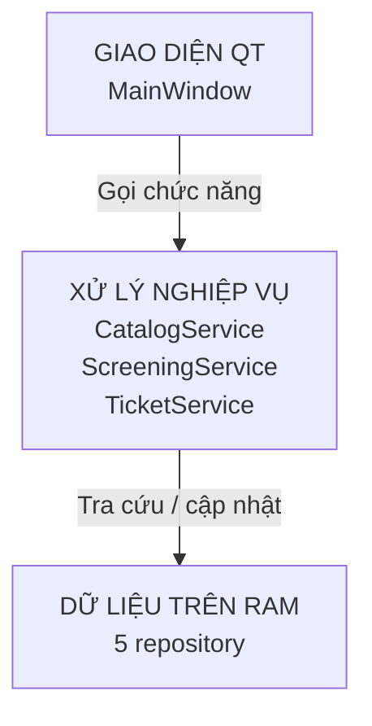
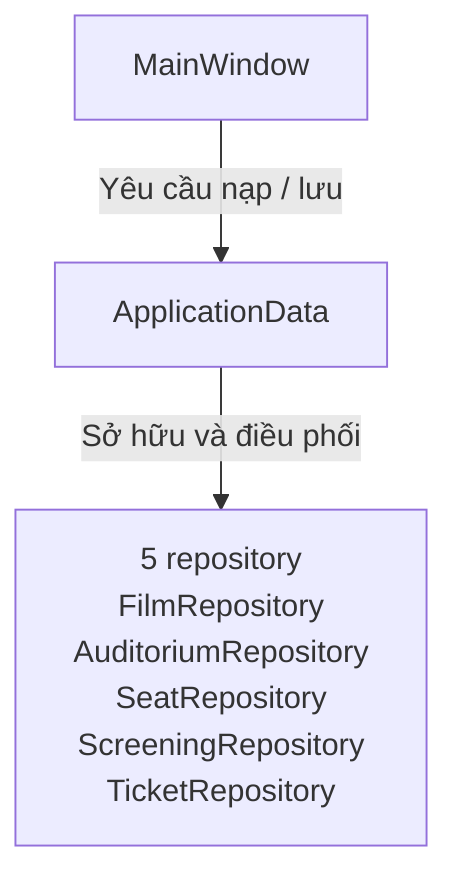

# THIẾT KẾ LỚP VÀ TỔ CHỨC DỮ LIỆU TRÊN RAM

**Phiên bản:** 1.0 - Hoàn thiện | **Ngày:** 19/10/2026 | **Căn cứ:** SRS 1.0 và `docs/design/data-design.md`.

Đã triển khai DSA, entity, repository, ba service C++, `ApplicationData` nạp/lưu TXT
và giao diện Qt Widgets cho toàn bộ nghiệp vụ trong SRS. Mục tiêu là phân trách nhiệm
rõ ràng, dùng DSA tự viết và không xây kiến trúc lớn hơn phạm vi đồ án.

## 1. Các nhóm lớp

| Nhóm/lớp | Trách nhiệm và lý do |
|---|---|
| `Film`, `Auditorium`, `Seat`, `Screening`, `Ticket` | Giữ thuộc tính theo ERD; mã và dữ liệu được đóng gói, không có setter tùy ý. Quan hệ giữa entity lưu bằng ID, không giữ con trỏ sang entity khác. |
| `FilmRepository`, `AuditoriumRepository`, `SeatRepository`, `ScreeningRepository`, `TicketRepository` | Mỗi lớp sở hữu một tập bản ghi và chỉ mục mã; cung cấp tìm, duyệt, thêm và cập nhật/xóa khi nghiệp vụ cho phép. Kiểm tra mã trùng và đồng bộ chỉ mục; không đọc/ghi TXT. |
| `CatalogService` | Thêm/sửa/xóa phim và phòng; tạo ghế theo kích thước; kiểm tra dữ liệu đang được suất tham chiếu trước khi thay đổi. Gom các thao tác danh mục nhỏ vào một service. |
| `ScreeningService` | Quản lý suất, tính giờ kết thúc, kiểm tra tham chiếu, lịch trùng và giới hạn sửa/xóa khi có vé. |
| `TicketService` | Lập sơ đồ ghế theo suất, bán, tra cứu và liệt kê vé, tính doanh thu theo ngày bán. Không tách thêm service báo cáo khi chỉ cần lọc, đếm và cộng giá vé. |
| `ApplicationData` | Sở hữu năm repository, điều phối nạp/kiểm tra toàn bộ dữ liệu và lưu khi thoát; không chứa nghiệp vụ bán vé. |
| `MainWindow` | Hiển thị các tab Qt, lấy dữ liệu nhập, gọi service và thông báo kết quả. Không truy cập trực tiếp repository hoặc TXT. |

Service nhận tham chiếu đến các repository cần dùng khi khởi tạo; không tự tạo bản sao dữ liệu. Kiểm tra giá trị đơn lẻ trước khi nhận vào entity; ràng buộc liên thực thể thuộc service. Sau khi nạp TXT, phải kiểm tra cả hai loại trước khi cho chỉnh sửa.

### 1.1. Ánh xạ lớp sang file

| Nhóm | File riêng |
|---|---|
| Entity | `entities/Film.h`, `entities/Auditorium.h`, `entities/Seat.h`, `entities/Screening.h`, `entities/Ticket.h` |
| Repository | `repositories/FilmRepository.h`, `repositories/AuditoriumRepository.h`, `repositories/SeatRepository.h`, `repositories/ScreeningRepository.h`, `repositories/TicketRepository.h` |
| Service nghiệp vụ | `services/CatalogService.{h,cpp}`, `services/ScreeningService.{h,cpp}`, `services/TicketService.{h,cpp}` |
| Hạ tầng dùng chung | `repositories/Repository.h`, `persistence/TxtPersistence.h`, `ApplicationData.{h,cpp}` |

Không có file `entities.h`, `repositories.h` hoặc `services.h` gom nhiều thực thể
nghiệp vụ. Các helper nhỏ như `SeatMap`, `ScreeningTime`, `ScreeningValidation` và
`ServiceClock` cũng nằm trong cặp file mang đúng tên trách nhiệm của chúng.

## 2. Quan hệ giữa các lớp

### 2.1. Khi người dùng thao tác

Đọc từ trên xuống. Mỗi khối gom các lớp cùng trách nhiệm để tránh đường nối giao nhau.

Phụ thuộc cụ thể nằm trong bảng thay vì vẽ chéo nhiều mũi tên. Tên ở cột phải được rút gọn, bỏ hậu tố `Repository`.

| Service | Repository sử dụng |
|---|---|
| `CatalogService` | `Film`, `Auditorium`, `Seat`, `Screening` |
| `ScreeningService` | `Film`, `Auditorium`, `Screening`, `Ticket` |
| `TicketService` | `Film`, `Auditorium`, `Seat`, `Screening`, `Ticket` |

### 2.2. Khi mở hoặc thoát chương trình

`ApplicationData` quản lý vòng đời của cả năm repository và điều phối nạp/lưu TXT; service chỉ mượn tham chiếu để làm việc trên RAM. UI không gọi repository trực tiếp.

Đây là quan hệ chứa/sở hữu, không kế thừa. `ApplicationData` có năm thành viên
`films`, `rooms`, `seats`, `screenings`, `tickets`. `load()` kiểm tra trên dữ liệu
tạm trước khi đưa vào các thành viên này; chỉ tạo service/UI khi `isReady()` là
true. Mỗi repository cụ thể và mỗi service có file riêng; template dùng chung nằm
trong `repositories/Repository.h`. Các hàm chuyển đổi TXT nằm trong
`persistence/TxtPersistence.h`, không nằm trong entity hoặc widget. Quy tắc lịch
được dùng chung với service, bỏ điều kiện
tương lai khi nạp lịch sử; chi tiết ở `docs/design/txt-format.md`.

`main.cpp` tạo `ApplicationData`, các service rồi cửa sổ theo thứ tự đó. Service và cửa sổ phải ngừng sử dụng dữ liệu trước khi `ApplicationData` bị hủy. Chưa cần controller riêng, interface/implementation, lớp cha entity hoặc cơ chế dependency injection tự động.

## 3. DSA và template

| Cấu trúc tự viết | Nơi dùng | Lý do và chi phí dự kiến |
|---|---|---|
| `LinkedList<T>` - danh sách liên kết đôi | Mỗi repository giữ bản ghi theo giá trị, ví dụ `LinkedList<Film>` và `LinkedList<Ticket>`. | Dùng lại template cho nhiều entity; thêm cuối O(1), duyệt O(n). Địa chỉ bản ghi ổn định đến khi chính nút đó bị xóa. |
| `HashTable<Key, Value>` - bảng băm nối chuỗi | Chỉ mục `ID → con trỏ bản ghi` trong mỗi repository. Bucket dùng danh sách tự viết, không dùng container thư viện. | Tìm mã trung bình O(1) khi giữ hệ số tải phù hợp, xấu nhất O(n). Cần xử lý va chạm và tăng số bucket khi cần. |
| `Matrix2D<T>` - mảng hai chiều | Sơ đồ ghế tạm của một suất, mỗi ô chứa ID ghế và trạng thái trống/đã bán. | Truy cập ô O(1); ánh xạ thẳng hàng/cột từ ERD; không phải nguồn dữ liệu bền vững thứ hai. |

Tìm theo tên, lọc suất và tính doanh thu duyệt danh sách. Chống trùng suất-ghế có thể duyệt vé; dựng sơ đồ bằng cách điền ghế rồi duyệt vé của suất, chi phí O(số ghế + số vé). Chưa thêm chỉ mục ghép, cây, queue hoặc stack nếu chưa có yêu cầu thực tế.

## 4. Sở hữu bộ nhớ và cập nhật dữ liệu

- Repository sở hữu `LinkedList<T>`; danh sách sở hữu các nút và entity. Hash table sở hữu bucket/nút chỉ mục, **không sở hữu entity mà con trỏ trỏ tới**. Xóa chỉ mục trước khi hủy bản ghi.
- Kết quả tìm trả về dữ liệu chỉ đọc, có thể không tìm thấy. UI giữ ID, không giữ con trỏ bản ghi lâu dài; khi cần thao tác phải tra lại. Chỉ cập nhật qua service/repository để tránh bỏ qua ràng buộc hoặc làm lệch chỉ mục.
- Thêm bản ghi phải thêm được cả danh sách lẫn chỉ mục; nếu cập nhật chỉ mục thất bại thì gỡ bản ghi vừa thêm. Với thay đổi nhiều bản ghi như tạo lại ghế, chuẩn bị và kiểm tra dữ liệu mới trước, lỗi phải giữ trạng thái cũ.
- Triển khai hiện tại chuẩn bị lại toàn bộ repository ghế khi tạo/sửa/xóa phòng, sau đó hoán đổi dữ liệu và chỉ mục không cấp phát. Mã ghế ở phòng khác giữ nguyên nhưng con trỏ ghế cũ mất hiệu lực sau khi thao tác thành công; giữ ID và tra lại. Đây là đánh đổi bộ nhớ cho dữ liệu đồ án nhỏ, chưa cần cơ chế batch tổng quát.
- DSA giải phóng tài nguyên bằng destructor và cấm sao chép ngầm khi quyền sở hữu
  không cho phép. Repository và `ApplicationData` không được sao chép vì chứa chỉ
  mục bằng con trỏ tới bản ghi do chính chúng sở hữu.
- Repository đánh dấu thay đổi sau thao tác thành công. `ApplicationData` tổng hợp trạng thái chưa lưu; chỉ xóa dấu sau khi toàn bộ bộ file lưu thành công.

## 5. Luồng bán một vé

1. `MainWindow` gửi ID suất và ID ghế đã chọn cho `TicketService`; giá không lấy từ dữ liệu nhập của UI.
2. Service tra suất/ghế, kiểm tra ghế đúng phòng, chưa bán và giờ hiện tại còn trước giờ chiếu; trả thông tin cho UI hiển thị để người dùng xác nhận tiền mặt.
3. Khi nhận xác nhận, service **kiểm tra lại** các điều kiện, lấy giá từ suất, sinh mã vé và thời điểm bán.
4. `TicketRepository` thêm vé cùng chỉ mục trên RAM. Lỗi thì không để lại vé, không tăng doanh thu; thành công thì đánh dấu chưa lưu.
5. UI cập nhật sơ đồ và kết quả. Doanh thu tính từ vé, sơ đồ được dựng lại từ ghế/vé; không ghi TXT ở bước này.

Khi thoát, `MainWindow` gọi `ApplicationData` lưu đủ bộ dữ liệu theo
`FR-DATA-08/09`; chi tiết file tạm và bộ sao nằm trong `txt-format.md`. Lưu lỗi
thì giữ cửa sổ mở và RAM. Crash/mất điện vẫn có thể mất thay đổi chưa lưu, không
bổ sung journal hoặc DBMS.

`save()` không phụ thuộc cờ dirty để chọn file: luôn ghi đủ cả bộ. Lỗi phục hồi
chặn lần lưu tiếp theo; `retryRecovery()` cho thử phục hồi bộ cũ sau khi sửa lỗi
I/O, không làm mất dữ liệu mới trên RAM. `MainWindow::closeEvent` dùng chung cho
nút Thoát và dấu ×: xác nhận, thử phục hồi nếu cần rồi lưu; chỉ chấp nhận đóng khi
thành công. Lỗi hiển thị thông báo và giữ cửa sổ mở. `main.cpp` chỉ tạo service và
cửa sổ sau khi nạp/kiểm tra hoặc xác nhận phiên rỗng thành công.

## 6. Trạng thái triển khai

Các nhóm nằm dưới `src/`: `entities/`, `DataStructures/`, `repositories/`, `persistence/`,
`services/`, `ui/`; `ApplicationData` nằm tại `src/`. Mỗi entity và repository cụ thể
có header riêng; mỗi service nghiệp vụ có cặp header/implementation riêng. Header
template dùng chung chỉ chứa phần hạ tầng áp dụng cho nhiều kiểu.

`MainWindow` đã nối đủ ba service cho năm tab: `Bán vé`, `Phim`, `Phòng & ghế`,
`Suất chiếu`, `Vé và doanh thu`. Tab cuối dùng cùng một ngày bán cho số vé, doanh
thu và danh sách vé; chọn một dòng hiển thị chi tiết, còn tra cứu mã vé tự chuyển
đến ngày bán tương ứng rồi chọn đúng dòng. Kiểm thử gồm DSA, entity/repository,
service, TXT và luồng Qt xuyên suốt đến lưu/mở lại. Không dùng container STL/Qt
thay DSA chính.
