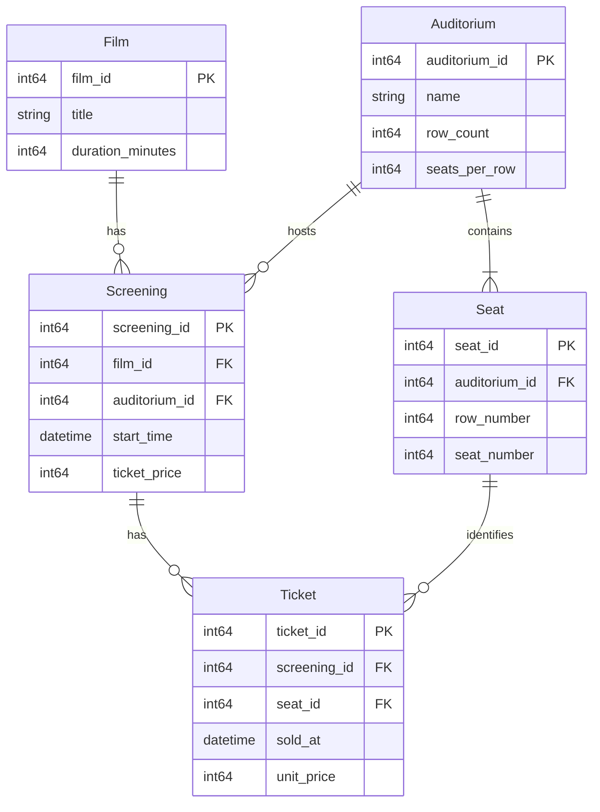

# THIẾT KẾ CƠ SỞ DỮ LIỆU LOGIC

**Phiên bản:** 1.0 - Hoàn thiện | **Ngày:** 19/10/2026 | **Căn cứ:** SRS 1.0 (`docs/requirements/srs.md`).

## 1. Phạm vi

Thiết kế cho một rạp, một người vận hành, mỗi lần bán một vé. ERD mô tả dữ liệu và quan hệ nghiệp vụ; dữ liệu thực tế lưu TXT, nạp lên RAM khi mở và lưu khi thoát bình thường. Không sử dụng DBMS hoặc SQL.

## 2. ERD

Mỗi suất thuộc đúng một phim và một phòng; mỗi ghế thuộc đúng một phòng; mỗi vé thuộc đúng một suất và một ghế. Phim, phòng, suất hoặc ghế có thể chưa có bản ghi con, riêng phòng hợp lệ phải có đủ ghế theo cấu hình.

**Quy ước:** PK là khóa chính số nguyên dương do chương trình sinh, duy nhất trong từng thực thể và không được sửa; FK là khóa ngoại bắt buộc tồn tại. Mọi trường bắt buộc có giá trị. Tên không rỗng, không dùng làm khóa vì có thể trùng hoặc thay đổi. Tiền dùng số nguyên 64 bit, đơn vị VND; thời gian dùng giờ địa phương, định dạng `YYYY-MM-DD HH:mm`.

## 3. Lý do chọn thực thể và thuộc tính

| Thực thể | Lý do thiết kế |
|---|---|
| `Film` | Một phim có nhiều suất nên lưu tên và thời lượng một lần, tránh lặp trên từng suất. Thời lượng dùng tính giờ kết thúc. |
| `Auditorium` | Phòng tồn tại độc lập với lịch. Lưu số hàng và số ghế mỗi hàng vì sơ đồ chỉ là hình chữ nhật; sức chứa tính từ hai giá trị này. |
| `Seat` | Mỗi ghế là vị trí vật lý được vé tham chiếu. Dù sinh tự động từ kích thước phòng, vẫn giữ mã ghế ổn định qua các phiên; không tự sinh lại mã khi nạp. |
| `Screening` | Cùng phim có thể chiếu nhiều lần trong cùng phòng, khác giờ và giá. Vì vậy suất cần mã riêng, không thể chỉ dùng cặp phim-phòng làm khóa. |
| `Ticket` | Mỗi vé ghi một ghế đã bán cho một suất. `sold_at` phục vụ thống kê theo ngày bán, khác ngày chiếu; `unit_price` giữ số tiền chốt lúc bán, thay vì tính lại từ giá niêm yết của suất. |

Vé không lưu tên phim, tên phòng hoặc mã phòng vì tra được qua suất và ghế. Theo phạm vi đơn giản, tra cứu hiển thị **tên hiện tại** của phim, không lưu bản chụp tên lịch sử.

## 4. Ràng buộc và chính sách thay đổi

| Ràng buộc | Lý do nghiệp vụ |
|---|---|
| Duy nhất `(auditorium_id, row_number, seat_number)`. | Không có hai ghế cùng vị trí trong một phòng. |
| Hàng/cột dương, trong kích thước phòng; đủ `row_count × seats_per_row` ghế. | Sơ đồ hình chữ nhật không có ghế ngoài phạm vi hoặc vị trí bị khuyết. |
| Duy nhất `(screening_id, seat_id)`. | Không bán trùng ghế trong cùng suất; vẫn bán được ghế đó ở suất khác. |
| Phòng của ghế phải bằng phòng của suất trên vé. | Hai FK tồn tại riêng lẻ chưa đủ ngăn bán nhầm ghế của phòng khác. |
| Khoảng sử dụng phòng `[start_time, start_time + duration_minutes + 15 phút)` không chồng lấn. | Bảo đảm đủ thời gian chiếu và nghỉ; suất sau được bắt đầu đúng lúc hết khoảng nghỉ, kể cả qua ngày mới. |
| Giá, thời lượng, kích thước dương; bán trước giờ bắt đầu, kiểm tra lại khi xác nhận. | Không nhận dữ liệu vô nghĩa hoặc bán vé khi suất đã bắt đầu. |

Chính sách sửa/xóa bảo vệ các quan hệ trên:

- **Phim:** sửa tên được; chỉ sửa thời lượng hoặc xóa khi chưa có suất, tránh làm đổi giờ kết thúc lịch đã tạo.
- **Phòng:** chỉ sửa/xóa khi chưa có suất; ghế được tạo lại hoặc xóa cùng phòng để sơ đồ luôn đồng bộ.
- **Suất:** chỉ sửa/xóa khi chưa có vé; khi sửa kiểm tra lại lịch và giờ bắt đầu tương lai, không so trùng với chính nó.
- **Vé:** chỉ tạo sau xác nhận tiền mặt, giá lấy từ suất; không sửa/xóa vì chưa có nghiệp vụ hủy hoặc hoàn tiền.

Chương trình kiểm tra các ràng buộc khi thay đổi và khi nạp TXT vì không có DBMS thực thi thay. Suất lịch sử được nạp dù đã qua; vé vẫn phải có thời điểm bán trước giờ chiếu. Không xóa dây chuyền phim hoặc suất có dữ liệu tham chiếu.

## 5. Những dữ liệu không lưu riêng

- **Ghế đã bán:** suy ra từ vé theo cặp suất-ghế; không đặt `is_sold` trên ghế vì trạng thái thay đổi theo suất.
- **Sức chứa, giờ kết thúc, doanh thu:** tính từ kích thước phòng, thời lượng phim và giá trên vé; tránh lưu nhiều giá trị có thể lệch nhau.
- **User, Customer:** không đăng nhập và không quản lý danh tính người mua.
- **Transaction, Report:** mỗi lần chỉ bán một vé; báo cáo là đếm vé và cộng `unit_price` theo ngày `sold_at`, không cần thực thể riêng.

Chi tiết DSA, lớp C++ và định dạng TXT được thiết kế riêng; không đưa chúng vào mô hình quan hệ hoặc mở rộng nghiệp vụ chỉ để phục vụ triển khai.

## 6. Ánh xạ sang triển khai

| Entity | Khai báo C++ | Repository RAM | File bền vững |
|---|---|---|---|
| `Film` | `src/entities/Film.h` | `src/repositories/FilmRepository.h` | `films.txt` |
| `Auditorium` | `src/entities/Auditorium.h` | `src/repositories/AuditoriumRepository.h` | `auditoriums.txt` |
| `Seat` | `src/entities/Seat.h` | `src/repositories/SeatRepository.h` | `seats.txt` |
| `Screening` | `src/entities/Screening.h` | `src/repositories/ScreeningRepository.h` | `screenings.txt` |
| `Ticket` | `src/entities/Ticket.h` | `src/repositories/TicketRepository.h` | `tickets.txt` |

Mỗi entity và repository cụ thể có file khai báo riêng. Repository chỉ quản lý dữ
liệu trên RAM; `src/persistence/TxtPersistence.h` chuyển đổi TXT và
`src/ApplicationData.cpp` điều phối nạp, kiểm tra, lưu toàn bộ bộ dữ liệu.
