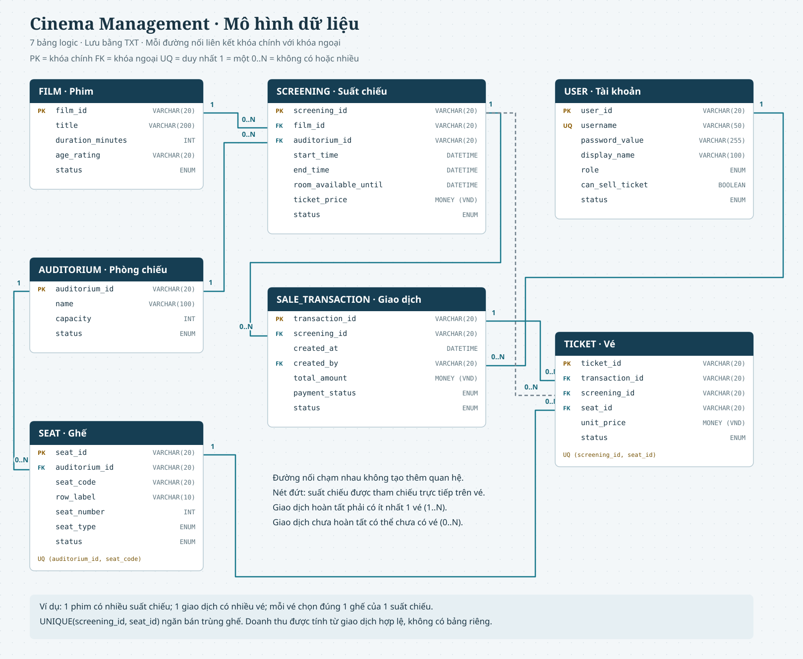

# THIẾT KẾ MÔ HÌNH DỮ LIỆU

## Hệ thống quản lý rạp chiếu phim

| Thông tin | Nội dung |
|---|---|
| Mã tài liệu | DD-CMS-001 |
| Phiên bản | 0.1 - Draft |
| Tài liệu liên quan | `docs/requirements/brd.md`, `docs/requirements/srs.md` |
| Phạm vi | Mô hình logic và định dạng lưu trữ TXT |
| Hệ quản trị CSDL | Không sử dụng |

---

# 1. Nguyên tắc thiết kế

- Mô hình logic được thiết kế tương đương các bảng quan hệ để dễ kiểm tra khóa và ràng buộc.
- Dữ liệu triển khai thực tế được lưu trong các file TXT cục bộ.
- Mỗi bản ghi phải có mã định danh duy nhất trong phạm vi thực thể.
- Không xóa vật lý dữ liệu nghiệp vụ đã được xác nhận; dùng trạng thái `INACTIVE` hoặc trạng thái tương ứng.
- Vé, giao dịch, ghế đã bán và doanh thu phải được ghi nhận nhất quán.
- Giá vé của vé đã bán được lưu tại thời điểm bán, không lấy lại từ giá hiện tại của suất chiếu.
- File TXT dùng UTF-8, mỗi dòng là một bản ghi, ký tự phân cách là `|`.
- Giá tiền lưu dưới dạng số nguyên VND, không lưu dấu phân cách hàng nghìn hoặc ký hiệu tiền tệ.
- Giá trị chuỗi không được chứa `|`, ký tự xuống dòng hoặc ký tự điều khiển chưa được quy định.

## 1.1. Ánh xạ sang cấu trúc dữ liệu tự xây dựng

Phần lõi của chương trình phải dùng các cấu trúc trong `src/DataStructures/`, không thay bằng `std::vector`, `std::map`, `std::set`, `QVector`, `QList` hoặc `QHash` để lưu dữ liệu nghiệp vụ.

| Cấu trúc | Cách dùng trong CMS | Lý do |
|---|---|---|
| `DoublyLinkedList<T>` | Danh sách bản ghi chính: phim, phòng, ghế, suất chiếu, giao dịch và vé | Lưu tuần tự, thêm cuối và duyệt báo cáo |
| `HashTable<int>` | Chỉ mục `id -> vị trí/bản ghi` cho tra cứu mã nhanh | Phục vụ đăng nhập, tra cứu vé/giao dịch và kiểm tra mã trùng |
| `BST<T>` | Chỉ mục suất chiếu theo thời điểm trong từng phòng | Duyệt theo thứ tự thời gian và hỗ trợ kiểm tra lịch gần nhau |
| `Matrix2D` | Sơ đồ hàng/cột ghế của một phòng | Biểu diễn trực quan vị trí và trạng thái ghế |
| `Queue<T>` | Chỉ dùng khi có luồng xử lý chờ thực tế, không đưa vào bán vé nếu không cần | Tránh ép cấu trúc dữ liệu vào nghiệp vụ |
| `Stack<T>` | Chỉ dùng cho thao tác cần hoàn tác/lịch sử nếu phạm vi được phê duyệt | Phiên bản đầu chưa có hủy/hoàn vé |
| `Graph` | Không dùng trong nghiệp vụ cốt lõi vì rạp không có bài toán mạng lưới | Không tạo thêm chức năng giả tạo |

`std::string` và các kiểu giá trị cơ bản vẫn được phép dùng bên trong model vì các cấu trúc hiện có dùng chúng. `QString`, `QDateTime` và API Qt chỉ nên dùng ở biên giao diện, file và chuyển đổi dữ liệu.

### Quy tắc đồng bộ chỉ mục

- `DoublyLinkedList<T>` là nguồn dữ liệu chính; `HashTable` và `BST` chỉ là chỉ mục hỗ trợ.
- Khi thêm hoặc ngừng bản ghi, phải cập nhật chỉ mục tương ứng trong cùng thao tác nghiệp vụ.
- Không xóa vật lý bản ghi đã được tham chiếu; dùng trạng thái để giữ vị trí và tránh làm hỏng chỉ mục.
- Khi khởi động, đọc lại file TXT vào danh sách chính rồi dựng lại toàn bộ `HashTable` và `BST`, không lưu chỉ mục ra TXT.
- `Matrix2D` được tạo từ cấu hình `SEAT`; trạng thái đã bán được đối chiếu từ `TICKET` theo từng `SCREENING`.

---

# 2. Quy ước kiểu dữ liệu

| Kiểu logic | Quy ước trong TXT | Ví dụ |
|---|---|---|
| `String` | Chuỗi UTF-8, không chứa `|` | `FILM001` |
| `Int` | Số nguyên không có dấu phân cách | `120` |
| `Money` | Số nguyên VND, lớn hơn hoặc bằng 0 | `80000` |
| `Boolean` | `1` hoặc `0` | `1` |
| `DateTime` | `YYYY-MM-DD HH:mm:ss` | `2026-10-10 19:30:00` |
| `Enum` | Một trong các giá trị được quy định | `OPEN` |

Múi giờ sử dụng là giờ địa phương của máy chạy ứng dụng. Phiên bản đầu không cần lưu múi giờ trong từng giá trị thời gian.

---

# 3. Mô hình logic kiểu SQL

Các khai báo dưới đây là mô hình thiết kế, không phải script tạo database. `PK` là khóa chính, `FK` là khóa ngoại.

## 3.1. USER

```sql
USER (
    user_id          VARCHAR(20)  PK,
    username         VARCHAR(50)  NOT NULL UNIQUE,
    password_value   VARCHAR(255) NOT NULL,
    display_name     VARCHAR(100) NOT NULL,
    role             ENUM('MANAGER', 'SELLER') NOT NULL,
    can_sell_ticket  BOOLEAN      NOT NULL DEFAULT 0,
    status           ENUM('ACTIVE', 'INACTIVE') NOT NULL
)
```

Ràng buộc:

- `username` không được trùng.
- Tài khoản `INACTIVE` không được đăng nhập.
- `MANAGER` có quyền quản lý phim, phòng, suất chiếu và báo cáo.
- Người dùng chỉ được bán vé khi `can_sell_ticket = 1`.
- Mật khẩu không được hiển thị trực tiếp trong giao diện; nếu có cơ chế băm phù hợp thì lưu giá trị đã băm.

## 3.2. FILM

```sql
FILM (
    film_id           VARCHAR(20)  PK,
    title             VARCHAR(200) NOT NULL,
    duration_minutes  INT          NOT NULL CHECK (duration_minutes > 0),
    age_rating        VARCHAR(20)  NOT NULL,
    status            ENUM('ACTIVE', 'INACTIVE') NOT NULL
)
```

Ràng buộc:

- `film_id` duy nhất.
- `title` không được rỗng.
- Phim `INACTIVE` không được dùng để tạo hoặc mở bán suất chiếu mới.
- Không được ngừng phim nếu còn suất chiếu tương lai bị ảnh hưởng.

## 3.3. AUDITORIUM

```sql
AUDITORIUM (
    auditorium_id  VARCHAR(20)  PK,
    name           VARCHAR(100) NOT NULL,
    capacity       INT          NOT NULL CHECK (capacity > 0),
    status         ENUM('ACTIVE', 'INACTIVE') NOT NULL
)
```

Ràng buộc:

- `auditorium_id` duy nhất.
- `capacity` phải bằng số ghế hợp lệ thuộc phòng.
- Phòng `INACTIVE` không được dùng để tạo hoặc mở bán suất chiếu mới.
- Không được ngừng phòng nếu còn suất chiếu tương lai bị ảnh hưởng.

## 3.4. SEAT

```sql
SEAT (
    seat_id       VARCHAR(20) PK,
    auditorium_id VARCHAR(20) NOT NULL FK -> AUDITORIUM.auditorium_id,
    seat_code     VARCHAR(20) NOT NULL,
    row_label     VARCHAR(10) NOT NULL,
    seat_number   INT         NOT NULL CHECK (seat_number > 0),
    seat_type     ENUM('STANDARD') NOT NULL,
    status        ENUM('ACTIVE', 'INACTIVE') NOT NULL,
    UNIQUE (auditorium_id, seat_code)
)
```

Ràng buộc:

- Một `seat_code` chỉ duy nhất trong một phòng.
- Phiên bản đầu chỉ hỗ trợ `STANDARD`.
- Ghế `INACTIVE` không được chọn bán.
- `seat_id` là mã toàn cục để vé tham chiếu ổn định; `seat_code` là mã hiển thị cho người dùng.

## 3.5. SCREENING

```sql
SCREENING (
    screening_id         VARCHAR(20) PK,
    film_id              VARCHAR(20) NOT NULL FK -> FILM.film_id,
    auditorium_id        VARCHAR(20) NOT NULL FK -> AUDITORIUM.auditorium_id,
    start_time           DATETIME    NOT NULL,
    end_time             DATETIME    NOT NULL,
    room_available_until DATETIME    NOT NULL,
    ticket_price         MONEY       NOT NULL CHECK (ticket_price >= 0),
    status               ENUM('DRAFT', 'OPEN', 'CLOSED', 'COMPLETED') NOT NULL
)
```

Ràng buộc:

- `end_time = start_time + duration_minutes` của phim.
- `room_available_until = end_time + 15 phút`.
- Hai suất chiếu cùng phòng không được thỏa điều kiện chồng lấn:

```text
new.start_time < old.room_available_until
AND old.start_time < new.room_available_until
```

- Chỉ `OPEN` và chưa đến `start_time` mới được bán vé.
- Khi đã có vé, không được thay đổi `film_id`, `auditorium_id`, `start_time` hoặc `ticket_price`.
- `CLOSED` là trạng thái không nhận bán vé mới; `COMPLETED` dùng cho suất đã kết thúc.

## 3.6. SALE_TRANSACTION

Không dùng tên `TRANSACTION` vì đây thường là từ khóa của hệ quản trị cơ sở dữ liệu.

```sql
SALE_TRANSACTION (
    transaction_id VARCHAR(20) PK,
    screening_id   VARCHAR(20) NOT NULL FK -> SCREENING.screening_id,
    created_at     DATETIME    NOT NULL,
    created_by     VARCHAR(20) NOT NULL FK -> USER.user_id,
    total_amount   MONEY       NOT NULL CHECK (total_amount > 0),
    payment_status ENUM('UNCONFIRMED', 'CONFIRMED') NOT NULL,
    status         ENUM('PENDING', 'COMPLETED', 'FAILED') NOT NULL
)
```

Ràng buộc:

- Một giao dịch phải thuộc đúng một suất chiếu.
- Giao dịch `COMPLETED` phải có ít nhất một vé.
- `total_amount` bằng tổng `unit_price` của các vé thuộc giao dịch.
- Giao dịch `FAILED` không được tính vào doanh thu.
- Giao dịch `COMPLETED` không được xóa hoặc sửa tùy ý.

## 3.7. TICKET

```sql
TICKET (
    ticket_id      VARCHAR(20) PK,
    transaction_id  VARCHAR(20) NOT NULL FK -> SALE_TRANSACTION.transaction_id,
    screening_id    VARCHAR(20) NOT NULL FK -> SCREENING.screening_id,
    seat_id         VARCHAR(20) NOT NULL FK -> SEAT.seat_id,
    unit_price      MONEY       NOT NULL CHECK (unit_price >= 0),
    status          ENUM('ISSUED') NOT NULL,
    UNIQUE (screening_id, seat_id)
)
```

Ràng buộc:

- Một ghế chỉ được bán một lần trong một suất chiếu.
- `TICKET.screening_id` phải trùng `SALE_TRANSACTION.screening_id`.
- `seat_id` phải thuộc đúng phòng của suất chiếu.
- `unit_price` lấy từ giá tại thời điểm bán và không thay đổi về sau.
- Vé chỉ được tạo khi giao dịch đã được xác nhận thanh toán.

---

# 4. Quan hệ giữa các thực thể



Mở `database-erd.svg` để phóng to sơ đồ. `PK` là khóa chính, `FK` là khóa ngoại, `UQ` là ràng buộc duy nhất. `1` nghĩa là một bản ghi; `0..N` nghĩa là không có hoặc nhiều bản ghi liên quan. Giao dịch hoàn tất phải có ít nhất một vé, trong khi giao dịch chưa hoàn tất có thể chưa có vé.

```text
USER 1 -------- N SALE_TRANSACTION
FILM 1 -------- N SCREENING
AUDITORIUM 1 - N SEAT
AUDITORIUM 1 - N SCREENING
SCREENING 1 -- N SALE_TRANSACTION
SCREENING 1 -- N TICKET
SALE_TRANSACTION 1 - N TICKET
SEAT 1 ------- N TICKET
```

`SEAT 1 - N TICKET` là đúng ở phạm vi toàn hệ thống vì một ghế vật lý có thể được bán ở nhiều suất chiếu khác nhau. Ràng buộc duy nhất chỉ áp dụng cho cặp `(screening_id, seat_id)`.

---

# 5. Thiết kế file TXT

## 5.1. Thư mục dữ liệu

```text
data/
  users.txt
  films.txt
  auditoriums.txt
  seats.txt
  screenings.txt
  transactions.txt
  tickets.txt
  sale_journal.txt
  backup/
```

Tên file cố định trong phiên bản đầu để giảm cấu hình và tránh tạo nhầm nhiều nguồn dữ liệu.

## 5.2. Quy tắc chung của file

- Dòng đầu tiên là header, dùng đúng tên trường trong bảng bên dưới.
- Các dòng tiếp theo là bản ghi, mỗi trường cách nhau bằng `|`.
- Bản ghi không được có thêm hoặc thiếu số lượng trường.
- Giá trị rỗng chỉ được phép ở trường được đánh dấu nullable.
- Mã định danh không được chứa `|`.
- Khi ghi lại file, ứng dụng phải ghi vào file tạm trước rồi thay thế file chính sau khi kiểm tra thành công.
- File có thể có dòng cuối kết thúc bằng newline; parser không được tạo thêm bản ghi rỗng.

## 5.3. Định dạng từng file

### `users.txt`

```text
user_id|username|password_value|display_name|role|can_sell_ticket|status
U001|manager|...|Quan ly|MANAGER|1|ACTIVE
U002|seller01|...|Nhan vien 01|SELLER|1|ACTIVE
```

### `films.txt`

```text
film_id|title|duration_minutes|age_rating|status
F001|Phim mau|120|P|ACTIVE
```

### `auditoriums.txt`

```text
auditorium_id|name|capacity|status
A001|Phong 1|100|ACTIVE
```

### `seats.txt`

```text
seat_id|auditorium_id|seat_code|row_label|seat_number|seat_type|status
S001|A001|A01|A|1|STANDARD|ACTIVE
```

### `screenings.txt`

```text
screening_id|film_id|auditorium_id|start_time|end_time|room_available_until|ticket_price|status
SC001|F001|A001|2026-10-10 19:30:00|2026-10-10 21:30:00|2026-10-10 21:45:00|80000|OPEN
```

### `transactions.txt`

```text
transaction_id|screening_id|created_at|created_by|total_amount|payment_status|status
TX001|SC001|2026-10-10 18:15:10|U002|160000|CONFIRMED|COMPLETED
```

### `tickets.txt`

```text
ticket_id|transaction_id|screening_id|seat_id|unit_price|status
T001|TX001|SC001|S001|80000|ISSUED
T002|TX001|SC001|S002|80000|ISSUED
```

## 5.4. Không lưu file doanh thu riêng

Không tạo `revenue.txt`. Doanh thu được tính từ `transactions.txt` có:

```text
payment_status = CONFIRMED
AND status = COMPLETED
```

Việc tính động tránh tạo thêm nguồn dữ liệu có thể lệch với giao dịch thực tế.

---

# 6. Kiểm tra toàn vẹn khi khởi động

Khi mở ứng dụng, hệ thống phải đọc và kiểm tra theo thứ tự:

1. Kiểm tra file tồn tại, header và số lượng trường.
2. Đọc `users`, `films`, `auditoriums` và `seats`.
3. Kiểm tra khóa chính và khóa duy nhất trong từng file.
4. Kiểm tra khóa ngoại của `screenings`.
5. Kiểm tra thời gian và xung đột giữa các `screenings` cùng phòng.
6. Đọc `transactions` và kiểm tra người dùng, suất chiếu, số tiền và trạng thái.
7. Đọc `tickets` và kiểm tra giao dịch, suất chiếu, ghế cùng ràng buộc `(screening_id, seat_id)`.
8. Kiểm tra tổng tiền giao dịch bằng tổng giá vé tương ứng.
9. Nếu có lỗi, hiển thị file/bản ghi bị lỗi và không cho thực hiện nghiệp vụ làm thay đổi dữ liệu cho đến khi xử lý.

---

# 7. Quy trình ghi một giao dịch bán vé

Mục tiêu là không tạo trạng thái giao dịch thành công một phần.

## 7.1. Trước khi ghi

Ứng dụng phải kiểm tra:

- Người dùng có `can_sell_ticket = 1`.
- Suất chiếu tồn tại, ở trạng thái `OPEN` và chưa bắt đầu.
- Tất cả ghế được chọn thuộc đúng phòng và đang còn trống.
- Không có ghế trùng trong lựa chọn.
- Tổng tiền hợp lệ.

## 7.2. Ghi dữ liệu

1. Tạo `transaction_id` và các `ticket_id` mới.
2. Ghi một bản ghi chuẩn bị vào `sale_journal.txt` với trạng thái `PREPARED`.
3. Tạo dữ liệu mới cho `transactions.txt` với trạng thái `PENDING`.
4. Tạo đầy đủ các bản ghi vé trong `tickets.txt`.
5. Kiểm tra lại số lượng vé, ghế và tổng tiền.
6. Ghi trạng thái thanh toán `CONFIRMED` và giao dịch `COMPLETED`.
7. Ghi bản ghi `COMMITTED` vào `sale_journal.txt`.
8. Xóa hoặc đánh dấu hoàn tất bản ghi journal sau khi các file chính đã hợp lệ.

Nếu bất kỳ bước nào thất bại:

- Không hiển thị giao dịch thành công.
- Không tính giao dịch vào doanh thu.
- Không coi các vé thuộc giao dịch là vé hợp lệ.
- Khôi phục từ bản sao trước giao dịch hoặc bỏ toàn bộ bản ghi chưa `COMMITTED` khi khởi động lại.

## 7.3. Nguyên tắc đọc dữ liệu bán vé

Chỉ các giao dịch có `status = COMPLETED` và `payment_status = CONFIRMED` được xem là hợp lệ. Vé liên quan đến giao dịch chưa hoàn tất không được tính là ghế đã bán.

---

# 8. Quy tắc cập nhật và xóa

| Dữ liệu | Cho phép cập nhật | Cách xử lý xóa/ngừng |
|---|---|---|
| User | Tên hiển thị, quyền, trạng thái | Chuyển `INACTIVE`, không xóa vật lý tài khoản đã dùng |
| Film | Thông tin phim khi chưa ảnh hưởng suất đã bán | Chuyển `INACTIVE` |
| Auditorium | Tên, trạng thái, cấu hình khi chưa ảnh hưởng suất tương lai | Chuyển `INACTIVE` |
| Seat | Cấu hình khi chưa có ràng buộc bán vé | Chuyển `INACTIVE` |
| Screening | Trạng thái khi chưa vi phạm quy tắc | Không xóa nếu đã có vé; đóng bán thay vì xóa |
| Sale transaction | Không sửa sau khi hoàn tất | Không xóa |
| Ticket | Không sửa sau khi phát hành | Không xóa trong phiên bản đầu |

---

# 9. Định nghĩa dữ liệu báo cáo

Các chỉ số báo cáo được tính từ dữ liệu hợp lệ:

```text
sold_tickets = COUNT(TICKET)
              WHERE transaction.status = COMPLETED
              AND transaction.payment_status = CONFIRMED

revenue = SUM(TICKET.unit_price)
          WHERE transaction.status = COMPLETED
          AND transaction.payment_status = CONFIRMED

occupancy_rate = sold_tickets / auditorium.capacity * 100
```

Khi không có vé bán, `occupancy_rate = 0%`. Hệ thống không chia cho sức chứa bằng 0 vì phòng không hợp lệ phải bị từ chối ngay khi cấu hình.

---

# 10. Kiểm tra nghiệm thu mô hình dữ liệu

| ID | Kiểm tra | Kết quả mong đợi |
|---|---|---|
| DD-01 | Tạo hai phim cùng `film_id` | Bản ghi thứ hai bị từ chối. |
| DD-02 | Tạo hai ghế cùng `seat_code` trong một phòng | Bản ghi thứ hai bị từ chối. |
| DD-03 | Tạo cùng `seat_code` ở hai phòng khác nhau | Được phép. |
| DD-04 | Tạo suất chiếu với phim/phòng không tồn tại | Bị từ chối. |
| DD-05 | Tạo suất chiếu chồng lấn | Bị từ chối, lịch cũ không đổi. |
| DD-06 | Bán một ghế hai lần trong cùng suất | Giao dịch thứ hai bị từ chối. |
| DD-07 | Bán cùng vị trí ghế ở suất khác | Được phép nếu ghế còn trống. |
| DD-08 | Giao dịch thất bại giữa lúc ghi file | Không được tính vé hoặc doanh thu hợp lệ. |
| DD-09 | Đóng/mở lại ứng dụng sau giao dịch thành công | Dữ liệu và báo cáo vẫn khớp. |
| DD-10 | Giá suất chiếu thay đổi sau khi bán vé | `unit_price` của vé cũ không thay đổi. |

---

# 11. Việc cần chốt trước khi lập trình

- Chọn cách sinh mã: mã tăng dần (`F001`) hoặc mã ngẫu nhiên ổn định.
- Chốt tên thư mục dữ liệu và vị trí backup.
- Chốt cách băm mật khẩu theo ngôn ngữ được phép dùng trong bài tập.
- Chốt cách thay thế file an toàn trên hệ điều hành mục tiêu.
- Chốt giao diện nhập sơ đồ ghế: nhập theo hàng/cột hay nhập từng ghế.
