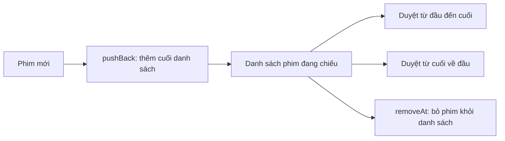
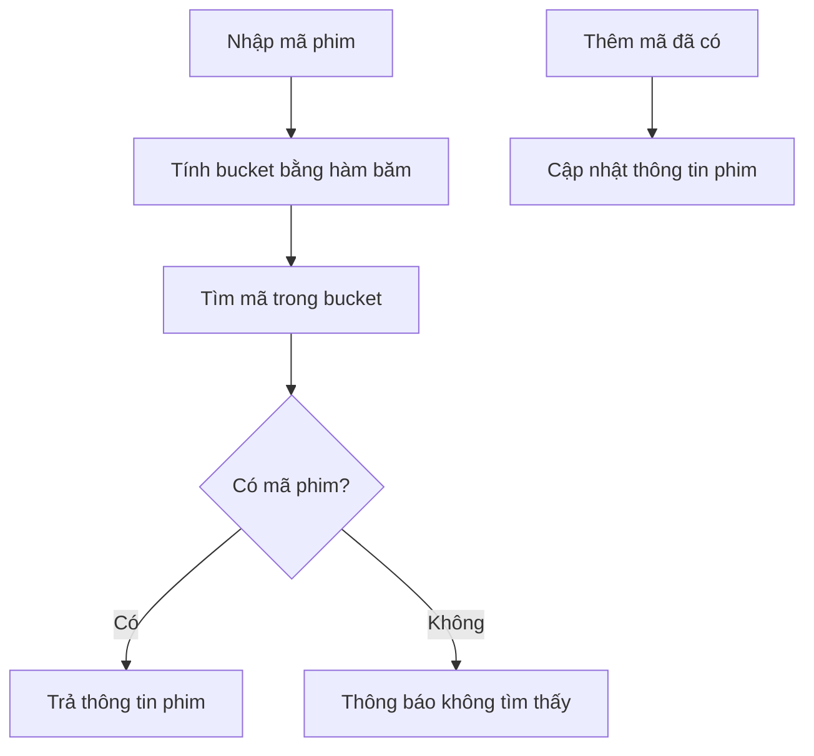
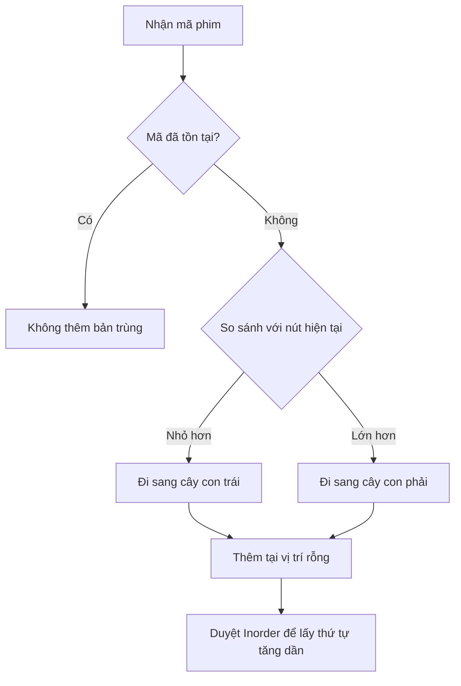
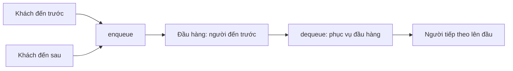
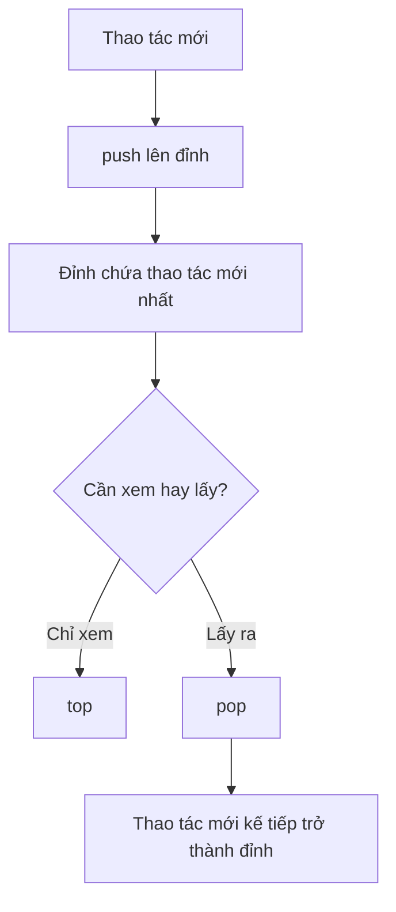
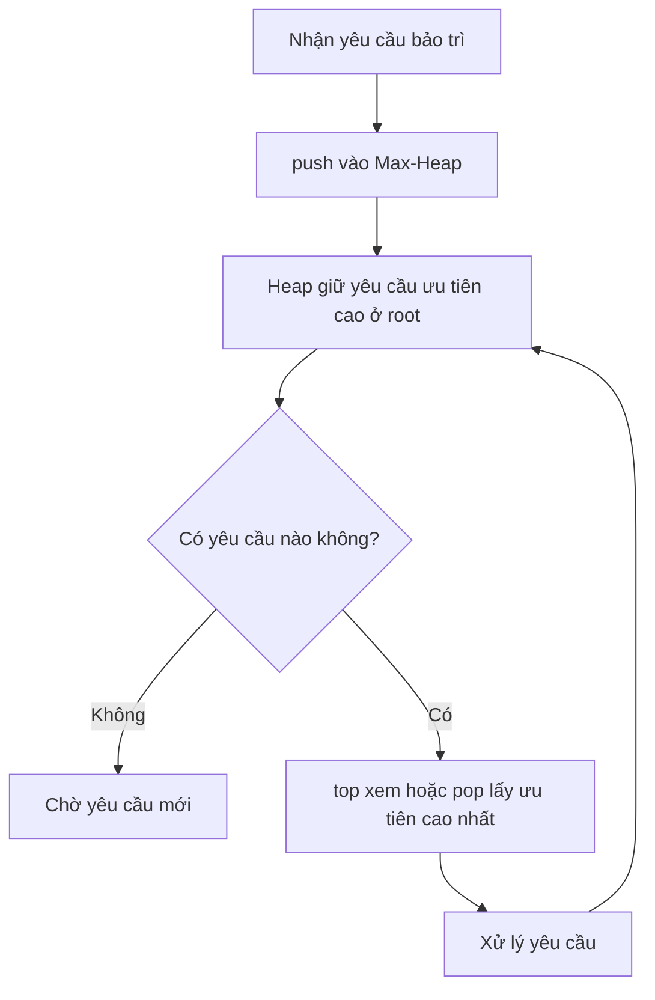
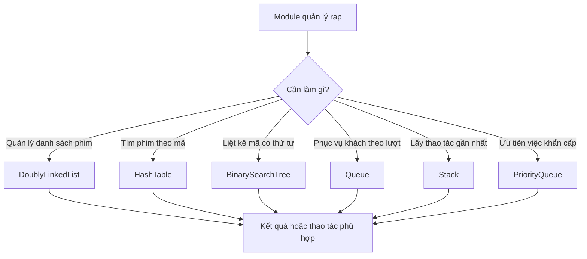

# Ví dụ ứng dụng các cấu trúc dữ liệu trong rạp chiếu phim

Tài liệu này minh họa các tình huống đơn giản có thể dùng sáu cấu trúc dữ liệu trong thư viện. Mỗi ví dụ tập trung vào một nhiệm vụ; đây là hướng áp dụng, chưa phải nghiệp vụ hoàn chỉnh hay kết nối cơ sở dữ liệu.

Các sơ đồ dùng cú pháp Mermaid và có thể xem bằng GitHub hoặc tiện ích Markdown trong VS Code.

## 1. Danh sách phim đang chiếu — `DoublyLinkedList<T>`

**Tình huống:** màn hình cần giữ thứ tự danh sách phim, thêm phim mới vào cuối, hoặc bỏ phim đã ngừng chiếu.

```cpp
DoublyLinkedList<int> movieIds;

movieIds.pushBack(101);
movieIds.pushBack(102);
movieIds.pushFront(99);

int firstMovieId = movieIds.at(0);  // 99
movieIds.removeAt(1);               // bỏ phim có mã 101 ở vị trí 1
```



Mỗi nút giữ liên kết tới phần tử kế tiếp và phần tử trước đó. Thêm/xóa ở hai đầu nhanh; tìm phim hoặc truy cập theo vị trí cần duyệt qua danh sách.

## 2. Tra cứu phim theo mã — `HashTable<Key, Value>`

**Tình huống:** nhân viên nhập mã phim và muốn lấy thông tin phim tương ứng nhanh chóng.

```cpp
HashTable<int, string> movies;
movies.insert(101, "Phim A");
movies.insert(102, "Phim B");

string* title = movies.find(102);
if (title != NULL) {
    cout << *title << endl;
}
```



Nếu hai mã được băm vào cùng bucket, bảng duyệt các mục trong danh sách của bucket đó. `insert` với mã đã có sẽ cập nhật giá trị thay vì tạo mục trùng.

## 3. Liệt kê mã phim theo thứ tự — `BinarySearchTree<T>`

**Tình huống:** cần lưu mã phim không trùng và liệt kê chúng theo thứ tự tăng dần.

```cpp
BinarySearchTree<int> movieIds;
movieIds.insert(105);
movieIds.insert(101);
movieIds.insert(103);

void printMovieId(const int& movieId) {
    cout << movieId << " ";
}

movieIds.traverseInOrder(printMovieId);  // 101 103 105
```



Cây thường tìm kiếm nhanh khi tương đối cân bằng. Cây hiện tại không tự cân bằng; nếu thêm mã đã được sắp xếp từ nhỏ đến lớn, cây có thể bị lệch.

## 4. Khách chờ mua vé — `Queue<T>`

**Tình huống:** khách được phục vụ đúng thứ tự đến quầy (FIFO: vào trước, ra trước).

```cpp
Queue<int> customers;
customers.enqueue(1);  // khách thứ nhất
customers.enqueue(2);  // khách thứ hai

int nextCustomer = customers.front();    // 1, chỉ xem
int servedCustomer = customers.dequeue(); // lấy khách thứ nhất ra khỏi hàng
```



Gọi `front()` hoặc `dequeue()` khi hàng rỗng sẽ ném `std::logic_error`; ứng dụng có thể kiểm tra `empty()` trước khi gọi.

## 5. Lịch sử thao tác — `Stack<T>`

**Tình huống:** ghi lại các thao tác tạm thời để xem hoặc lấy thao tác gần nhất trước (LIFO: vào sau, ra trước).

```cpp
Stack<string> operationHistory;
operationHistory.push("Them phim");
operationHistory.push("Cap nhat ten phim");

string mostRecent = operationHistory.top(); // "Cap nhat ten phim"
operationHistory.pop();                     // lấy thao tác gần nhất ra
```



Stack chỉ cung cấp cách lưu và lấy dữ liệu LIFO. Tự nó không thực hiện hoàn tác và không nên dùng để đảo ngược giao dịch đã xác nhận.

## 6. Yêu cầu bảo trì khẩn cấp — `PriorityQueue<T>`

**Tình huống:** xử lý công việc bảo trì theo mức độ ưu tiên. Với Max-Heap mặc định, số lớn hơn có ưu tiên cao hơn.

```cpp
PriorityQueue<int> maintenanceTasks;
maintenanceTasks.push(2);  // ưu tiên thường
maintenanceTasks.push(5);  // ưu tiên khẩn cấp
maintenanceTasks.push(3);  // ưu tiên cao

int nextPriority = maintenanceTasks.top(); // 5
int processedPriority = maintenanceTasks.pop();
```



Có thể dùng hàm so sánh riêng cho kiểu công việc. Nên quy định rõ ý nghĩa mức ưu tiên (ví dụ số càng lớn càng khẩn cấp) để người sử dụng không hiểu ngược thứ tự.

## 7. Kết hợp trong một tình huống tổng quát

Một module rạp có thể dùng nhiều cấu trúc cho các thao tác khác nhau. Sơ đồ dưới đây minh họa các yêu cầu đi vào đúng nơi lưu trữ, không yêu cầu phải dùng cả sáu cấu trúc cho cùng một tập dữ liệu.



### Gợi ý chọn cấu trúc

| Câu hỏi | Chọn |
|---|---|
| Cần duyệt danh sách và thêm/xóa ở hai đầu? | `DoublyLinkedList<T>` |
| Cần tìm trực tiếp theo khóa như mã phim? | `HashTable<Key, Value>` |
| Cần lưu phần tử theo thứ tự để duyệt tăng dần? | `BinarySearchTree<T>` |
| Ai đến trước được xử lý trước? | `Queue<T>` |
| Thao tác mới nhất cần được lấy trước? | `Stack<T>` |
| Việc quan trọng nhất cần được xử lý trước? | `PriorityQueue<T>` |

Ví dụ trên dùng kiểu cơ bản để dễ đọc. Khi chuyển sang đối tượng như phim, khách hàng hoặc vé, hãy dùng kiểu dữ liệu phù hợp và cung cấp phép so sánh hoặc hàm băm mà cấu trúc đó yêu cầu.
