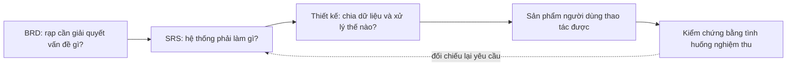

# 01. Phạm vi và đối chiếu yêu cầu

Nguồn gốc: [BRD](../requirements/brd.md), [SRS](../requirements/srs.md),
[Use case](../requirements/use-cases.md), [Thiết kế dữ liệu](../design/data-design.md)
và [Wireframe](../design/wireframes/wireframe.html).
Ngày kiểm chứng: 12/10/2026. Không thay BRD/SRS để làm cho code có vẻ đúng.

Có service chưa đủ để kết luận đạt một yêu cầu cấp sản phẩm: nhân viên phải
thao tác được qua Qt và kết quả phải tồn tại đúng sau lưu/mở lại. Ngược lại,
một nút hiện trên giao diện cũng chưa đủ nếu thiếu kiểm tra quyền hoặc ghi
dữ liệu không nhất quán. Ma trận dưới dùng cả hai góc nhìn.

## 1. Phạm vi và vai trò

Một rạp, nhiều phòng, một máy và một phiên ghi dữ liệu. Nhân viên bán trực
tiếp, xác nhận đã nhận tiền mặt. Một suất có một giá cơ bản; mọi ghế STANDARD.
Quản lý độ tuổi bằng nhãn thông tin; người bán kiểm tra giấy tờ bên ngoài app.

| Thao tác | Admin/Manager | Nhân viên/Seller |
|---|---|---|
| Đăng nhập, xem danh mục, tra suất/ghế, tra vé/giao dịch | Có | Có |
| Tạo/sửa phim và phòng; lập lịch/chuyển trạng thái | Có | Không |
| Xem báo cáo tổng hợp; quản lý tài khoản/quyền | Có | Không |
| Xác nhận bán vé | Chỉ khi `canSellTicket=true` | Chỉ khi `canSellTicket=true` |

Ẩn nút chỉ là trải nghiệm. `AuthService::requireManager/requireSeller` đọc
lại tài khoản hiện tại trước thao tác. Quyền bị thu hồi khi đang mở dialog
thanh toán phải làm lần xác nhận sau thất bại.

## 2. Đóng các lỗi của lần rà soát trước

| Lỗi trong `docs/reviews/requirements-audit.md` | Bản sửa hiện tại | Regression |
|---|---|---|
| P1-01 thiếu/trống tickets được xem là bảng rỗng | Phân biệt mới hoàn toàn và dữ liệu thiếu; kiểm tra header/quan hệ | `IntegrityTest.cpp` |
| P1-02 sai tổng tiền/trạng thái vé được load | Đối soát Completed↔Confirmed, đủ vé và tổng giá, FK/cặp suất-ghế | `IntegrityTest.cpp` |
| P1-03 không có luồng Qt vận hành | Nối OperationsController và trang lịch, quầy, lookup, report/tổng quan | `QtOperationsTest.cpp` |
| P2-01 capacity/vị trí/thời gian TXT sai lọt qua | Kiểm tra miền dữ liệu, vị trí duy nhất, thời lượng, nghỉ ≥15 phút, overlap | `IntegrityTest.cpp` |
| P2-02 mẫu số lấp đầy dùng ghế ACTIVE | Mẫu số là `Auditorium.capacity` | `IntegrityTest.cpp` |
| P2-03 thiếu tạo phòng/lọc suất/lookup đủ thông tin | `saveGrid`, enriched DTO, trang tạo phòng/lọc suất/lookup | `QtOperationsTest.cpp` |

Thêm kiểm chứng triển khai: thư mục mới được cấp Admin bằng lệnh riêng;
demo có suất tương lai/ghế đã bán; không ghi đè; `QLockFile` chặn hai app cùng
thư mục kể cả qua symlink; sidebar cuộn khi cửa sổ 800×560; test HiDPI 1,5.

## 3. BRD: toàn bộ 18 yêu cầu

| ID | Đối chiếu hiện tại |
|---|---|
| BR-01 | FilmPage tạo/xem/tìm/sửa/ngừng phim qua FilmService |
| BR-02 | AuditoriumPage tạo/sửa trạng thái, capacity và lưới ghế thực |
| BR-03 | ScreeningPage tạo DRAFT/OPEN, mở/đóng/hoàn tất |
| BR-04 | Khoảng `[start, roomAvailableUntil)` không được chồng cùng phòng |
| BR-05 | SalePage lọc suất và map ghế riêng theo suất |
| BR-06 | Giá suất nhập ở quản lý lịch, hiển thị trước bán |
| BR-07 | Một SaleRequest nhiều seatIds, một transaction nhiều tickets |
| BR-08 | Chặn trùng seat trong request và cặp suất-ghế trong dữ liệu |
| BR-09 | Chỉ confirmed payment được commit; preview không ghi |
| BR-10 | LookupPage theo transactionId/ticketId, kết quả join đầy đủ |
| BR-11 | ReportPage thời gian bán/phim/suất; lấp đầy toàn bộ suất |
| BR-12 | Guard service, menu theo quyền; thu hồi giữa thao tác bị từ chối |
| BR-13 | TXT load/save, reopen, rollback và phục hồi marker |
| BR-14 | Validate graph giao dịch/vé/tiền và map/report từ cùng nguồn |
| BR-15 | Hủy/hoàn vé: ngoài MVP, không triển khai |
| BR-16 | Soát vé: ngoài MVP, không triển khai |
| BR-17 | Giá linh hoạt: ngoài MVP, dùng một giá cơ bản/suất |
| BR-18 | Đối soát ca: ngoài MVP, chỉ lưu người và thời điểm bán |

BO-01..07 được phục vụ bởi danh mục/lịch/quầy/lookup/report/guard ở bảng này.
Quy trình BP-01..05 **mục 7 BRD** tương ứng danh mục → lịch → bán → tra cứu →
báo cáo. Không nhầm với Business Problems BP-01..06 ở mục 2 cùng tiền tố.
SC-01..10 và rủi ro dữ liệu/lịch/quyền được kiểm soát bằng các luồng đó;
không thêm BR-15..18 để bù chức năng còn thiếu.

## 4. SRS: toàn bộ 60 FR (59 Must, 1 Should)

“Có + kiểm chứng” nghĩa có đường Qt/service và bằng chứng trong suite, không
phải 60 test độc lập hay chứng nhận mọi tổ hợp đầu vào. Tên test là source
trong `tests/`. Các chi tiết hạn chế xem chương 07.

| ID | Hành vi/đường mã | Bằng chứng chính |
|---|---|---|
| FR-AUTH-01 | LoginDialog chỉ username/password | QtLoginTest |
| FR-AUTH-02 | Role/quyền từ User, không chọn trên login | AuthControllerTest, QtAccountTest |
| FR-AUTH-03 | Sai/khóa trả lỗi chung, không lộ hash | MinimumServicesTest, QtLoginTest |
| FR-AUTH-04 | Logout xóa currentUserId, quay login | QtLoginTest, QtAccountTest |
| FR-AUTH-05 | AccountPage tạo/sửa/khóa/cấp quyền | QtAccountTest |
| FR-AUTH-06 | Guard tại service, không chỉ ẩn nút | QtOperationsTest, MinimumServicesTest |
| FR-FILM-01 | FilmPage tạo đủ trường tối thiểu | QtFilmTest |
| FR-FILM-02 | Chặn thiếu trường/thời lượng/mã trùng | FilmControllerTest, IntegrityTest |
| FR-FILM-03 | Danh sách/tìm/chi tiết | QtFilmTest |
| FR-FILM-04 | Sửa thông tin an toàn; không đổi duration khi có lịch | FilmControllerTest |
| FR-FILM-05 | Không ngừng phim còn lịch tương lai bị ảnh hưởng | QtOperationsTest |
| FR-FILM-06 | Không xóa và không làm mất hợp lệ lịch cũ | MinimumServicesTest |
| FR-ROOM-01 | Form tạo phòng và `saveGrid` | QtOperationsTest |
| FR-ROOM-02 | ID/code/vị trí duy nhất trong phòng | IntegrityTest |
| FR-ROOM-03 | Capacity=rows×columns=số ghế vật lý | IntegrityTest, QtOperationsTest |
| FR-ROOM-04 | List/capacity/map phòng | QtAuditoriumTest |
| FR-ROOM-05 | Sửa trạng thái có guard lịch | QtOperationsTest |
| FR-ROOM-06 | Không ngừng khi còn lịch tương lai | QtOperationsTest |
| FR-SHOW-01 | Form chọn phim/phòng/start/price | QtOperationsTest |
| FR-SHOW-02 | End=start+duration | QtOperationsTest, IntegrityTest |
| FR-SHOW-03 | Create +15 phút; load cho nghỉ ≥15 | IntegrityTest |
| FR-SHOW-04 | Từ chối overlap, chấp nhận đúng biên | QtOperationsTest |
| FR-SHOW-05 | FK/ACTIVE/date/price hợp lệ | MinimumServicesTest, IntegrityTest |
| FR-SHOW-06 | DRAFT hoặc OPEN; chỉ OPEN bán | MinimumServicesTest, QtOperationsTest |
| FR-SHOW-07 | List/filter, chuyển trạng thái quản lý | QtOperationsTest |
| FR-SHOW-08 | Không đổi phim/phòng/start khi có vé | MinimumServicesTest, TxtDatabaseTest |
| FR-SHOW-09 | Được đóng; `now>=start` luôn chặn bán | QtOperationsTest |
| FR-SEARCH-01 | SalePage lọc ngày/phim/phòng, OPEN/future | QtOperationsTest, MinimumServicesTest |
| FR-SEARCH-02 | Hiển thị phim/phòng/start/end/price | QtOperationsTest |
| FR-SEARCH-03 | Map theo screeningId, O/X | QtOperationsTest |
| FR-SEARCH-04 | Phân biệt O/X/-; ghế không dùng không chọn | IntegrityTest, QtOperationsTest |
| FR-SALE-01 | Chọn OPEN future và quyền bán | QtOperationsTest |
| FR-SALE-02 | Multiselection nhiều ghế cùng suất | QtOperationsTest |
| FR-SALE-03 | Chặn đã bán/sai phòng/trùng request | MinimumServicesTest, QtOperationsTest |
| FR-SALE-04 | Tổng giá nguyên có chống overflow | MinimumServicesTest |
| FR-SALE-05 | Dialog preview join phim/phòng/ghế/giá/tổng | QtOperationsTest |
| FR-SALE-06 | Hủy xóa selection, không ghi | QtOperationsTest |
| FR-SALE-07 | Checkbox nhận đủ tiền; mặc định false | QtOperationsTest |
| FR-SALE-08 | ID riêng transaction/ticket, map/report từ vé | QtOperationsTest |
| FR-SALE-09 | PersistMutation/saveAll rollback và marker | TxtDatabaseTest, QtOperationsTest |
| FR-SALE-10 | Không paid hoặc lỗi ghi không báo thành công | QtOperationsTest |
| FR-SALE-11 | Seller/time lấy session/clock, không nhận UI | MinimumServicesTest, QtOperationsTest |
| FR-SALE-12 | Không giữ ghế khi preview/hủy/thất bại | QtOperationsTest |
| FR-QUERY-01 | Lookup theo transactionId | QtOperationsTest |
| FR-QUERY-02 | Lookup theo ticketId | QtOperationsTest |
| FR-QUERY-03 | Join phim/suất/phòng/ghế/giá/status/người | QtOperationsTest |
| FR-QUERY-04 | Không thấy/sai ID trả lỗi, xóa kết quả cũ | QtOperationsTest |
| FR-QUERY-05 | Chỉ đọc, không có API xóa/sửa transaction | Kiểm tra API, QtOperationsTest |
| FR-REPORT-01 | Khoảng createdAt hợp lệ, manager guard | MinimumServicesTest, QtOperationsTest |
| FR-REPORT-02 | Lọc filmId/screeningId | MinimumServicesTest, QtOperationsTest |
| FR-REPORT-03 | Vé/doanh thu và sold/capacity/% theo suất | QtOperationsTest |
| FR-REPORT-04 | Chỉ COMPLETED + CONFIRMED | IntegrityTest, MinimumServicesTest |
| FR-REPORT-05 | Sold/Auditorium.capacity×100 | IntegrityTest |
| FR-REPORT-06 | Không tính lợi nhuận/chi phí/failed | Kiểm tra ReportService, IntegrityTest |
| FR-DATA-01 | 7 TXT lưu tập trung TxtDatabase | TxtDatabaseTest |
| FR-DATA-02 | Load/reopen trạng thái đã xác nhận | QtOperationsTest |
| FR-DATA-03 | Graph nhất quán, map/report suy từ tickets | IntegrityTest, QtOperationsTest |
| FR-DATA-04 | Thiếu/trống/hỏng lỗi; thư mục mới khác dữ liệu mất | IntegrityTest |
| FR-DATA-05 | Lỗi ghi không success receipt/records | QtOperationsTest |
| FR-DATA-06 | Should: backup/marker/recovery có, không là backup lưu trữ dài hạn | TxtDatabaseTest |

## 5. Quy tắc và quyết định SRS

| Nhóm | Ràng buộc được thực hiện |
|---|---|
| RULE-01..03 | ID duy nhất; ghế/code/vị trí unique trong phòng; suất FK phim/phòng |
| RULE-04 | Khoảng chiếm phòng chứa duration và nghỉ ≥15; overlap bị từ chối |
| RULE-05..07 | Chỉ OPEN và trước giờ bắt đầu; unique suất-ghế; không lặp seatIds |
| RULE-08..10 | Tổng vé=totalAmount; confirmed mới có vé/doanh thu; thất bại không success |
| RULE-11..12 | Không sửa/xóa giao dịch đã xác nhận; ticket.unitPrice lưu giá lúc bán |
| RULE-13..15 | Manager cho lịch/report; canSell riêng; không đổi lịch đã có vé |
| OQ-01,02 | Không bán tại/sau start; nghỉ tối thiểu 15 phút |
| OQ-03,04 | STANDARD; chỉ hiển thị ageRating |
| OQ-05,06 | Không hoàn/hủy; không giữ chỗ trước thanh toán |
| OQ-07,08 | Không ca; giữ người/time; manager bán cần cấp quyền |
| OQ-09 | Không ngừng phim/phòng khi lịch tương lai chưa được xử lý |

Các BRD RULE-01..27 được phân vào nhóm mã/ghế/FK, lịch, bán, tiền/truy vết,
quyền; không biến rule thiết kế thành một nghiệp vụ mới.

## 6. Điểm tài liệu chưa đồng nhất, không tự quyết

1. BRD BP-01 nhắc “thể loại”; SRS/model tối thiểu không có genre. Bản này
   theo các trường SRS, ghi nhận mâu thuẫn để chủ yêu cầu chốt.
2. BRD vẫn Draft và OQ đề xuất trong khi SRS gọi quyết định đã chốt. Không
   tự đổi trạng thái phê duyệt. Dùng SRS làm tiêu chí triển khai hiện tại.
3. Cấp Admin đầu tiên chưa đặc tả giao diện trong SRS: `--setup-admin` là
   công cụ triển khai riêng, không sửa FR-AUTH-01 thành đăng ký.
4. Search Trie/n-gram từng được bàn nhưng không là Must BRD/SRS; hiện chỉ
   Exact/Prefix/Contains ASCII. Không nói đã có fuzzy hoặc bỏ dấu tiếng Việt.
5. Đổi duration/layout khi đã có bất kỳ lịch bị chặn bảo thủ hơn chỉ “đã
   có vé”: MVP không có thao tác tái lập lịch/di chuyển ghế tự động.
