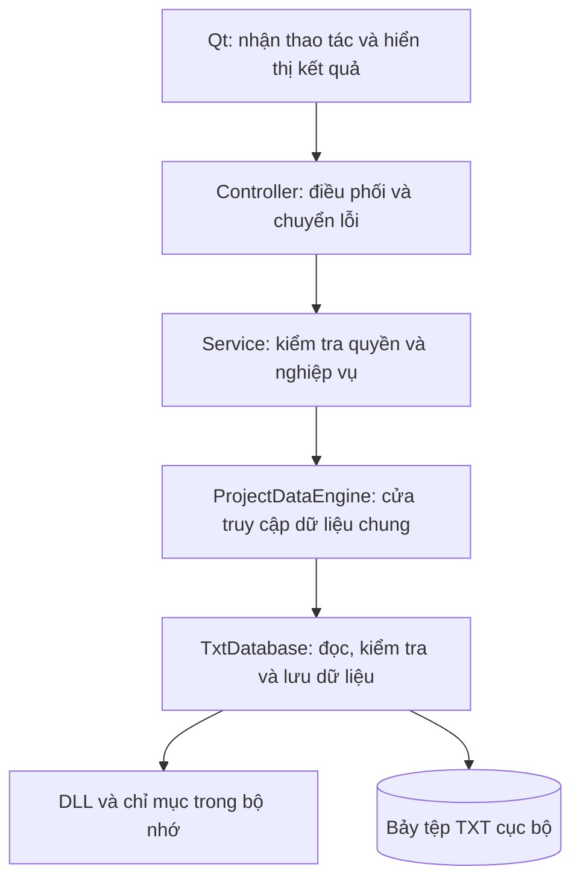
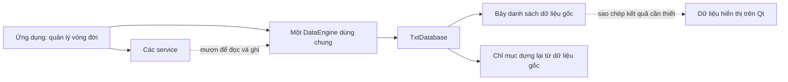
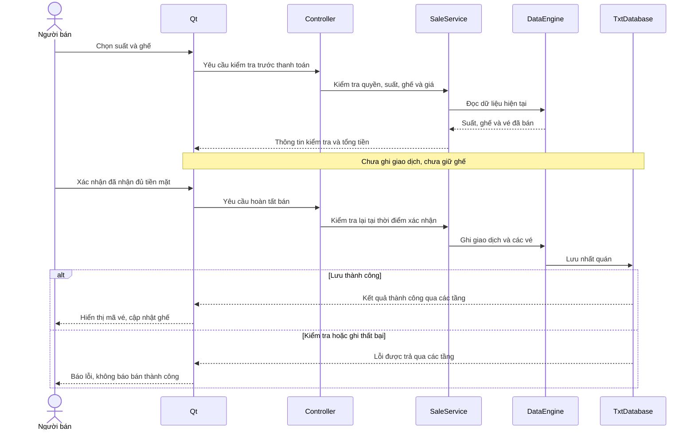

# 03. Kiến trúc và quyền sở hữu

## 1. Đường phụ thuộc

**Vì sao không để màn hình đọc file?** Nếu màn hình bán vé và báo cáo tự
đọc theo hai cách khác nhau, chúng có thể hiểu khác nhau về giao dịch đã
thanh toán. Khi đổi định dạng file phải sửa nhiều nơi. Thiết kế một cửa dữ
liệu chung giữ việc đọc/lưu nhất quán; service quyết định dữ liệu ấy được
dùng thế nào trong từng nghiệp vụ.

Ví dụ: Qt biết khách chọn A01, nhưng không được tự kết luận A01 còn trống.
Service kiểm tra suất, quyền và vé đã bán; tầng lưu trữ kiểm tra quan hệ và
ghi đủ dữ liệu; cuối cùng Qt mới hiển thị kết quả.

Ban đầu tham khảo cách chia trách nhiệm của Spring Boot, nhưng bản hiện tại
đã bỏ cây `main/cpp/com/cinema` và các layer rỗng. Đây là ứng dụng C++/Qt,
không phải HTTP backend hay JVM. Các thành phần nằm trực tiếp trong `src/`:

| Folder | Trách nhiệm | Không được làm |
|---|---|---|
| `entity/`, `enums/` | Model/enum có kiểu, ID và trạng thái | Đọc TXT/hiển thị dialog |
| `repository/` | API dữ liệu chung, query/search/aggregate/get/commit | Kiểm tra vai trò dựa nút Qt |
| `repository/txt/` | Format, index, quan hệ, persistence/recovery | Nhận input trực tiếp từ widget |
| `service/` | Quyền, lịch, bán, báo cáo; DTO | Đọc mỗi file riêng tại mỗi service |
| `controller/` | Chuyển lỗi/exception thành kết quả hiển thị | Tự tính doanh thu hay write TXT |
| `ui/` | Widget, form, selection, signal/slot | Giả thành công nếu service trả false |
| `util/` | Timestamp format/parse/tính thời lượng chung | Lưu domain records |
| `DataStructures/` | Collection và chỉ mục tự xây dựng | Quyết định nghiệp vụ |
| `tests/` ở gốc dự án | Assert-based checks, temporary fixtures | Ghi vào data thật |

Không có thêm factory/interface/service cho từng phép toán nhỏ. Mỗi service
nghiệp vụ có cặp `.h/.cpp` riêng trong `src/service/`, request/result nằm cạnh
service sử dụng. Một `ServiceSupport.h/.cpp` giữ các hàm dùng chung, không
gom lại lớp service. Các trang vận hành hiện vẫn nằm trong OperationsPages.

## 2. Composition root và vòng đời

`CinemaApplication.cpp::main` tạo QApplication trước widget, áp theme, parse
CLI, lấy dataPath, giữ QLockFile rồi mở một ProjectDataEngine. Engine sống
đến hết main. AuthService tham chiếu engine. Film/Auditorium/Screening/Sale/
ReportService tham chiếu cùng engine và AuthService. Controller tham chiếu
service tương ứng. LoginDialog/MainWindow dùng controller, không sở hữu nó.

Các biến stack bị hủy theo thứ tự ngược khai báo; window/dialog kết thúc
trước controller/service/engine. Nếu tạo service cục bộ trong một hàm rồi
trả window giữ tham chiếu service đó, sẽ dangling reference — bản hiện tại
không làm như vậy. Dependency injection ở đây là truyền reference vào
constructor, không cần container/runtime reflection.

## 3. Ai giữ dữ liệu?

Mũi tên liền ở đây mô tả phần quản lý/sở hữu; mũi tên nét đứt mô tả việc
sử dụng hoặc chuyển bản sao. Chỉ có **một nguồn dữ liệu gốc trong RAM**.
Chỉ mục giúp tìm; dữ liệu hiển thị giúp đọc; cả hai không là kho nghiệp vụ
độc lập. Vì vậy sửa một ô trên màn hình không tự sửa dữ liệu đã lưu.

- `TxtDatabase` **sở hữu** bảy `DoublyLinkedList<Entity>` và các index.
- DLL sở hữu Node (`new`, `delete` trong list); mỗi Node sở hữu data theo value.
- Hash index giữ **số thứ tự int**, không sở hữu model. Aggregate hash giữ
  Node pointer tạm của result list, chỉ tồn tại trong hàm aggregate.
- BST giữ **bản sao Screening**, không là nguồn chân lý thứ hai; dựng lại.
- Engine get/query trả **bản sao** ra ngoài; UI không giữ pointer vào Node
  nguồn. `const` của các container cũ chưa thực sự const-correct (có hàm
  trả pointer có thể sửa), nên biên engine copy là quan trọng.
- QWidget parent sở hữu QObject con. Các `new QLabel(parent)` là hợp lý:
  Qt giải phóng con khi parent hủy. Controller/service reference không được
  Qt giải phóng vì không phải widget con.

Nếu mutation thất bại, danh sách cũ được copy trả lại và index dựng lại.
Không giữ pointer cũ qua mutation/reload/clear; những pointer đó có thể mất
hiệu lực. DTO làm snapshot cho màn hình, không cung cấp quyền sửa database.

## 4. Một lần bán cụ thể

Các mũi tên trả về rút gọn đường đi qua engine/service/controller. Nhánh lỗi
kiểm tra có thể dừng ngay tại service mà chưa gọi lưu trữ. Điều quan trọng
là **xem trước và xác nhận là hai thời điểm khác nhau**, không phải hai lần
bán vé. Một bản xem trước hợp lệ không bảo đảm lần xác nhận sau cũng hợp lệ.

Preview không giữ ghế; phải kiểm tra lần nữa lúc sell vì quyền/time/dữ liệu
có thể đổi trong lúc người dùng xem dialog. UI không gửi sellerId/time;
service lấy từ session/clock để không tin input ngoài.

## 5. Một lần tra cứu / báo cáo

FilmService::list dùng generic engine search (name/id) rồi query/filter.
ScreeningService::list dùng QuerySpec, sort theo giờ và join film/room thành
ScreeningDetails. SaleService::lookup lấy ticket/transaction, query các vé,
join film/room/seat/user thành SaleDetails. ReportService dựng AggregateSpec
với where, groupBy filmId, value ticket.unitPrice; engine không hiểu “doanh
thu”, service hiểu và chọn điều kiện Completed/Confirmed.

Thay format TXT chỉ sửa TxtDatabase/parser/writer/tests tài liệu format.
Thay rule bán ở service, không copy rule sang mọi page. Thêm một entity vẫn
cần model, bảng/serializer/index và overload recordsFor; đây là persistence
có kiểu, không là DBMS tự đọc schema và thực thi SQL tùy ý.

## 6. Exception và bool

Mutation thường `bool` + `std::string& error`. Read cần quyền có thể throw
runtime_error; query/aggregate/search reject input bằng exception. Controller
bắt `std::exception`, clear result, trả false và error. Mã lỗi không chứa
password/hash. Không nuốt lỗi ghi để vẫn tạo session hoặc receipt thành công.

Không hứa recover mọi exception: lỗi `bad_alloc` giữa sửa graph nằm ngoài
bảo đảm rollback bool hiện tại; OOM cần dừng ứng dụng và mở lại/kiểm dữ liệu.
MVP một luồng GUI, không có worker/thread pool hoặc race giữa các writer;
QLockFile entrypoint thực thi giới hạn một app trên bộ dữ liệu.
