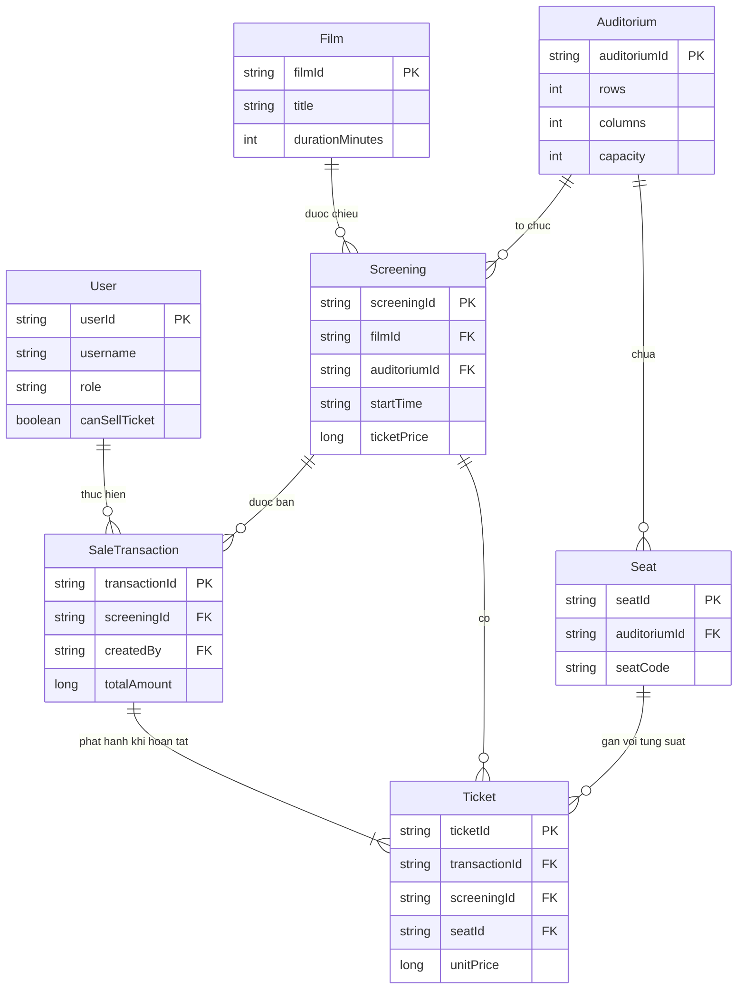
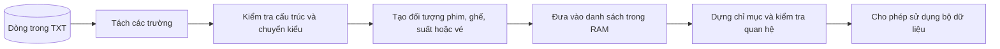
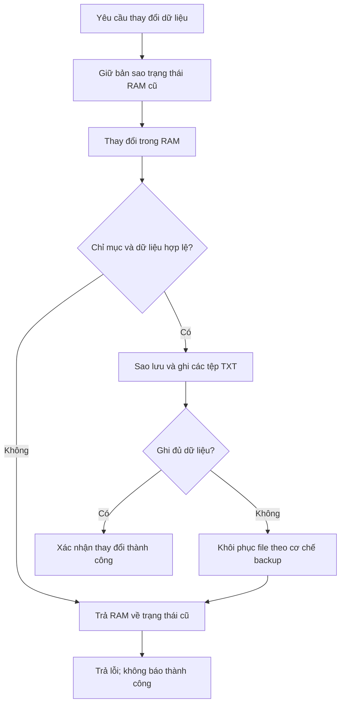
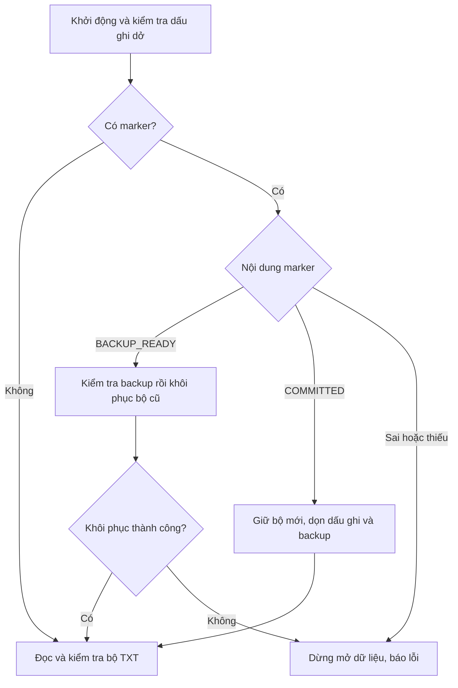
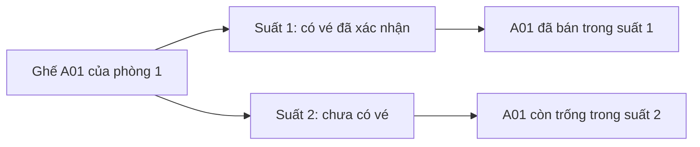

# 04. Mô hình dữ liệu, TXT và toàn vẹn

## 1. Bảy entity và quan hệ



`SaleTransaction ||--|{ Ticket` mô tả giao dịch **hoàn tất** phải có vé; model
có enum Pending/Failed, nhưng luồng bán MVP không persist preview Pending.
Diagram là mô hình khái niệm, không là bảng SQL với FK do DBMS thực thi.

**Cách đọc:** một phim có nhiều suất; một phòng có nhiều ghế và nhiều suất;
một giao dịch bán nhiều vé; một vé chỉ ứng với một ghế trong một suất.
PK là mã định danh, FK là mã tham chiếu. Kiểu trên sơ đồ rút gọn để dễ đọc;
kiểu C++ và toàn bộ trường nằm trong bảng bên dưới.

**Vì sao tách giao dịch và vé?** Khách trả tiền một lần để mua A01 và A02:
cần một giao dịch ghi người bán/thời điểm/tổng tiền, nhưng cần hai vé để biết
từng chỗ ngồi. Gộp thành một bản ghi duy nhất sẽ khó tra từng vé; tạo hai
giao dịch lại làm mất ý nghĩa của một lần thanh toán.

| File/model | Trường theo thứ tự header | Kiểu trong C++ |
|---|---|---|
| users/User | user_id,username,password_value,display_name,role,can_sell_ticket,status | string×4, UserRole, bool, RecordStatus |
| films/Film | film_id,title,duration_minutes,age_rating,status | string,string,int,string,RecordStatus |
| auditoriums/Auditorium | auditorium_id,name,rows,columns,capacity,status | string×2,int×3,RecordStatus |
| seats/Seat | seat_id,auditorium_id,seat_code,row_label,seat_number,seat_type,status | string×4,int,SeatType,RecordStatus |
| screenings/Screening | screening_id,film_id,auditorium_id,start_time,end_time,room_available_until,ticket_price,status | string×6,long long,ScreeningStatus |
| transactions/SaleTransaction | transaction_id,screening_id,created_at,created_by,total_amount,payment_status,status | string×4,long long,PaymentStatus,TransactionStatus |
| tickets/Ticket | ticket_id,transaction_id,screening_id,seat_id,unit_price,status | string×4,long long,TicketStatus |

Tiền là số nguyên VND `long long`, không float; tránh sai làm tròn và có
kiểm tra tràn tổng. ID dùng string, không đổi thành số vì có prefix và số 0.
Model `operator==` so ID, không so mọi thuộc tính; dùng để nhận diện cùng
record. Đây không phải chứng minh hai snapshot có nội dung giống nhau.

Trạng thái hợp lệ: ACTIVE/INACTIVE; MANAGER/SELLER; STANDARD; DRAFT/OPEN/
CLOSED/COMPLETED; UNCONFIRMED/CONFIRMED; PENDING/COMPLETED/FAILED; ISSUED.
Không dùng tự do mọi chuỗi trong enum parser.

## 2. Đọc dòng thành biến có kiểu



File chỉ chứa chữ; model cung cấp ý nghĩa và kiểu. Ví dụ thời lượng “90”
phải thành một số phút hợp lệ, không được giữ nguyên rồi đem cộng như chuỗi.
Đọc đúng từng dòng vẫn chưa đủ: một vé có thể có cấu trúc đúng nhưng trỏ
đến một ghế không tồn tại. Vì vậy phải kiểm cả quan hệ trước khi mở app.

Ví dụ TXT (header phim đúng như bảng):

```text
F001|Film A|90|T13|ACTIVE
```

`readRows` đọc `std::getline`, chuẩn hóa CR cuối dòng, `splitLine` tạo DLL
field. Kiểm tra số field; `fieldAt` lấy phần tử. Lambda parser cho Film:
gán filmId/title/ageRating từ string, `parseInt` chuyển duration bằng stoi và
kiểm tra consumed==text.size(), `parseRecordStatus` chuyển ACTIVE→enum.
Sau parse thành công `filmRecords.addLast(value)` copy Film vào Node.
Không có phép cast toàn bộ dòng string sang struct và không dùng memcpy
bytes TXT vào model (string có bộ nhớ/representation riêng).

`90abc` bị từ chối vì còn ký tự; ngoài int bị từ chối bởi exception được
parser bắt. `|` hoặc newline trong field bị reject vì format không có escape.
UTF-8 tên phim được lưu nguyên byte, khác với search ASCII không bỏ dấu.
Header phải khớp chính xác, không tự reorder cột/đoán schema.

File tồn tại 0 byte không có header → lỗi; header-only là bảng rỗng **có
cấu trúc** nhưng còn phải phù hợp graph. Ví dụ transactions có COMPLETED
mà tickets header-only thì lỗi. Load thất bại clear records, không trả một
nửa dataset hợp lệ để tiếp tục bán.

## 3. Index và lookup

Sau đọc các bảng: `rebuildIndexes` tạo hash ID→index. User có namespace
`id:` và `username:` trên cùng hash để tránh key khác loại va chạm logic.
Duplicate insert thất bại → lỗi ID/username. Unique seatCode kiểm trong
phòng, vị trí `(room,row,number)` cũng unique. BST comparator `(startTime,
screeningId)` cho phép hai phòng bắt đầu cùng giờ có hai mã khác nhau.

**Quan trọng cho vấn đáp:** hash tìm số thứ tự trung bình O(1), nhưng gọi
DLL.getAt(index) vẫn O(n). Vì vậy lookup model hiện tại **không thể tuyên bố
O(1)** đầu-cuối. Dựng index dùng vòng for/getAt cũng có phần O(n²). BST được
dựng nhưng đường query/range/filter thực tế chưa duyệt nó. Mọi index có thể
xây lại từ TXT; không lưu pointer hoặc index position vào file.

## 4. Validate graph

1. User/Film/Room có trường bắt buộc, enum đúng; duration>0.
2. Room rectangular: rows 1..26, columns>0, capacity=rows×columns không tràn,
   có đủ ghế vật lý. Seat thuộc đúng room, label A-Z đúng bounds, number đúng
   columns, STANDARD, status hợp lệ và vị trí/code duy nhất.
3. Screening có FK film/room, tiền dương, timestamp hợp lệ; end từ duration,
   roomAvailableUntil ít nhất end+15 phút, không chồng cùng room.
4. Transaction có FK screening/user; timestamp trước start, tiền không âm;
   Completed iff Confirmed. Giao dịch hoàn tất có ít nhất một vé.
5. Ticket ISSUED có FK transaction/screening/seat, same screening với
   transaction, seat thuộc room, giá dương; không cặp suất-ghế trùng.
6. Tổng giá tickets của transaction bằng totalAmount, chống overflow.

Validate chạy lúc load **và** trước save. Khác nhau giữa historical record
và tạo mới: phim/phòng có thể hiện INACTIVE sau lịch quá khứ, không vì thế
xóa vé cũ; thao tác tạo/bán lại yêu cầu ACTIVE ở service.

## 5. Thời gian và lịch

Format cố định `YYYY-MM-DD HH:mm:ss`, local time cùng máy. parseTimestamp
dùng get_time → mktime → localtime → format roundtrip. Nhờ roundtrip, ngày
31/02 bị reject dù mktime có thể tự đẩy sang tháng sau. Chuỗi cố định hợp lệ
so từ điển cho cùng timezone giữ thứ tự thời gian; không áp cho chuỗi tự do.
App không xử lý timezone chuyển vùng/multi-host; đồng hồ sai ảnh hưởng rule.

Với phim 90 phút start 19:00:00: end 20:30:00, room ready 20:45:00.
Hai khoảng chồng khi `a.start < b.available && b.start < a.available`.
Biên 20:45:00 hợp lệ, 20:44:59 không; dùng khoảng nửa mở nên không cấm hai
suất chạm biên. Create sinh nghỉ đúng 15, loader chấp nhận nghỉ dài hơn.

## 6. Ghi một mutation và rollback



**Vì sao vừa có bản sao RAM vừa có backup file?** Bản sao RAM phục hồi trạng
thái đang chạy; backup file phục hồi dữ liệu cho lần mở sau. Chỉ khôi phục
một phía có thể khiến màn hình hiện một kết quả nhưng file lưu kết quả khác.
Nếu khôi phục file thất bại, app giữ bằng chứng phục hồi và báo lỗi; không
được hiểu sơ đồ này là luôn sửa được mọi hỏng hóc của ổ đĩa.

`persistMutation`: deep copy bảy DLL → chạy lambda mutation → rebuild index →
validate graph → saveAll. Nếu false: trả lại các DLL cũ, rebuild index, trả
false và giữ error. Chi phí copy/ghi toàn bộ dataset là giới hạn chủ ý MVP,
không phải update in-place vài byte hay engine transaction full SQL.

`saveAll` làm thứ tự:

1. Validate; xử lý marker lần ghi trước nếu có.
2. Tạo backup bảy file hiện có, lưu bit file nào từng tồn tại.
3. Ghi `write_pending.txt` bằng temp+rename với `BACKUP_READY` và bảy bit.
4. Mỗi TXT: ghi `.tmp`, flush, close, kiểm tra stream, rename thay file.
5. Nếu bước ghi lỗi: recovery backup và trả false; không success receipt.
6. Nếu đủ bảy bảng: đổi marker thành `COMMITTED` (kèm bảy bit).
7. Xóa marker/backups. Cleanup sau committed lỗi không đảo giao dịch đã lưu.

Rename chỉ thay nguyên **một file**, không atomically thay bảy file cùng lúc.
Backup+marker giải quyết lỡ ghi một phần trong các ca đã kiểm chứng.
Không có fsync file/directory; không cam kết mất điện/ổ hỏng giữa mọi lệnh.

## 7. Recovery và journal



Marker là “ghi chú lần lưu đã tới đâu”, không là dữ liệu doanh thu. Nhờ nó,
app không chọn ngẫu nhiên vài file mới trộn với vài file cũ. Bộ dữ liệu vẫn
phải được kiểm tra sau phục hồi; có marker không tự chứng minh vé hợp lệ.

Khi open thấy BACKUP_READY: xác minh đủ backups cần thiết trước khi restore;
copy lại file cũ, xóa file trước đó không có; giữ backup nếu khôi phục lỗi.
COMMITTED: dùng bộ mới, dọn marker/backup rồi load/validate. Marker sai/thừa/
thiếu dữ liệu báo lỗi, không đoán để tiếp tục.

Sale có `sale_journal.txt`: PREPARED trước persist; COMMITTED sau success.
Journal là vết thao tác, **không phải** WAL đầy đủ để replay từng record.
Nếu ghi dòng COMMITTED journal cuối thất bại sau bảng đã commit, transaction
vẫn có thật; source of truth là bảng và marker. Không đổi thành “bán thất
bại” rồi cho người dùng bán lại cùng ghế. Journal chưa rotate/compact.

Thiếu tất cả bảy bảng nhưng còn backup hoặc journal không được coi là thư
mục mới. Trống hoàn toàn mới tạo header. Mất một bảng không tự tạo lại.
Backup dùng cho recovery ngắn hạn và dọn sau commit, không thay backup
định kỳ lưu trữ lâu dài.

## 8. Map ghế và doanh thu không là bảng thứ tám



Nếu lưu một cờ “đã bán” ngay trên ghế A01, app sẽ khóa A01 cho mọi suất.
Thiết kế lấy tình trạng từ vé theo **suất + ghế** tránh lỗi ấy, đồng thời
giữ map ghế, tra cứu và báo cáo dựa trên cùng một nguồn xác nhận bán.

`seatMapForScreening`: matrix '-' → ghế vật lý ACTIVE thành 'O' → ticket
của completed/confirmed transaction thành 'X'. Cùng Seat ở show khác vẫn O
nếu chưa có ticket của show đó. Không sửa Seat.status thành SOLD: Seat.status
là khai thác vật lý ACTIVE/INACTIVE, không là occupancy của mọi show.

Revenue được aggregate ticket.unitPrice sau join trạng thái transaction.
Không persist một total revenue riêng rồi phải đồng bộ nó khi lỗi ghi.
Occupancy=sold/capacity×100, inactive seat vẫn thuộc capacity; vì vậy
`availableSeats` của DTO là capacity-sold vật lý, **không** là số O bán được.
