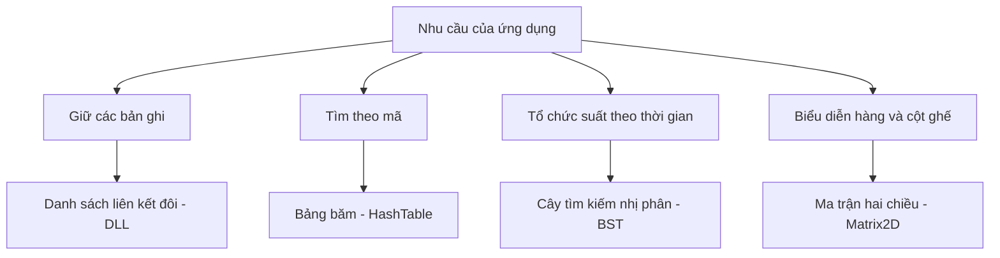
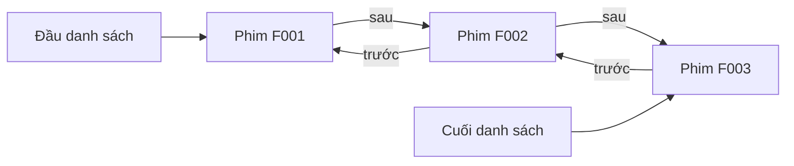
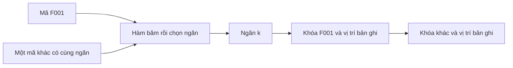
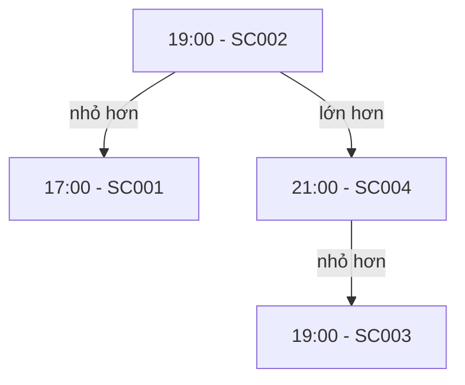
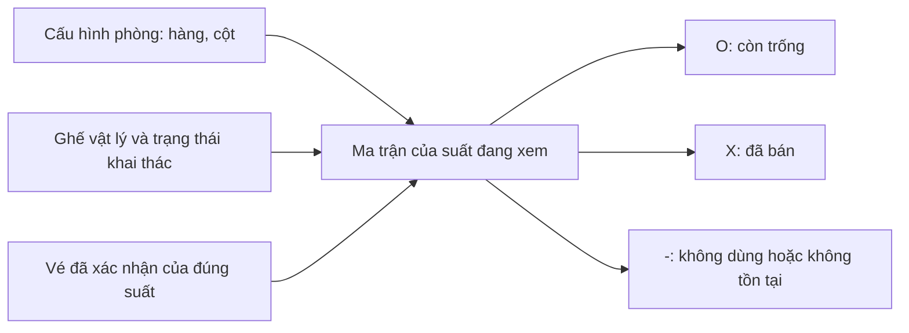
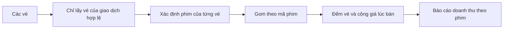

# 05. Vì sao chọn các cấu trúc dữ liệu này?

## 1. Bài toán trước, cấu trúc sau

Ứng dụng cần giữ nhiều bản ghi, tìm theo mã, xử lý thứ tự thời gian và vẽ
ghế theo hàng/cột. Không có một cấu trúc tối ưu cho tất cả. Theo yêu cầu bài
tập, các collection nghiệp vụ dùng thư viện tự xây dựng trong `src/DataStructures/`.

Sơ đồ mô tả vai trò, không có nghĩa mọi truy vấn đã tận dụng mọi cấu trúc.
Đặc biệt, BST thời gian hiện được dựng nhưng bộ lọc thông thường vẫn duyệt
danh sách. Cần phân biệt **có cài đặt** và **đang được sử dụng để tăng tốc**.

## 2. DLL: nơi chứa dữ liệu gốc trong RAM

Mỗi phim, ghế hoặc vé nằm trong một nút. Nút biết nút trước và nút sau, nên
danh sách có thể đi hai chiều và thêm cuối mà không phải dịch mọi phần tử.

**Vì sao phù hợp?** Khi đọc TXT, app nhận từng bản ghi rồi thêm vào cuối;
khi lọc, app đi lần lượt qua các bản ghi. DLL phù hợp với cách xử lý tuần tự
đó và đáp ứng yêu cầu tự cài cấu trúc dữ liệu.

**Đánh đổi:** muốn lấy phần tử thứ 500 phải đi qua liên kết, không thể nhảy
trực tiếp như mảng. Thêm đầu/cuối O(1); duyệt hoặc tìm theo nội dung O(n).
Lặp nhiều lần theo vị trí có thể thành O(n²), dù nhìn bên ngoài chỉ thấy một
vòng lặp. Đây là giới hạn thực tế, không gọi DLL là luôn nhanh hơn mảng.

**Vì sao sao chép sâu?** Hai danh sách độc lập phải có hai bộ nút độc lập.
Nếu chỉ sao địa chỉ nút, sửa/xóa một danh sách sẽ làm danh sách kia hỏng;
hai bên còn có thể cùng giải phóng một vùng nhớ. Bản sao dùng trong rollback
phải thật sự giữ được dữ liệu cũ.

## 3. HashTable: tra mục lục bằng mã

Bảng băm giống mục lục: chuyển mã thành một ngăn, rồi tìm khóa đúng trong
ngăn đó. Nhiều mã có thể vào cùng ngăn; điều này bình thường, không có nghĩa
hai mã là một.

Ví dụ collision ở đây là minh họa nguyên lý, không khẳng định hai mã cụ thể
luôn băm vào cùng ngăn. Các entry trong ngăn được nối bằng DLL. Tìm kiếm
vẫn so sánh **khóa đầy đủ**, không chỉ so kết quả băm.

**Vì sao dùng?** Phim, suất, vé và tài khoản đều có mã định danh. Chỉ mục
giúp tìm vị trí record và phát hiện mã trùng khi nạp dữ liệu.

**Giới hạn cần trả lời đúng:** hash hiện giữ mã → số thứ tự trong DLL.
Tìm số thứ tự có thể nhanh, nhưng lấy record theo số thứ tự vẫn phải duyệt
DLL. Không được kết luận toàn bộ lookup là O(1). Bảng còn dùng số ngăn cố
định, chưa tự mở rộng khi dữ liệu tăng.

Hàm băm của bảng này phục vụ tìm kiếm, không phục vụ mật khẩu. Mật khẩu
dùng yescrypt riêng; hai khái niệm đều có chữ “băm” nhưng mục đích khác nhau.

## 4. BST: tổ chức theo một thứ tự

Cây đặt khóa nhỏ hơn ở trái, lớn hơn ở phải. Với suất chiếu, thứ tự là giờ
bắt đầu rồi mã suất. Hai phòng có thể chiếu cùng giờ, nên chỉ dùng giờ làm
khóa sẽ nhầm một suất hợp lệ là trùng.

SC003 có cùng giờ với SC002 nhưng mã lớn hơn nên vẫn phân biệt được. Đây
là cây minh họa quy tắc so sánh, không phải ảnh chụp cây dữ liệu demo.

**Đánh đổi:** cây hiện không tự cân bằng. Nếu chèn theo thứ tự tăng dần,
cây có thể dài như một danh sách: tìm kiếm O(n), không bảo đảm O(log n).
Khi nói về sản phẩm hiện tại, phải nói thêm rằng query vẫn duyệt DLL;
chỉ mục thời gian chưa được khai thác để làm truy vấn khoảng hiệu quả hơn.

## 5. Matrix2D: chuyển dữ liệu ghế thành sơ đồ dễ hiểu

Ma trận trả lời “ô hàng A, cột 2 hiện ở trạng thái nào?”; nó không là kho
vé hoặc nguồn dữ liệu độc lập. App dựng lại ma trận từ phòng, ghế và các vé
của suất đang chọn.

**Vì sao không lưu ma trận vào một file nữa?** Khi đã có vé, ma trận có thể
suy ra. Lưu cả hai sẽ phải cập nhật đồng thời và dễ xảy ra “có vé nhưng ghế
vẫn trống”. Dựng lại giúp tránh thêm một nguồn cần đối soát.

Lấy/đặt một ô O(1); dựng hoặc đếm cả ma trận O(hàng × cột). Thư viện sở hữu
bộ nhớ các hàng; bản sao cần bộ nhớ riêng, không chia sẻ địa chỉ rồi cùng xóa.

## 6. Query, search và group khác nhau thế nào?

| Nhu cầu | Cách hiểu | Cách làm hiện tại |
|---|---|---|
| Query | Lấy bản ghi đúng điều kiện | Duyệt, lọc, có thể sắp xếp và giới hạn |
| Search | Tìm theo tên hoặc mã | So khớp toàn bộ, đầu chuỗi hoặc đoạn chứa |
| Aggregate/group | Gom nhiều bản ghi để đếm/cộng | HashTable xác định nhóm, DLL giữ kết quả |

Service chọn **điều kiện có ý nghĩa nghiệp vụ**; engine thực hiện phép lọc/
gom chung. Vì vậy không cần mỗi màn hình một bộ đọc TXT và một thuật toán
GROUP BY riêng. Tuy nhiên “query chung” không đồng nghĩa mọi nghiệp vụ dùng
cùng một điều kiện hoặc bỏ kiểm tra quyền.

Search hiện chưa có Trie, n-gram hoặc fuzzy search. Việc tìm tiền tố đang
là so chuỗi, không phải đi trên cây tiền tố. Chưa có bỏ dấu tiếng Việt.
Sắp xếp kết quả query dùng insertion sort O(m²), phù hợp quy mô nhỏ hơn là
tuyên bố tối ưu cho dữ liệu lớn.

## 7. Cấu trúc có trong thư viện nhưng chưa nối app

Stack theo nguyên tắc vào sau ra trước; Queue vào trước ra trước; Graph mô
tả các đỉnh và cạnh, có BFS/DFS. Chúng có trong thư viện, nhưng không tham
gia luồng bán vé hiện tại. Không giải thích thành “undo bán vé bằng stack”
hoặc “tìm phòng bằng BFS” vì sản phẩm chưa có các thiết kế đó.

## 8. Khi nào cần nâng cấp?

Đo trên dữ liệu thật trước. Nếu lookup là nút thắt, đổi cách index tới record
và kiểm soát vòng đời record; nếu sort chậm, đổi thuật toán; nếu cần tra cứu
theo khoảng thời gian lớn, khai thác cây cân bằng phù hợp. Không thêm cấu
trúc chỉ để sơ đồ trông nhiều thành phần hơn.
