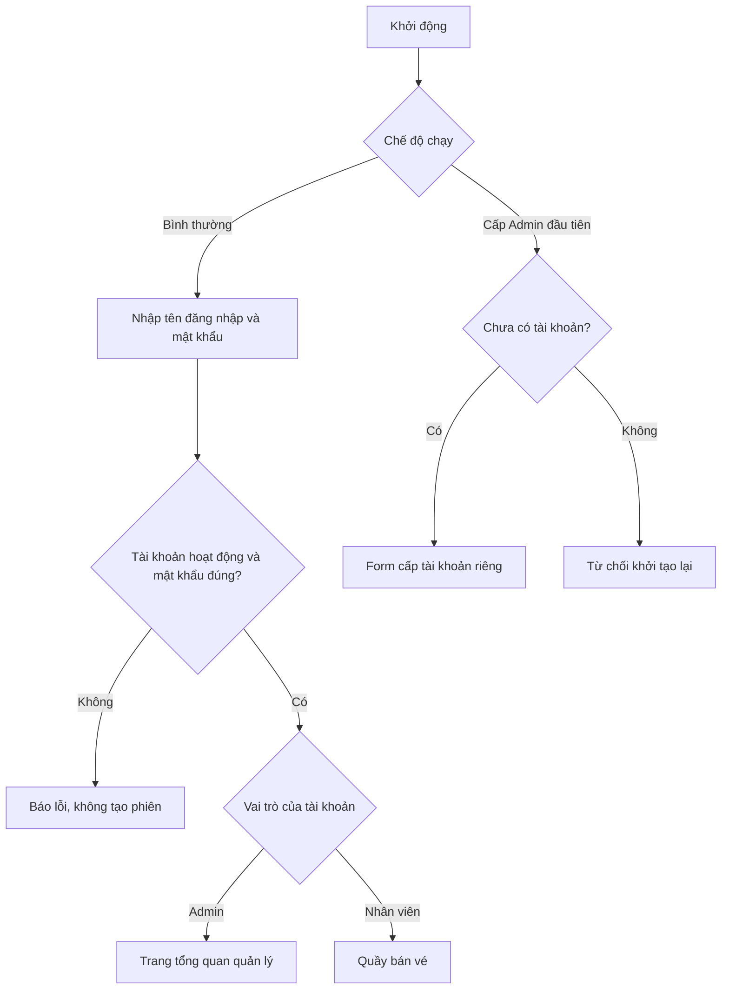
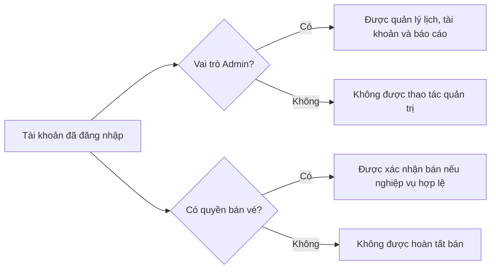
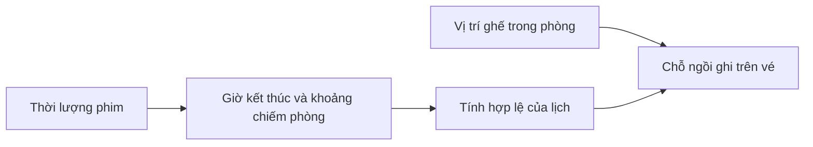
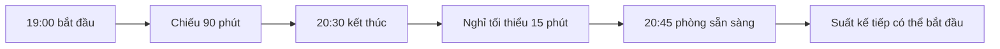
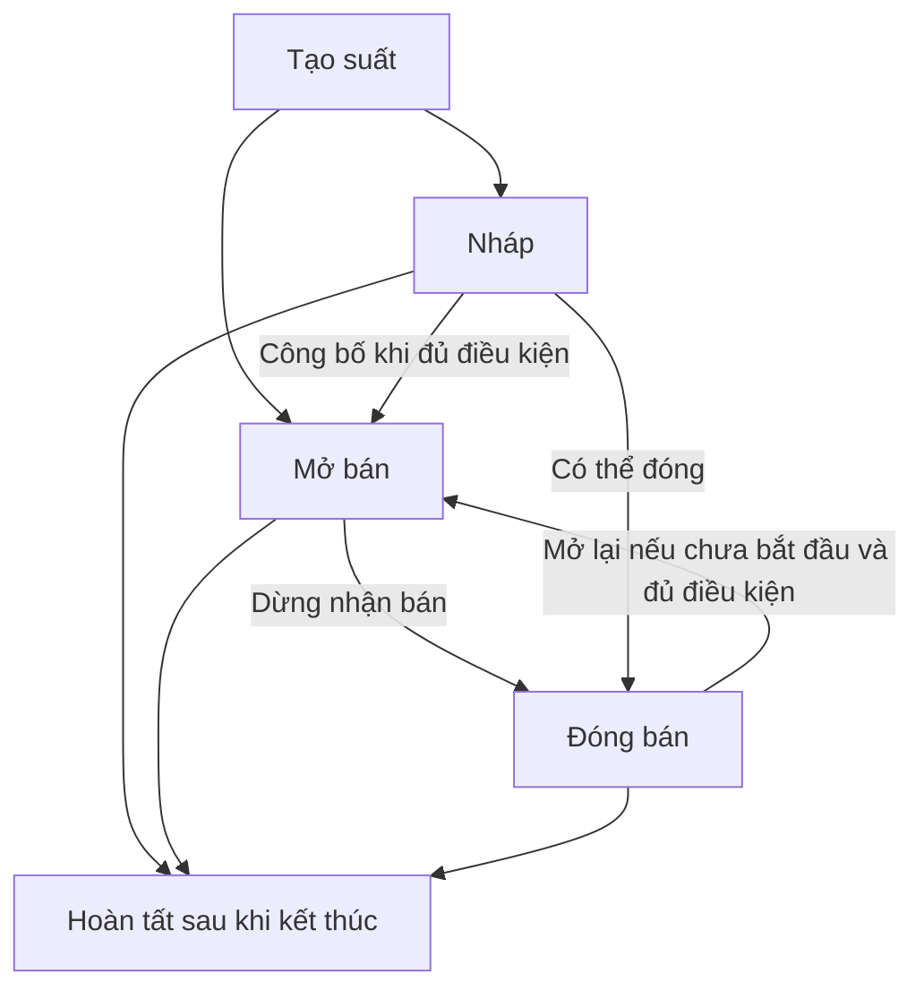
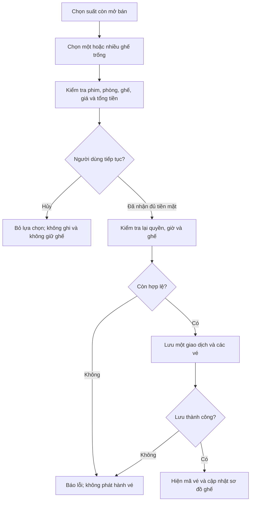
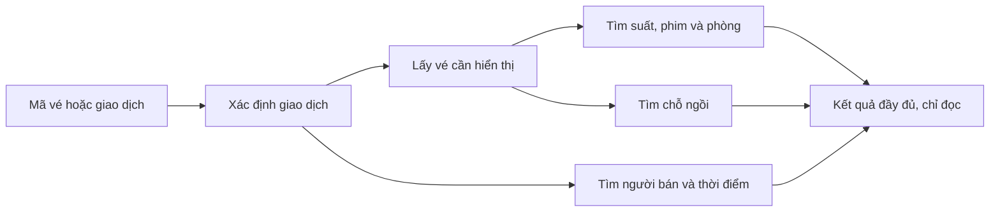
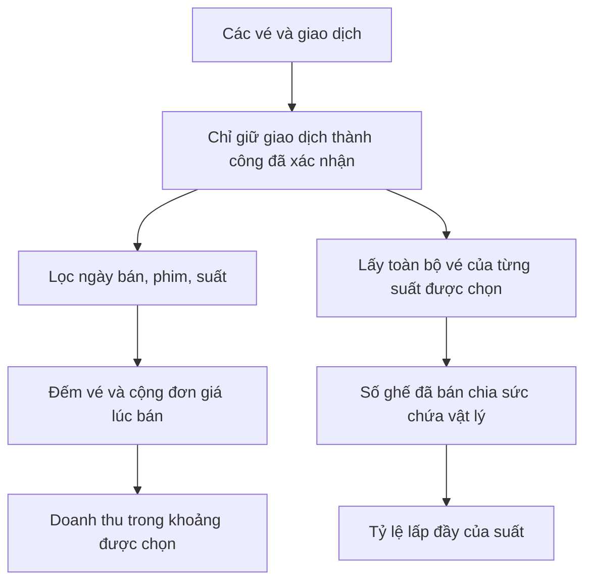

# 06. Ý nghĩa thiết kế các luồng nghiệp vụ

## 1. Màn hình và service giải quyết hai việc khác nhau

Qt giúp người dùng nhập liệu và hiểu kết quả. Service quyết định yêu cầu có
được phép thực hiện không. Controller nối hai bên và chuyển lỗi thành kết
quả mà màn hình hiển thị được. Không dùng việc ẩn nút để thay kiểm tra quyền.

| Phần nghiệp vụ | Trách nhiệm chính | Vì sao tách riêng? |
|---|---|---|
| AuthService | Phiên đăng nhập, tài khoản, vai trò và quyền | Các nghiệp vụ dùng cùng một cách xác định người dùng |
| FilmService | Phim và điều kiện cập nhật | Không làm lịch hiện có mất hợp lệ |
| AuditoriumService | Phòng, sơ đồ ghế và điều kiện cập nhật | Không làm vé/lịch trỏ tới ghế đã thay đổi |
| ScreeningService | Lập lịch, giá và trạng thái suất | Một nơi kiểm tra giờ chiếu và điều kiện mở bán |
| SaleService | Kiểm tra trước bán, thanh toán, vé và tra cứu | Một nơi quyết định thế nào là một lần bán hợp lệ |
| ReportService | Doanh thu, số vé và tỷ lệ lấp đầy | Mọi báo cáo dùng cùng định nghĩa số liệu |

## 2. Đăng nhập khác cấp tài khoản

**Lý do:** đăng nhập là chứng minh mình là một tài khoản đã được cấp, không
phải đăng ký một danh tính mới. Do đó không hỏi tên hiển thị hoặc cho chọn
vai trò trên màn hình đăng nhập. Tên hiển thị thuộc bước tạo/quản lý tài
khoản. Cấp Admin đầu tiên là chế độ triển khai riêng, không tự xuất hiện
thay cho login khi mật khẩu sai.

Sau đăng nhập, app giữ định danh người dùng. Khi thực hiện nghiệp vụ, app
đọc lại quyền hiện tại; không tin mãi một bản sao quyền được lấy lúc login.
Mật khẩu mới được băm yescrypt, bảng tài khoản không hiển thị hash.

## 3. Vì sao vai trò và quyền bán tách nhau?

Admin không mặc nhiên có quyền thu tiền/bán vé. Nhân viên cũng có thể bị
thu hồi quyền bán. Hai nhánh độc lập đáp ứng đúng yêu cầu quyền bán riêng,
không đồng nhất “Manager” với “được làm mọi việc”.

**Ví dụ cần hiểu:** nhân viên mở màn hình kiểm tra tiền, rồi quyền bán bị
thu hồi. Lần bấm xác nhận phải thất bại vì service kiểm tra lại, dù dialog
vẫn đang mở và nút chưa kịp bị ẩn.

## 4. Danh mục không chỉ là thêm/sửa bản ghi

Phim và phòng là dữ liệu nền cho lịch; lịch lại là dữ liệu nền cho vé. Thay
đổi ở đầu chuỗi có thể làm dữ liệu cuối chuỗi mất ý nghĩa.

Vì vậy không cho sửa thời lượng hoặc layout khi đã có lịch theo cách tùy
ý. Không ngừng phim/phòng khi còn lịch tương lai bị ảnh hưởng. Đổi tên mô
tả khác với đổi cấu hình làm thay đổi vị trí/giờ mà vé đã dựa vào.

Tạo mới và cập nhật là hai ý định khác nhau: tạo mã đã tồn tại phải báo
trùng, sửa mã không tồn tại phải báo không thấy; không tự biến yêu cầu này
thành yêu cầu kia. Tạo phòng tính sức chứa từ hàng/cột, tự sinh ghế; sửa
cùng kích thước giữ mã và trạng thái ghế cũ.

## 5. Lập lịch: phòng bận lâu hơn thời lượng phim

Start 20:44:59 cùng phòng vẫn xung đột; 20:45:00 thì không. Hai phòng khác
nhau có thể chiếu cùng giờ. Phần mềm tính giờ kết thúc, không để người nhập
tự khai một end ngắn hơn để lách lịch. Suất mới cần phim/phòng hoạt động,
giá dương, giờ hợp lệ trong tương lai và có ghế đang khai thác.

### Trạng thái phục vụ mục đích gì?

Đây là các chuyển trạng thái có ý nghĩa của luồng hiện tại, bỏ qua thao tác
đặt lại cùng trạng thái. Nháp chưa được bán; đóng bán không xóa vé và không
có nghĩa hủy lịch/giải phóng phòng; hoàn tất không được mở lại. Tại/sau giờ
bắt đầu, service luôn chặn bán dù nhãn trạng thái chưa đổi khỏi “Mở bán”.

## 6. Bán vé: chỉ xác nhận cuối mới thay đổi dữ liệu

**Vì sao phải kiểm tra hai lần?** Lần đầu giúp người bán thông báo đúng giá;
lần cuối bảo đảm điều kiện vẫn đúng khi thật sự hoàn tất. Người dùng có
thể chờ đến giờ chiếu hoặc bị thu hồi quyền trong lúc xem thông tin.

**Vì sao không giữ ghế khi chọn?** MVP không có đặt chỗ chưa trả tiền. Bỏ
lựa chọn hoặc đóng màn hình không được để lại ghế bị giữ trong dữ liệu.

**Vì sao lấy người bán/giờ/tổng từ service?** Màn hình chỉ gửi ý định chọn
suất và ghế. Nó không được tự khai người bán khác, lùi thời gian hoặc gửi
một tổng tiền tùy ý. Giá vé và tổng được tính theo dữ liệu đã kiểm tra.

Một lần mua hai ghế giá 80.000 VND tạo một giao dịch 160.000 VND và hai vé.
Vé giữ đơn giá lúc bán. Lỗi ghi không được hiện thông báo bán thành công;
luồng phục hồi dữ liệu được giải thích ở chương 04.

## 7. Tra cứu: ghép dữ liệu để trả lời câu hỏi nghiệp vụ

Tìm theo giao dịch trả tất cả vé của lần mua; tìm theo vé trả riêng vé đó.
Một vé vẫn hiển thị tổng giao dịch với nhãn rõ ràng, còn dòng vé có đơn giá
riêng. Không tìm thấy phải xóa kết quả cũ và báo lỗi, tránh tưởng dữ liệu
của lần tra trước là kết quả mới. Không có sửa/xóa tùy ý giao dịch đã chốt.

## 8. Báo cáo: định nghĩa số liệu trước khi cộng

Doanh thu theo khoảng thời gian là theo **ngày bán**, không phải ngày chiếu.
Chỉ vé của giao dịch hoàn tất và đã xác nhận tiền mặt mới được tính.

Hai nhánh trả lời hai câu hỏi khác nhau: “khoảng ngày này bán bao nhiêu?”
và “suất này đã lấp đầy bao nhiêu?”. Bảng lấp đầy không cắt theo ngày bán,
đúng nhãn trên giao diện. Phòng bốn ghế, một ghế ngừng khai thác, bán một
ghế: lấp đầy vẫn là 1/4 = 25%, không phải 1/3.

## 9. Thiết kế Qt để phục vụ đúng luồng

Điều hướng theo vai trò giúp không làm nhân viên rối bởi chức năng quản trị.
Các trang dùng chung controller/service, không có kho dữ liệu riêng cho mỗi
trang. Sau lưu thành công mới nạp lại bảng/map từ dữ liệu đã xác nhận.

Ghế hiển thị cả chữ “Trống”, “Đã bán”, “Không dùng”, không chỉ đổi màu. Mã
ghế thật gắn với ô hiển thị; không suy mã dữ liệu từ một đoạn chữ đã dịch.
Màn hình nhỏ có cuộn để người dùng vẫn tới được các nút; lỗi hiển thị gần
thao tác và không giữ kết quả cũ gây hiểu nhầm.

Qt hoạt động theo sự kiện: bấm nút gây một yêu cầu; lời đáp cập nhật giao
diện. Dialog kiểm tra tiền có thể chờ người dùng, nhưng chờ không tạo giao
dịch. Chi tiết vòng đời và sự kiện được giải thích ở chương 09.
