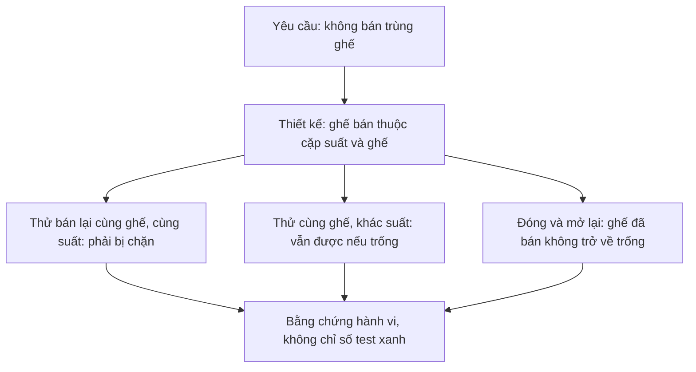

# 07. Kiểm chứng, nghiệm thu và giới hạn

## 1. Kết quả kiểm chứng 12/10/2026

Linux/Qt5 trên máy phát triển, dữ liệu test trong thư mục tạm, không sửa
tài khoản/TXT vận hành. Bộ CTest hiện có 16 cases (một số source chạy hai
cấu hình DPI). Không diễn giải là “16 test chứng minh mọi trạng thái”.



Ba ca này kiểm ba mặt khác nhau của cùng một thiết kế: tính duy nhất, phạm
vi của tính duy nhất và khả năng giữ dữ liệu. Chỉ thử nhánh thành công sẽ
bỏ sót các lỗi như mất vé khi mở lại hoặc khóa ghế cho mọi suất.

| Case CTest | Điều kiểm chứng chính |
|---|---|
| cms_core_check | DLL/hash/BST/matrix và model smoke |
| cms_storage_check | TXT đọc/ghi, ID/FK, sale persistence, rollback/recovery |
| cms_data_engine_check | Generic query/search/aggregate/get, reject input |
| cms_services_check | Auth, roles, film/room/show, sale/report, boundaries |
| cms_auth_controller_check | Controller auth, create/update và error |
| cms_film_controller_check | Filter/detail/create/edit và guard film |
| cms_integrity_check | Hơn 20 bộ TXT hỏng độc lập, không tự ghi sửa/mất dữ liệu |
| cms_performance_check | 1000 phim/100 suất/500 vé, lookup≤2s và sale≤3s |
| cms_qt_check | Login hai trường; setup riêng cancel/mismatch/hash/create-only; logout |
| cms_qt_film_check | Widget phim và form, permissions |
| cms_qt_account_check | Admin/staff, quyền bán riêng, password và account state |
| cms_qt_account_hidpi_check | Account UI scale1.5/font DPI144 |
| cms_qt_auditorium_check | 3 phòng/136 ghế demo, viewer, lỗi dữ liệu |
| cms_qt_operations_check | Chuỗi Qt room→show→sale→lookup→report→reopen |
| cms_qt_operations_hidpi_check | Chuỗi vận hành ở scale1.5/font DPI144 |
| cms_qt_deployment_check | Prepare demo, không ghi đè, khóa qua symlink |

Đã chạy Debug và Release; Release giữ assert bằng -UNDEBUG. Build strict
warnings + AddressSanitizer/UndefinedBehaviorSanitizer với
`ASAN_OPTIONS=detect_leaks=0` kiểm UAF/out-of-bounds/UB trong ca chạy; leak
detection **tắt** do runtime Qt, không khẳng định leak-free. Core-only không
Qt build được và chạy các core checks. Số liệu/log có thể tái tạo bằng lệnh
dưới, không cần tin log cũ như chứng nhận vĩnh viễn.

```bash
cmake -S . -B /tmp/cinema-debug -DCMAKE_BUILD_TYPE=Debug
cmake --build /tmp/cinema-debug -j2
ctest --test-dir /tmp/cinema-debug --output-on-failure

cmake -S . -B /tmp/cinema-core-only -DCMAKE_BUILD_TYPE=Release \
  -DCMAKE_DISABLE_FIND_PACKAGE_QT=ON
cmake --build /tmp/cinema-core-only -j2
ctest --test-dir /tmp/cinema-core-only --output-on-failure

cmake -S . -B /tmp/cinema-sanitize -DCMAKE_BUILD_TYPE=Debug \
  '-DCMAKE_CXX_FLAGS=-Wall -Wextra -Wpedantic -Werror -fsanitize=address,undefined -fno-omit-frame-pointer'
cmake --build /tmp/cinema-sanitize -j2
ASAN_OPTIONS=detect_leaks=0 ctest --test-dir /tmp/cinema-sanitize --output-on-failure
```

Thêm CMAKE_PREFIX_PATH Qt local như chương 02 nếu máy chưa tìm được Qt.
Check không phụ thuộc dữ liệu thật; không chạy chúng bằng cách đổi fixture
path vào thư mục vận hành.

## 2. SAT-01..12 / BAC-01..12

| SAT | Bằng chứng | BAC liên quan |
|---|---|---|
| 01 danh mục phim/phòng | QtFilmTest + QtOperations tạo phòng thật | BAC-01 |
| 02 tạo/mở suất | QtOperations SC001, end/buffer/giá đúng | BAC-02 |
| 03 overlap | QtOperations 20:44:59 reject,20:45:00 accept | BAC-03 |
| 04 bán hai ghế | QtOperations 1transaction/2tickets/160000/50% phòng4ghế | BAC-04,08 |
| 05 bán lại cùng ghế cùng suất | Service và QtOperations reject, map nonselectable | BAC-05 |
| 06 cùng ghế khác suất | QtOperations A01 của SC002 vẫn bán được | BAC-06 |
| 07 hủy/không paid | Dialog confirm tắt, cancel không ghi/không hold | BAC-07 |
| 08 đóng/mở | Reopened engine đủ transaction/ticket/map; TXT test đối soát | BAC-09 |
| 09 nhân viên vượt quyền | Hidden nav + service report/status reject, thu hồi lúc dialog mở | BAC-10 |
| 10 lọc report | QtOperations date/film/show filters, range sai, occupancy | BAC-11 |
| 11 tại start | Clock==start → list trống, sell reject | BAC-05 |
| 12 ngừng film/room có future | QtOperations rejects, dữ liệu giữ nguyên | Ràng buộc bổ sung SAT-12 |

BAC-12 tra mã vé/giao dịch được kiểm qua LookupPage trong QtOperations,
bao gồm không thấy thì clear result. SAT-08 tự động mở lại engine, chưa là
robot click đóng/mở toàn process GUI cho mọi OS; khi demo thi nên làm lại
thao tác thủ công đóng/mở app như chương 02.

## 3. Mười trường hợp lỗi SRS

| ERR | Xử lý và bằng chứng |
|---|---|
| 01 thiếu/sai dữ liệu | Form/service/parser validate; FilmController/Integrity |
| 02 trùng ID | create khác update; storage index reject duplicate |
| 03 lịch chồng | Service/TXT interval validation; đúng biên test |
| 04 suất không bán được | OPEN/future/ACTIVE tại list và sell |
| 05 ghế không hợp lệ | exists/room/active/unique/unsold tại preview/commit |
| 06 ghế bị đổi trạng thái trước commit | sell preview lại; không tin selection/DTO cũ |
| 07 không quyền | Guard re-read current User; revoke ở modal test |
| 08 không payment | false default, checkbox explicit, không commit |
| 09 lỗi file ghi | Tạo tickets.txt.tmp là directory để ép lỗi; không thêm vé/success |
| 10 thiếu/hỏng TXT | Header, enums, FK, capacity/seat/time/total checks; không skip record |

## 4. NFR-01..10

| ID | Bằng chứng / giới hạn |
|---|---|
| 01 Offline | Source không gọi network cho nghiệp vụ, TXT cục bộ |
| 02 Hiệu năng | Fixture xác định ở mục5, không suy rộng vô hạn |
| 03 Toàn vẹn | Validate load/save graph và rollback/failure tests |
| 04 Bảo toàn | Reopen và marker recovery, không hứa power-loss durability |
| 05 Quyền | Service guard mỗi thao tác, UI ẩn nút chỉ hỗ trợ |
| 06 Truy vết | IDs, createdAt, createdBy, lookup full details |
| 07 Khả dụng | TXT thiếu/hỏng báo lỗi, không tiếp tục bán trên half dataset |
| 08 Dễ dùng | Suất→ghế→tiền→paid→receipt; nhỏ/HiDPI có scroll |
| 09 Password | Mới yescrypt, UI mask/no hash; legacy plaintext migrate-on-login còn giới hạn |
| 10 Bảo trì | Enum/ID/FK/miền/total validate tập trung, typed model |

## 5. Đo NFR-02 có phạm vi

`PerformanceTest.cpp` tạo fixture riêng: 1000 phim,1room48seats,100shows,
100transactions và500tickets. Đo gộp Contains search + query sort + revenue
report; sau đó commit hai ghế (bao gồm copy/validate/backup/ghi7files).
Trên Debug máy hiện tại một lần đo: **0,00257s** lookup/query/report,
**0,04381s** sale. Assertions kiểm ≤2s/≤3s, reopen kiểm502tickets.

```bash
./build/cms_performance_check
```

Đây là quan sát trên fixture và filesystem/máy cụ thể, không p95/p99, không
test lịch sử triệu vé hoặc disk lỗi/ngắt điện. Mỗi chạy in timing thực tế.
Chưa chốt “phạm vi bài tập” thành ngưỡng dữ liệu trong SRS; phải nêu rõ
fixture này nếu trình bày đã đạt NFR-02, không tuyên bố với mọi quy mô.

## 6. Giới hạn còn lại và biện pháp vận hành

- TXT không fsync; backup/marker không là ACID đa-file tuyệt đối trước mất
  điện. Không xóa backups/marker thủ công khi chưa chụp cả thư mục.
- Một app/một writer. QLockFile chỉ entrypoint Qt, không khóa external tool
  tự gọi core hoặc editor tay. Không sửa TXT trong lúc app chạy.
- Legacy plaintext được nhận và đổi hash **khi login** thành công. Account
  chưa login vẫn plaintext nếu nhập seed cũ; dữ liệu mới/demo đã hash. Không
  bảo đảm mật khẩu cũ tất cả được hash tự động ngay open.
- Không mã hóa film/ticket/transactions; người đọc được file có thể thấy
  dữ liệu, người sửa được file có thể phá. Dùng account OS và quyền folder
  phù hợp; hash không bảo vệ toàn bộ file hay chống người quản trị OS.
- Raw custom containers chưa strong exception safety khi bad_alloc; matrix
  rất lớn có thể cạn RAM. Không lấy sanitizer-pass làm bằng chứng OOM safe.
- Search ASCII-only; no accent folding/Trie/n-gram. Hash cố định bucket,
  BST không balance; sort insertion O(m²); lookup hash+DLL vẫn O(n).
- Không sửa duration/layout sau có lịch; không cancel/refund/relocate. Muốn
  mở rộng phải chốt business flow và migration, không đổi TXT tùy ý.
- Qt5/Linux được kiểm; Qt6 và hệ điều hành khác cần build/test/crypto riêng.
  Offscreen screenshots không là kiểm thủ công mọi screen reader/màn hình.
- Setup Admin là bổ sung triển khai, chưa là workflow được BRD mô tả riêng.
  Genre và trạng thái phê duyệt BRD/SRS còn cần người sở hữu tài liệu chốt.

## 7. Quy trình thử tay trước khi thi

Tạo demo mới, login staff, bán2ghếtrống, ghi mã. Cancel một lần không paid,
kiểm map không đổi. Bán lại ghế đã bán bị từ chối. Logout→manager, lọc report
ngày bán,film,show; tra ID. Đóng toàn app, mở cùng path, tra ID/map. Thử
instance thứ hai cùng path trong terminal: bị khóa. Không dùng dữ liệu thật
để cố tình xóa ticket hoặc gây lỗi ghi — chỉ dùng thư mục tạm bản sao.
