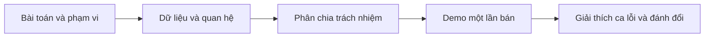

# 08. Kịch bản thi và câu hỏi khó

## 1. Trình bày 5–7 phút

Trình bày thiết kế bằng tình huống cụ thể trước, rồi mới mở phần mã liên
quan nếu thầy hỏi. Không dùng một tập listing thay cho việc hiểu lý do.

1. “Em làm app quản lý rạp offline C++17/Qt, TXT theo yêu cầu, một máy/một
   writer. Mục tiêu là danh mục/lịch/quầy vé/lookup/report, không là DBMS.”
2. Mở sơ đồ chương04, giải thích Seat vật lý khác Ticket theo show.
3. Mở chương03: chỉ một engine; service giữ rule, controller chuyển lỗi,
   Qt nhận input. DLL/hash/BST/matrix tự cài trong DataStructures.
4. Demo staff bán hai ghế, preview/checkbox tiền, receipt. Thử cancel và
   trùng ghế; logout manager xem report và lookup; đóng/mở lại.
5. Mở SaleService::sell rồi commitSale/persistMutation/saveAll theo stack.
   Chỉ ra vì sao true sau lưu đủ bảng mới hiện receipt.
6. Nói trước giới hạn: raw TXT không fsync, search chưa fuzzy, hash+DLL
   lookup không O(1), BST chưa balance, không hoàn vé. Không che khuyết điểm.

## 2. Hỏi kiến trúc

**Q: Có phải Spring Boot viết C++ không?**
A: Không. Chỉ mượn cách chia entity/repository/service/controller, chạy
desktop Qt local. Không Spring DI/JVM/HTTP, constructor reference injection.

**Q: Tại sao không mỗi service đọc file của nó?**
A: Khó đồng bộ FK, transaction, format và error. Một ProjectDataEngine là
cửa dữ liệu chung, TxtDatabase giữ collections/index/serializer/recovery.

**Q: Engine có rule quyền không?**
A: Rule vai trò nằm service, integrity nằm storage. Core persistence không
biết ai click; callers UI phải qua controller/service. Tool bypass core
phải tự tuân thủ quyền, không coi engine như API public cho user.

**Q: Vì sao không làm DBMS hoàn thiện?**
A: YAGNI với một rạp/TXT/bài tập. Typed query/filter/sum đủ, full SQL planner,
MVCC/WAL/joins/schema migrations vượt phạm vi và thêm lỗi.

## 3. Hỏi model và file

**Q: Đọc một dòng TXT vào struct thế nào?**
A: getline→split delimiter→check count→gán string→stoi/stoll/enumparser→
addLast copy value→rebuildIndexes→validateReferences. Không memcpy raw text.

**Q: Sao ticket có cả transactionId và screeningId?**
A: Dễ lookup/đếm theo show, nhưng có dư thừa FK nên validator yêu cầu
ticket.screeningId bằng transaction.screeningId. Không chỉ check hai ID
tồn tại độc lập rồi bỏ qua liên kết chéo.

**Q: Sao ghế không có sold boolean?**
A: Sold thuộc show. Seat là vị trí vật lý/ACTIVE. Vé ISSUED của transaction
Confirmed/Completed quyết định cặp show-seat đã bán; show khác độc lập.

**Q: Sao lưu unitPrice nếu có screening.ticketPrice?**
A: Snapshot giá lúc bán; giá lịch sau có thay không viết lại vé cũ. Báo cáo
cộng ticket.unitPrice, không nhân current screening price với vé cũ.

**Q: Xóa tickets.txt để trống app có tạo lại không?**
A: Không với bộ đã tồn tại. Missing/0byte hoặc Completed không đủ vé reject.
Chỉ hoàn toàn mới không có bằng chứng vận hành mới sinh7headers.

**Q: Nếu sửa tay total 160000 thành1?**
A: Validate sum tickets!=total, open false, không tiếp tục bán. IntegrityTest
có ca này. Không sửa bản thật trong buổi thi; dùng fixture nếu cần demo lỗi.

## 4. Hỏi thuật toán

**Q: Lookup O(1) vì hash?**
A: Hash value là int position; list.getAt vẫn O(n). Bucket11 không rehash
cũng tăng load factor. Nói O(1) đầu-cuối là sai với code hiện tại.

**Q: BST khác trie thế nào?**
A: BST comparator theo timestamp/ID, hai nhánh, không tổ chức từng ký tự.
Trie phục vụ prefix theo ký tự, chưa cài. Prefix search hiện là rfind(...,0).

**Q: Vì sao BST có thể O(n)?**
A: Không balance, sorted insert thành chain. Height n, recursion n; muốn
O(log n) worst cần AVL/RB hoặc rebuild balanced + truy vấn dùng đúng index.

**Q: Collision là gì? Key trùng và hash trùng khác nhau?**
A: Hai key khác cùng bucket chứa bằng separate chaining. Chỉ key string
bằng nhau bị insert reject, hash giống không đủ kết luận cùng record.

**Q: query sort có sửa database không?**
A: Không, copy matches vào result DLL rồi insertion sort dịch data của
result; source giữ nguyên. Stable với strict comparator; O(m²), limit sau sort.

**Q: Group by ở đâu?**
A: Engine aggregate dùng HashTable key→Node<AggregateRow>* và result DLL.
ReportService quyết filter/group/value; không SQL GROUP BY string.

## 5. Hỏi lịch và tiền

**Q: Show1 start19:00 duration90, Show2 start20:30 được không?**
A: Không, room ready20:45. Start20:45 mới được; interval half-open chạm biên
không overlap. Hai phòng khác nhau có thể cùng start.

**Q: Người bán đang confirm đúng lúc show bắt đầu?**
A: Sell gọi preview lại dùng clock hiện tại; now>=start reject. Không tin
list OPEN đã tải trước đó. Status OPEN cũ không có nghĩa còn được bán.

**Q: Tick trả tiền sai vì user chưa nhận thật?**
A: App chỉ ghi xác nhận của người thao tác; không tích hợp ngân hàng/máy
đếm tiền. Nhân viên chịu trách nhiệm xác nhận tiền mặt theo scope.

**Q: Vì sao long long tiền?**
A: VND nguyên không cần fractional float. Cộng có check max−unitPrice trước
khi total+=price để không signed overflow. Giá request dương.

**Q: Bán hai ghế có tạo hai transaction?**
A: Một transaction, hai tickets, total=sum2unitPrices. ID vé gắn mã giao
dịch và số thứ tự; cặp show-seat unique chứ không chỉ ticketId unique.

## 6. Hỏi storage và lỗi

**Q: Rename atomic sao còn backup?**
A: Chỉ từng file. Bảy rename không một transaction filesystem; marker và
backups giúp restore nếu dở. Flush không fsync; không hứa survive mất điện.

**Q: PREPARED journal có nghĩa tiền đã ghi chưa?**
A: Không. Nó trước persist. Đọc graph/marker để biết commit, journal không
full WAL replay. COMMITTED append lỗi sau save không đảo success bảng.

**Q: Lỗi ghi tickets mà transaction file ghi rồi?**
A: saveAll marker BACKUP_READY và backup cũ; recover restoring bộ cũ, RAM
restore snapshots. UI nhận false, không receipt; Qt test ép lỗi bằng directory
tickets.txt.tmp. Nếu recovery lỗi thì giữ backup/marker, dừng để xử lý.

**Q: Hai app cùng mở?**
A: EntryPoint giữ QLockFile trên canonical path, thứ hai reject. Không là
multiwriter scheduler; external text editor không tuân lock vẫn có thể phá.

## 7. Hỏi C++/Qt

**Q: Tại sao Node<T>* dùng `->`, Film value dùng `.`?**
A: `->` dereference pointer rồi member; null cần check. Value/reference member
dùng `.`, không có nghĩa copy hay ownership mỗi lần truy cập.

**Q: Tham chiếu `AuthService&` có tự delete không?**
A: Không sở hữu. Composition root đảm bảo lifetime. Widget children thì
QObject parent sở hữu; đây là hai mô hình lifetime khác nhau.

**Q: `[&]` lambda nguy hiểm ở đâu?**
A: Capture references tới stack; nếu callback sống sau scope thì dangling.
Form modal exec giữ scope trong lúc chạy callbacks; async kéo dài phải
capture value/QPointer hoặc ownership phù hợp. `[this]` cũng cần context.

**Q: Có cần Q_OBJECT cho tất cả QWidget subclass?**
A: Không cho connect vào lambda/native signal như đây; chỉ cần khi khai
báo signals/slots/metaobject riêng cần moc. CMake AUTOmoc vẫn xử lý các class
có Q_OBJECT, không biến mỗi method thành slot tự động.

**Q: Tại sao `assert(service.create(...))` Release nguy hiểm?**
A: NDEBUG làm mất cả biểu thức, không chỉ check kết quả; setup fixture cũng
biến mất. CMake target check -UNDEBUG để chạy thật ở Release.

## 8. Bài truy vết để tự luyện

### Bài A — cancel

Theo Qt selectedItems→request→preview→dialog reject. Xác nhận không hề
commitSale; assert engine tickets/transactions rỗng. Nếu chỉ bỏ success
message nhưng đã ghi DB trước checkbox thì trái SRS.

### Bài B — thu hồi quyền giữa dialog

Staff canSell true mở preview; Admin/service cập nhật false. Confirm gọi
sell→preview→requireSeller→currentSession đọc User mới→false. Timer UI không
là lý do chặn, guard tại thời điểm thao tác mới là lý do.

### Bài C — map và lấp đầy

Room2×2: 4 ghế vật lý, một inactive, bán một active. Map X1/O2/-1.
Occupancy1/4=25%, **không1/3**. availableSeats=3 vật lý chưa bán, không O2.
Chỉ ra IntegrityTest kiểm ca này và ReportService dùng capacity.

### Bài D — same seat different show

SC001 seatA01 có ticket; SC002 chưa có. sold predicate so cả screeningId,
seatId; mapSC002 vẫn O. Không được global set Seat.status=SOLD.

### Bài E — vì sao query chung vẫn trả đúng loại dữ liệu?

Phim và vé dùng cùng cách lọc nhưng không dùng chung danh sách nguồn. Kiểu
model của yêu cầu chọn đúng danh sách; điều kiện của service chọn đúng bản
ghi. Kết quả được sao chép ra ngoài để màn hình không sửa trực tiếp dữ liệu
gốc. Khi thầy chỉ phần triển khai query, giải thích ba ý này trước khi nói
đến cú pháp template: **đúng nguồn, đúng điều kiện, không lộ quyền sửa**.
