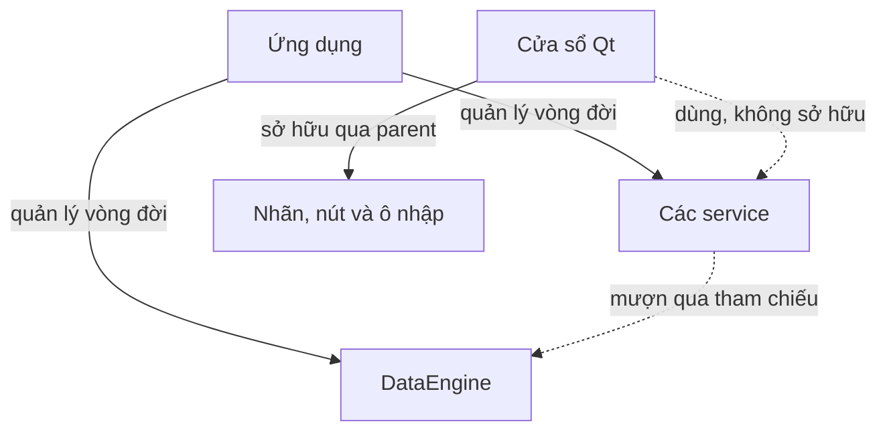
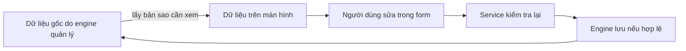
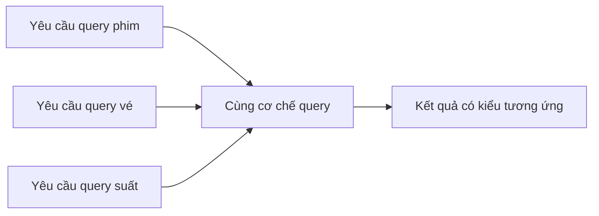
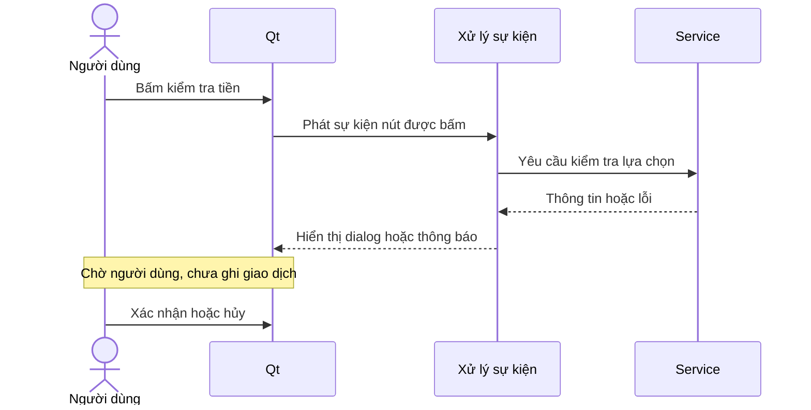
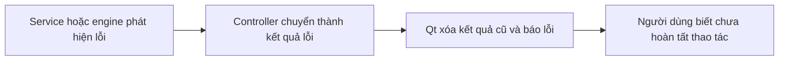

# 09. Ý nghĩa những lựa chọn C++ và Qt

Chương này không dạy bằng cách chép từng dòng cú pháp. Mục tiêu là hiểu
**dòng mã ấy đang bảo vệ điều gì trong thiết kế** khi mở source trong IDE.

## 1. Sở hữu khác sử dụng

Đối tượng sở hữu chịu trách nhiệm kết thúc vòng đời tài nguyên. Đối tượng
sử dụng chỉ mượn tài nguyên trong thời gian được phép; nó không tự xóa tài
nguyên của người khác.

Trong app, service sống lâu hơn cửa sổ đang dùng nó. Nếu service bị hủy mà
cửa sổ vẫn giữ tham chiếu, lần bấm nút sau sẽ truy cập một đối tượng không
còn tồn tại. Thứ tự tạo/hủy ở điểm khởi động ngăn tình huống này.

Widget con lại theo cơ chế parent của Qt: khi cửa sổ hủy, các con được dọn.
Vì vậy không thể thấy một con trỏ rồi kết luận “phải tự xóa tại nơi dùng”.
Trước hết phải xác định **ai là chủ sở hữu**.

## 2. Tại sao kết quả đọc là bản sao?

Nếu màn hình giữ trực tiếp địa chỉ record gốc, gõ vào form có thể sửa dữ
liệu trước khi bấm lưu; bấm hủy sẽ không thật sự hủy. Bản sao tách “đang
nhập” khỏi “đã xác nhận”. Chỉ yêu cầu lưu hợp lệ mới cập nhật nguồn gốc.

Các nút của danh sách cũng có vòng đời. Sau nạp lại hoặc rollback, địa chỉ
cũ có thể không còn dùng được. Đưa bản sao ra ngoài tránh để UI bám vào nút
đã bị xóa. Đánh đổi là chi phí sao chép, chấp nhận được ở quy mô MVP đã đo.

## 3. Kiểu dữ liệu là một phần của quy tắc

| Lựa chọn | Ý nghĩa thiết kế |
|---|---|
| Mã là chuỗi | Giữ được tiền tố và số 0 đầu, không xem mã là số để tính |
| Tiền là số nguyên VND | Tránh sai số làm tròn số thực khi cộng tiền vé |
| Trạng thái là enum | Giới hạn các trạng thái đã định nghĩa thay vì nhận chuỗi bất kỳ |
| Yêu cầu bán không chứa tổng/người bán | Không tin dữ liệu nhạy cảm tự khai từ màn hình |
| Query có kiểu model | Cùng cơ chế lọc nhưng vẫn phân biệt phim, ghế, vé ở thời điểm biên dịch |

TXT vẫn chỉ là chữ, nên parser phải chuyển và kiểm tra. “90abc” không là
90 phút hợp lệ; “31/02” không là ngày hợp lệ; trạng thái lạ không được tự
đổi sang mặc định rồi tiếp tục vận hành.

Giá dương vẫn có thể làm tổng vượt giới hạn số nguyên khi cộng nhiều vé.
Do đó kiểm tra tổng trước phép cộng là bảo vệ dữ liệu, không chỉ kiểm tra
form đã có số hay chưa.

## 4. Template: dùng chung cách làm, không trộn ý nghĩa dữ liệu

Engine có cùng một quy trình query: chọn danh sách đúng loại → lọc → sắp
xếp nếu cần → trả bản sao. Template cho phép tái sử dụng cách làm này cho
nhiều model mà không biến mọi thứ thành dữ liệu không có kiểu.

Chung thuật toán không đồng nghĩa chung điều kiện: service phim chọn phim
hoạt động, service bán chọn vé của suất, báo cáo chọn giao dịch đã xác nhận.
Không có parser SQL hoặc hệ thống tự đọc schema như DBMS.

## 5. Vì sao Qt dùng sự kiện và callback?

Ứng dụng không biết trước người dùng sẽ bấm gì, nên đăng ký hành động cho
từng sự kiện. Lambda là cách mô tả hành động ngắn tại nơi kết nối sự kiện;
nó không tự tạo thread hoặc làm thao tác dữ liệu chạy song song.

Một callback có thể mượn biến của form. Biến ấy phải còn sống khi callback
chạy. Form modal hiện tại giữ phạm vi sống trong khi chờ tương tác; không
được suy rộng rằng mọi callback mượn biến cục bộ đều luôn an toàn.

## 6. Lỗi phải có nghĩa với người dùng

Không có kết quả tìm kiếm và lỗi đọc dữ liệu là hai việc khác nhau. Nếu
controller nuốt lỗi rồi trả danh sách rỗng, người dùng sẽ tưởng không có vé
trong khi file đã hỏng. Tương tự, nhận lỗi ghi không được vẫn hiện receipt.

Giải phóng file khi kết thúc phạm vi giúp tránh bỏ quên tài nguyên, nhưng
không tự phục hồi nội dung đã ghi. Dọn bộ nhớ, khôi phục RAM và khôi phục
file là ba trách nhiệm khác nhau, không dùng một thuật ngữ để thay cả ba.

## 7. Lớp bảo vệ nào chống lỗi nào?

| Lớp bảo vệ | Chống điều gì? | Không thay thế được gì? |
|---|---|---|
| Ô nhập có giới hạn | Nhập sai thông thường, trải nghiệm khó dùng | Validation ở service/storage |
| Ẩn nút theo quyền | Hiện thao tác không phù hợp | Kiểm tra quyền khi thực hiện |
| Model có kiểu | Nhầm loại dữ liệu trong chương trình | Kiểm tra nội dung từ TXT |
| Backup/marker | Một số ca ghi nhiều file dở dang | Cam kết mất điện tuyệt đối |
| Kiểm thử | Hồi quy của ca đã xác định | Chứng minh mọi đầu vào đều đúng |

Đó là lý do có kiểm tra ở nhiều tầng mà không phải sao chép toàn bộ nghiệp
vụ ra mọi nơi. Mỗi tầng có biên trách nhiệm riêng: dễ nhập, đúng quyền/luật,
đúng dữ liệu và an toàn lưu trữ.

## 8. Cách trả lời khi thầy chỉ một dòng

Không đọc lại cú pháp thành lời. Hãy trả lời theo bốn bước:

1. **Ngữ cảnh:** dòng nằm trong luồng gì, trước hay sau xác nhận dữ liệu?
2. **Mục đích:** nó lấy dữ liệu, kiểm tra điều kiện, giữ bản sao hay ghi file?
3. **Hệ quả:** bỏ hoặc đổi nó sẽ gây sai nghiệp vụ hoặc lỗi bộ nhớ nào?
4. **Bằng chứng:** test hay ví dụ nào thể hiện điều kiện ấy?

Ví dụ với bước kiểm tra quyền lần cuối: nó không chỉ là một câu điều kiện;
nó bảo đảm quyền vừa bị thu hồi vẫn có hiệu lực khi dialog đang mở. Nếu bỏ,
quyền lúc mở màn hình có thể được dùng để bán ở thời điểm không còn được phép.
