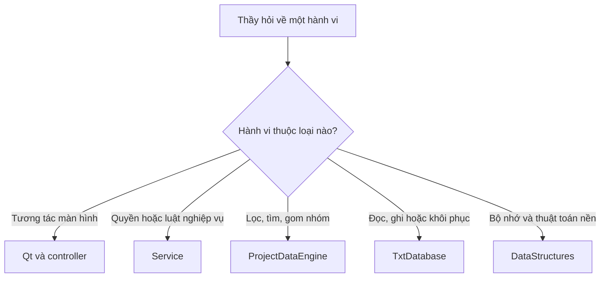

# 10. Bản đồ thiết kế để mở mã khi vấn đáp

Chương này chỉ dẫn **mở phần nào và hỏi vì sao**, không chép mã, không giữ
danh sách hàng nghìn số dòng hoặc hash. Số dòng dễ đổi khi sửa chương trình;
tên thành phần và trách nhiệm giúp tìm đúng vấn đề hơn.

## 1. Đi từ câu hỏi đến thành phần

Mở source gốc trong IDE sau khi xác định thành phần; dùng chương liên quan
để giải thích lựa chọn. Không cần đọc một bản sao source trong tài liệu.

## 2. Bản đồ các phần chính

Các đường dẫn rút gọn dưới đây tương đối với `src/`,
trừ những đường dẫn được ghi rõ ở gốc dự án.

| Câu hỏi thiết kế | Nơi mở | Chương giải thích |
|---|---|---|
| Ai tạo và quản lý các thành phần dùng chung? | `CinemaApplication.cpp` | 03, 09 |
| Tại sao login không hỏi tên hiển thị? | `ui/dialog/LoginDialog.cpp` | 01, 06 |
| Cấp Admin đầu tiên có khác login không? | `ui/dialog/AdminSetup.h` | 02, 06 |
| Quyền mới có tác dụng khi đang thao tác không? | `service/AuthService.cpp` | 06, 08 |
| Đổi phim/phòng có ảnh hưởng lịch và vé thế nào? | `service/FilmService.cpp`, `service/AuditoriumService.cpp` | 04, 06 |
| Chồng lịch và giờ nghỉ được xác định ở đâu? | `service/ScreeningService.cpp`; `util/DateTime.h` | 04, 06 |
| Xem trước và xác nhận bán khác nhau ở đâu? | `service/SaleService.cpp` | 03, 06 |
| Doanh thu/lấp đầy dùng định nghĩa nào? | `service/ReportService.cpp` | 04, 06 |
| Tại sao không mỗi màn hình một cách đọc dữ liệu? | `repository/ProjectDataEngine.h` và `.cpp` | 03, 05 |
| Tại sao dữ liệu thiếu/hỏng không được coi là rỗng? | `repository/txt/TxtDatabase.cpp`, phần load/validation | 04, 07 |
| Lỗi ghi giữa nhiều file xử lý thế nào? | Cùng file, phần persist/save/recovery | 04, 07 |
| Ghế bán phụ thuộc suất ở đâu? | Cùng file, phần dựng map từ vé | 04, 05 |
| Controller có tự tính tiền không? | `controller/OperationsController.cpp` | 03, 06 |
| Màn hình gọi nghiệp vụ lúc nào? | `ui/widget/OperationsPages.cpp` | 06, 09 |
| Ai giải phóng nút của danh sách? | Gốc `src/DataStructures/DoublyLinkedList.tpp` | 05, 09 |
| Collision/hash/BST/map được cài thế nào? | Gốc `src/DataStructures/` | 05 |
| Những giới hạn nào đã được kiểm thử? | Gốc `tests/` | 07 |

## 3. Ba đường truy vết nên tập trước

### Bán vé

Màn hình chọn ghế → controller → service kiểm tra → engine → TXT lưu nhất
quán → trả thành công → màn hình hiện vé. Tại mỗi bước, tự hỏi “đã ghi hay
chưa?”, “ai xác nhận quyền?”, “thất bại thì người dùng thấy gì?”.

### Mở lại dữ liệu

Điểm khởi động → khóa thư mục → engine mở → recovery nếu cần → parser và
kiểm quan hệ → mới cho đăng nhập. Tự hỏi “mất một file có bị tự tạo lại?”,
“tổng tiền sai có bị phát hiện?”, “có cho dùng dữ liệu nạp dở không?”.

### Báo cáo

Màn hình chọn điều kiện → service xác định giao dịch hợp lệ → engine lọc/
gom/đếm/cộng → service trả số liệu → màn hình hiển thị. Tự hỏi “ngày bán hay
ngày chiếu?”, “giá lúc bán hay giá hiện tại?”, “lấp đầy lấy mẫu số nào?”.

## 4. Khi thiết kế thay đổi

Thay luật thì cập nhật sơ đồ luồng và ca kiểm thử; thay định dạng TXT thì
cập nhật chương dữ liệu và parser/writer; thay cấu trúc lưu RAM thì kiểm
vòng đời/index/rollback và độ phức tạp. Không cần công cụ tự chép source
vào tài liệu: việc giải thích thiết kế cần chủ động theo đúng hành vi mới.
