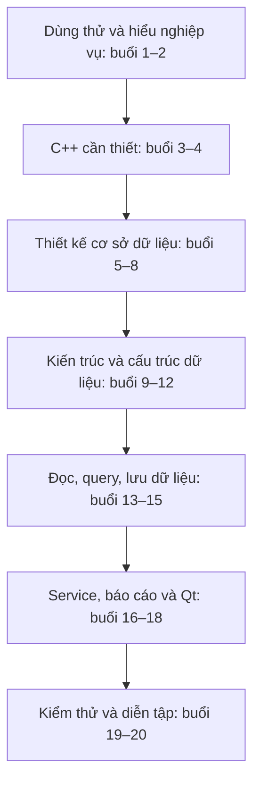
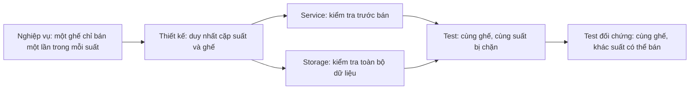
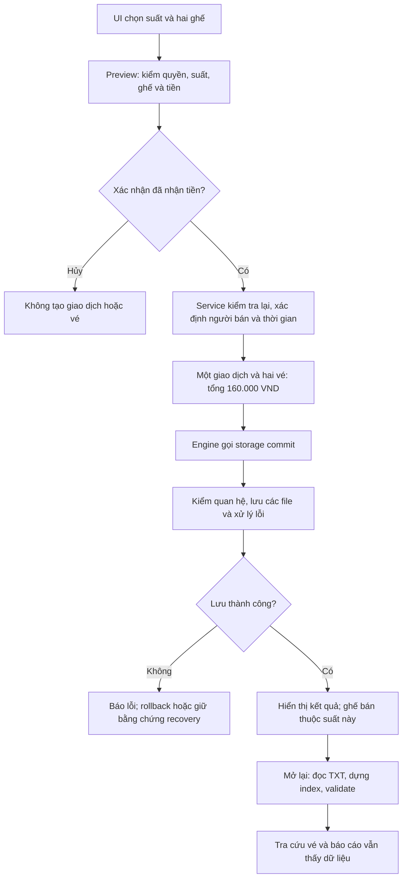

# 11. Lộ trình học dự án từ đầu đến vấn đáp

Lộ trình dành cho FRAME hiện tại: C++17, Qt Widgets, dữ liệu TXT, cấu trúc dữ
liệu tự xây dựng, source trong `src/`, kiểm thử trong `tests/`. Không học một
backend Spring Boot, DBMS SQL hay những tính năng chưa triển khai.

## 1. Mục tiêu và cách học

Đề xuất **20 buổi, mỗi buổi 2–3 giờ**. Đây là khung học, không phải cam kết
thời gian: nếu chưa nắm C++ thì tách buổi 3–4 thành nhiều buổi; nếu đã vững
thì dùng thời gian đó luyện thuật toán và truy vết. Chưa qua bài tự kiểm tra
thì chưa coi phần đó hoàn thành.

Sau lộ trình, bạn phải làm được năm việc:

1. Giải thích bài toán, phạm vi và quyền người dùng.
2. Tự vẽ thiết kế dữ liệu, bảo vệ quyết định về bảng, khóa và ràng buộc.
3. Vẽ và phân tích các cấu trúc dữ liệu tự xây dựng.
4. Truy vết một thao tác từ nút bấm tới file và ngược lại.
5. Chứng minh bằng demo/test và nói đúng giới hạn của sản phẩm.

Một buổi học chia thành: khoảng 25 phút đọc thiết kế, 40 phút đọc đúng phần
source, 35 phút vẽ hoặc thử tình huống, 20 phút trả lời thành tiếng; thời
gian còn lại để sửa chỗ chưa hiểu. Đọc source qua IDE, không chép code vào
ghi chú. Mỗi buổi ghi một trang: **mục đích, quyết định, luồng, lỗi, giới hạn**.

Các liên kết bên dưới dẫn tới tài liệu giải thích; đường dẫn source là nơi
mở mã trong IDE. Mọi tình huống phá dữ liệu phải dùng thư mục tạm hoặc bản
sao riêng, không thao tác trên dữ liệu thật hay seed `data/demo/`.

## 2. Giai đoạn A — Hiểu sản phẩm

### Buổi 1. Tự sử dụng ứng dụng trước khi đọc code

**Đọc:** [Build và demo](02-build-and-demo.md), [tổng quan](README.md).

**Học:** cách build, chạy app, thư mục dữ liệu, khác biệt dữ liệu seed/demo/
vận hành. Tạo demo theo hướng dẫn; đăng nhập Admin và nhân viên; quan sát
phim, phòng, lịch, quầy vé, tra cứu và báo cáo.

**Thực hành:** chọn suất tương lai, bán hai ghế đang trống, ghi mã giao dịch;
tra cứu, xem báo cáo ngày bán, đóng và mở lại cùng thư mục dữ liệu. Thử hủy
xác nhận thanh toán và quan sát ghế không đổi.

**Thầy có thể hỏi:**
- Sản phẩm làm gì? Chạy desktop hay client/server?
- Dữ liệu nằm đâu? Tắt chương trình thì dữ liệu còn không?
- Tại sao seed không có đầy đủ lịch và vé như demo đã tạo?
- Báo cáo lọc ngày thanh toán hay ngày chiếu?

**Đạt khi:** demo được một lần bán và đọc lại kết quả mà không cần người khác
hướng dẫn. Chưa cần giải thích toàn bộ triển khai.

### Buổi 2. Từ BRD/SRS tới quy tắc nghiệp vụ

**Đọc:** [Yêu cầu hiện tại](01-requirements.md), [BRD](../requirements/brd.md),
[SRS](../requirements/srs.md), [use case](../requirements/use-cases.md).
Đọc bản tóm tắt trước, chỉ mở BRD/SRS để đối chiếu các quy tắc cụ thể.

**Học:** vai trò, quyền bán, đầu vào/đầu ra của từng use case, điều kiện trước
và sau, luồng thành công và luồng lỗi. Phân biệt yêu cầu với quyết định triển
khai; tài liệu Draft không tự trở thành yêu cầu mới đã được phê duyệt.

**Thực hành:** lập bảng riêng cho quản lý phim, phòng, lịch, bán vé, tra cứu,
báo cáo: ai làm, dữ liệu cần có, kết quả, ba trường hợp bị từ chối. Với bán
vé, viết rõ preview chưa lưu và xác nhận cuối mới ghi nhận.

**Thầy có thể hỏi:**
- Vì sao đăng nhập không hỏi tên hiển thị hay cho chọn vai trò?
- Admin có luôn được bán vé không? Vai trò khác quyền bán ra sao?
- Phim/phòng ngừng hoạt động ảnh hưởng lịch tương lai thế nào?
- Giữ chỗ và hoàn vé có trong phạm vi hiện tại không?

**Đạt khi:** giới thiệu dự án trong hai phút và giải thích được năm quy tắc
quan trọng mà không nói tên hàm hay tên lớp.

## 3. Giai đoạn B — C++ để đọc và giải thích dự án

### Buổi 3. Kiểu dữ liệu, hàm và tổ chức mã

**Đọc:** [C++ trong dự án](09-cpp-reading-guide.md).
**Mở:** `src/entity/Film.h`, `src/entity/User.h`,
`src/enums/DomainEnums.h`, `src/controller/FilmController.h`.

**Học:** biến và kiểu, `struct/class`, phạm vi truy cập, constructor, `enum
class`, namespace, header/source, `#include`, truyền tham trị/tham chiếu,
`const`, giá trị trả về và tham số đầu ra. Bổ sung cú pháp cơ bản nếu chưa
đọc được một hàm kiểm tra điều kiện.

**Thực hành:** giải thích từng trường của Film bằng nghiệp vụ; tìm một hàm
trả `bool` và thông báo lỗi; chỉ ra khai báo, định nghĩa và nơi gọi. So sánh
bản sao model với tham chiếu tới model, không chỉ đọc tên kiểu.

**Thầy có thể hỏi:**
- Vì sao dùng enum thay vì chuỗi tùy ý?
- `const T&` khác `T` và `T&` thế nào?
- `operator==` của model so ID có ý nghĩa gì? Có chứng minh nội dung bằng nhau không?
- Vì sao có cả file `.h` và `.cpp`?

**Đạt khi:** đọc được chữ ký hàm, giải thích đầu vào/đầu ra và xác định hàm
có thể sửa đối tượng nào.

### Buổi 4. Bộ nhớ, template và callback

**Đọc:** [vòng đời và lựa chọn C++](09-cpp-reading-guide.md).
**Mở:** `src/DataStructures/Node.h`, `src/DataStructures/DoublyLinkedList.h`,
`src/DataStructures/DoublyLinkedList.tpp`, `src/repository/ProjectDataEngine.h`.

**Học:** con trỏ/tham chiếu, quyền sở hữu, stack/heap, destructor, deep copy,
move nếu có trong lớp đang đọc, dangling pointer và double delete. Nắm RAII,
template, lambda, capture và `std::function` vừa đủ để đọc query/mutation.

**Thực hành:** vẽ hai danh sách sau khi sao chép; xác định node nào phải được
tạo riêng. Tìm callback lọc và giải thích đối tượng nó nhận, dữ liệu nó đọc,
vòng đời tham chiếu. Đừng học template chỉ như cách thay chữ T.

**Thầy có thể hỏi:**
- Ai giải phóng Node? Nếu sao chép bằng cách chép con trỏ thì sai ở đâu?
- Callback giữ địa chỉ bản ghi sau query có an toàn không?
- Vì sao template trong thư viện có phần triển khai `.tpp`?
- Service mượn engine bằng tham chiếu thì ai phải sống lâu hơn ai?

**Đạt khi:** vẽ được ownership và giải thích một lỗi dangling reference bằng
tình huống cụ thể, không nhầm reference với quyền sở hữu.

## 4. Giai đoạn C — Thiết kế cơ sở dữ liệu, không chỉ thuộc model

Mô hình logic tổ chức như các bảng quan hệ; triển khai vật lý là TXT, không
có DBMS tự thực thi PK/FK/UNIQUE. Học cả **lý do thiết kế** và **nơi bảo vệ
thiết kế**. Ký hiệu kiểu SQL trong bản thiết kế không phải SQL đang chạy.

### Buổi 5. Từ nghiệp vụ suy ra thực thể và thuộc tính

**Đọc:** [Mô hình hiện tại](04-data-and-storage.md),
[thiết kế ban đầu](../design/data-design.md).
**Mở:** bảy model trong `src/entity/`.

**Học:** phân biệt đối tượng ổn định với sự kiện nghiệp vụ. Phim không phải
suất chiếu; ghế vật lý không phải vé; một lần thanh toán không phải một vé.
Hiểu User, Film, Auditorium, Seat, Screening, SaleTransaction, Ticket.

**Thực hành:** từ câu "nhân viên bán A01 và A02 của một suất", xác định bản
ghi nào đã có, bản ghi nào tạo mới, thông tin thuộc bản ghi nào. Liệt kê
thuộc tính và lý do tồn tại, không sao chép nguyên struct làm câu trả lời.

**Thầy có thể hỏi:**
- Vì sao cần Screening nếu đã có Film?
- Vì sao cần cả SaleTransaction và Ticket?
- Vì sao không lưu danh sách tên phim, ghế và người bán chung một dòng?
- Nếu xóa bảng Seat và chỉ lưu chữ A01 trên vé thì mất gì?

**Đạt khi:** tự suy ra bảy thực thể từ nghiệp vụ và bảo vệ được việc tách
Film/Screening, Seat/Ticket, Transaction/Ticket.

### Buổi 6. Khóa, quan hệ và lực lượng quan hệ

**Đọc:** [ERD hiện tại](04-data-and-storage.md),
[sơ đồ ERD](../design/database-erd.svg).

**Học:** PK, FK, khóa ứng viên, khóa đơn/ghép, 1–N và tính bắt buộc/tùy chọn.
Phân biệt ID toàn cục với mã hiển thị trong phạm vi một phòng. Đừng gọi mọi
quan hệ là N–N chỉ vì nhìn thấy nhiều bản ghi ở hai phía.

**Thực hành:** vẽ ERD không nhìn mẫu; tạo ví dụ hai phòng cùng có A01, một
phim có hai suất, một giao dịch có hai vé. Ghi từng FK trỏ tới đâu.

**Thầy có thể hỏi:**
- `seatId` khác `seatCode` thế nào? Vì sao cần cả hai?
- `username` duy nhất thì còn cần `userId` không?
- Một giao dịch hoàn tất có thể không có vé không?
- Tại sao cặp suất–ghế phải duy nhất, còn ghế riêng lẻ không duy nhất trên vé?
- FK tồn tại đã đủ chứng minh vé thuộc đúng phòng chưa?

**Đạt khi:** giải thích được mỗi cạnh trong ERD và ba ràng buộc: mã ghế
duy nhất trong phòng; vé cùng suất với giao dịch; ghế thuộc phòng của suất.

### Buổi 7. Chuẩn hóa, kiểu dữ liệu và dữ liệu dư thừa

**Đọc:** [trường và kiểu thực tế](04-data-and-storage.md).
**Mở:** `src/entity/Screening.h`, `src/entity/SaleTransaction.h`,
`src/entity/Ticket.h`, `src/entity/Auditorium.h`.

**Học:** phụ thuộc hàm, 1NF/2NF/3NF, bất thường thêm/sửa/xóa. Xác định khóa
ứng viên và phụ thuộc trước khi kết luận chuẩn hóa. Hiểu snapshot lịch sử,
dữ liệu suy ra được và chi phí giữ dữ liệu dư thừa nhất quán.

**Thực hành:** thử thiết kế một bảng gộp giao dịch/vé rồi chỉ ra tên người
bán, thời gian và tổng tiền lặp thế nào. Phân tích Ticket có `transactionId`
và `screeningId`: giao dịch đã xác định suất, nên trường suất trên vé cần
kiểm tra chéo. Không tuyên bố toàn schema đạt 3NF tuyệt đối.

**Thầy có thể hỏi:**
- Vì sao tiền dùng `long long`, không float? Vì sao ID dùng string?
- Vì sao lưu `unitPrice` trên vé? Có được tính lại bằng giá hiện tại không?
- Vì sao lưu `totalAmount` khi có thể cộng giá vé?
- `capacity`, thời gian kết thúc và suất trên vé là dữ liệu suy ra được không?
- Dữ liệu dư thừa khác dữ liệu lịch sử cần lưu như thế nào?

**Đạt khi:** chỉ ra ít nhất hai chỗ dư thừa và nêu cách kiểm tra nhất quán;
giải thích snapshot giá không phải lỗi thiết kế chỉ vì suất cũng có giá.

### Buổi 8. Ràng buộc, vòng đời và thiết kế lưu trữ vật lý

**Đọc:** [validate, TXT và recovery](04-data-and-storage.md).
**Mở:** `src/repository/txt/TxtDatabase.cpp`, tập trung `validateReferences`.

**Học:** ràng buộc trường, duy nhất, tham chiếu và nghiệp vụ; ACTIVE/INACTIVE
khác xóa bản ghi; dữ liệu lịch sử khác điều kiện bán mới. Một file ứng với
một bảng logic, header và thứ tự trường phải thống nhất với parser.

**Thực hành:** lập bảng "ràng buộc → nơi kiểm tra → hậu quả nếu bỏ": ID trùng,
FK không tồn tại, ghế sai phòng, vé khác suất giao dịch, trùng suất–ghế, tổng
tiền sai, thời gian sai, thiếu bảng. Chỉ thử sửa TXT trên bản sao tạm.

**Thầy có thể hỏi:**
- Nếu đổi tổng tiền bằng tay, app phát hiện ở đâu?
- Vì sao một bộ dữ liệu đang dùng thiếu tickets không được coi là database mới?
- Vì sao không xóa phòng/phim đã có lịch sử?
- File chứa ký tự phân cách, số sai hoặc enum lạ thì làm gì?
- Không có DBMS, ai thực thi PK/FK/UNIQUE?

**Đạt khi:** giải thích bảo vệ ở service và storage khác nhau, đồng thời chỉ
ra kiểm tra khi load và trước save. Bạn đã học thiết kế database, chưa chỉ
học thuộc bảy struct.

## 5. Giai đoạn D — Kiến trúc và cấu trúc dữ liệu

### Buổi 9. Kiến trúc và vòng đời ứng dụng

**Đọc:** [Kiến trúc](03-architecture.md).
**Mở:** `src/CinemaApplication.cpp`, một controller, một service,
`src/repository/ProjectDataEngine.h`.

**Học:** UI → controller → service → engine → TXT; vai trò từng thư mục,
constructor nhận tham chiếu, đối tượng dùng chung, thứ tự tạo/hủy. Cây thư
mục đã bỏ package Java và các layer trống, nhưng vẫn giữ phân chia trách nhiệm.

**Thực hành:** vẽ sơ đồ ai tạo ai, ai mượn ai và ai sở hữu dữ liệu. Truy vết
một thao tác tìm phim trước khi chọn luồng bán phức tạp hơn.

**Thầy có thể hỏi:**
- Tại sao không để widget tự đọc TXT?
- Controller khác service thế nào? Engine khác storage thế nào?
- Vì sao không mỗi service giữ một bản database riêng?
- Đây có phải Spring Boot viết bằng C++ không?

**Đạt khi:** từ một yêu cầu, chọn đúng nơi đặt xử lý và giải thích nơi không
được đặt nó. Không chỉ kể tên các tầng.

### Buổi 10. Danh sách liên kết đôi và bộ nhớ

**Đọc:** [DLL](05-data-structures.md).
**Mở:** `src/DataStructures/Node.h`, `src/DataStructures/Node.tpp`,
`src/DataStructures/DoublyLinkedList.h`, `src/DataStructures/DoublyLinkedList.tpp`.

**Học:** head/tail, prev/next, bất biến danh sách, thêm/xóa/tìm/duyệt,
`getAt`, deep copy, destructor. Phân biệt chi phí thay liên kết với chi phí
tìm vị trí: xóa node đã biết không giống tìm theo ID rồi xóa.

**Thực hành:** vẽ danh sách rỗng, một node, ba node; thêm đầu/cuối; xóa đầu,
giữa, cuối; sao chép và hủy một bản. Với mỗi bước, ghi liên kết nào đổi.

**Thầy có thể hỏi:**
- DLL có lợi/hại gì so với mảng hoặc vector?
- Xóa phần tử cuối cùng phải cập nhật gì?
- Vì sao `getAt` không O(1)?
- Nếu copy constructor chỉ chép head/tail thì xảy ra gì?

**Đạt khi:** giải thích được các biên rỗng/một phần tử và tính độ phức tạp
từ cách thực thi, không thuộc một bảng Big-O chung chung.

### Buổi 11. HashTable, index và lookup thực tế

**Đọc:** [Hash và index](05-data-structures.md), [lookup](04-data-and-storage.md).
**Mở:** `src/DataStructures/HashTable.h`, `src/DataStructures/HashTable.tpp`,
`src/DataStructures/HashTable.cpp`, `src/repository/txt/TxtDatabase.cpp`.

**Học:** hash, bucket, collision, separate chaining, key trùng khác hash
trùng; số bucket cố định và ảnh hưởng load. Index ID/username lưu vị trí
trong DLL, không lưu trực tiếp một model hoặc pointer bền vững.

**Thực hành:** vẽ hai key khác vào cùng bucket, tìm một key, chèn key đã có.
Theo một lookup từ mã tới vị trí rồi tới model; phân tích cả chuỗi thao tác.

**Thầy có thể hỏi:**
- Vì sao collision không có nghĩa hai bản ghi giống nhau?
- Lookup model có thật sự O(1) không?
- Khi thêm/sửa dữ liệu, vì sao cần dựng lại index?
- Vì sao key username và key user ID cần phân biệt namespace?

**Đạt khi:** giải thích lookup đầu-cuối hiện vẫn có O(n) do DLL; không nói
hash có hiệu năng cố định bất kể số bản ghi.

### Buổi 12. BST, Matrix2D và các cấu trúc chưa dùng

**Đọc:** [BST, matrix, Stack/Queue/Graph](05-data-structures.md).
**Mở:** `src/DataStructures/BST.h`, `src/DataStructures/BST.tpp`,
`src/DataStructures/Matrix2D.h`, `src/DataStructures/Matrix2D.cpp`.

**Học:** comparator thời gian/mã của BST, chèn/tìm/duyệt có trong thư viện,
cây lệch và chiều cao; hàng/cột và ánh xạ ghế của matrix. Đọc nguyên lý
Stack/Queue/Graph sau đó, nhưng phân biệt "có thư viện" với "được app dùng".

**Thực hành:** chèn khóa tăng dần và vẽ cây lệch; vẽ phòng 2×2, một ghế ngừng
dùng, một ghế đã bán. Xác định trạng thái từng ô theo từng suất, không gắn
SOLD vĩnh viễn vào Seat.

**Thầy có thể hỏi:**
- BST có bảo đảm O(log n) không? Muốn bảo đảm cần thay đổi gì?
- Có dựng BST nghĩa là mọi query đang sử dụng nó không?
- Trie khác BST thế nào? Dự án đã có Trie chưa?
- Stack có làm undo bán vé không? Graph có tham gia bán vé không?

**Đạt khi:** nêu đúng BST chưa cân bằng và query hiện chưa khai thác nó;
Stack/Queue/Graph chưa nối vào luồng bán, không bịa công dụng cho đủ cấu trúc.

## 6. Giai đoạn E — Từ file tới dữ liệu và ngược lại

### Buổi 13. Đọc TXT vào model có kiểu

**Đọc:** [Parser và load](04-data-and-storage.md).
**Mở:** `src/repository/txt/TxtDatabase.cpp`, bắt đầu từ `load`, parser,
`rebuildIndexes` và `validateReferences`.

**Học:** đọc dòng, tách trường, kiểm số trường/header, chuyển số/enum/thời
gian, gán model, đưa vào DLL, dựng index và kiểm quan hệ. Chuỗi "90abc"
không được nhận như 90 hợp lệ; con trỏ/bộ nhớ không phải định dạng lưu trữ.

**Thực hành:** giải thích một dòng phim hợp lệ, rồi năm dòng lỗi: thiếu
trường, ID trùng, số sai, enum lạ, FK không tồn tại. Phân biệt lỗi parser,
lỗi duy nhất và lỗi tham chiếu.

**Thầy có thể hỏi:**
- Vì sao không memcpy một dòng TXT vào struct?
- Lúc đọc vé, lấy đâu ra thông tin phòng của suất để kiểm tra?
- Vì sao phải đọc/dựng dữ liệu rồi validate quan hệ?
- Nếu file không tồn tại, trường hợp nào tạo mới và trường hợp nào báo lỗi?

**Đạt khi:** vẽ được đường TXT → model → RAM → index, chỉ đúng tầng phát
hiện từng lỗi và không coi file hỏng là dữ liệu trống.

### Buổi 14. Query, search, sort và aggregate chung

**Đọc:** [Truy vấn và đánh đổi](05-data-structures.md).
**Mở:** `src/repository/ProjectDataEngine.h`,
`src/repository/ProjectDataEngine.cpp`, `tests/ProjectDataEngineTest.cpp`.

**Học:** typed query chọn đúng nguồn model; where/orderBy/limit; callback,
kết quả sao chép, insertion sort trên kết quả; search exact/prefix/contains;
aggregate nhóm và cộng/đếm bằng hash. Phân biệt thao tác query với SQL parser.

**Thực hành:** mô tả lấy tối đa 20 phim ACTIVE, lọc thời lượng, sắp theo tên;
nhóm các vé phù hợp để tính doanh thu; xác định thời điểm áp dụng limit.
Vẽ nguồn dữ liệu và danh sách kết quả thành hai vùng riêng.

**Thầy có thể hỏi:**
- Một query chung dùng cho nhiều model mà vẫn đúng kiểu bằng cách nào?
- Sort có thay đổi thứ tự nguồn database không?
- Vì sao filter/sort xong mới limit? Sort có chi phí gì?
- Prefix search hiện có dùng Trie không? Fuzzy/n-gram đã triển khai chưa?
- Aggregate giữ pointer tạm ở đâu và nó được phép sống bao lâu?

**Đạt khi:** giải thích đúng nguồn, điều kiện và bản sao; search hiện không
fuzzy, chưa bỏ dấu tiếng Việt; sort O(m²) với m bản ghi sau lọc.

### Buổi 15. Ghi dữ liệu, rollback và recovery

**Đọc:** [Lưu và phục hồi](04-data-and-storage.md),
[giới hạn độ bền](07-verification.md).
**Mở:** `src/repository/txt/TxtDatabase.cpp`: `persistMutation`, `saveAll`,
`commitSale`; `tests/TxtDatabaseTest.cpp`.

**Học:** bản sao RAM, mutation, rebuild/validate, backup file, temp+rename,
marker ghi dở/đã commit và khôi phục. Phân biệt journal bán vé với marker
phục hồi bộ file; phân biệt lỗi ghi với lỗi cleanup sau khi đã commit.

**Thực hành:** vẽ ba ca: lưu thành công, validation thất bại, ghi một phần
thất bại. Với mỗi ca ghi rõ RAM/file/UI phải ra sao. Học tại sao rename một
file không làm việc thay bảy file thành một thao tác nguyên tử.

**Thầy có thể hỏi:**
- Vì sao cần cả bản sao RAM và backup file?
- Nếu lưu giao dịch được nhưng lưu vé lỗi thì sao?
- Lần khởi động sau biết bộ file đang ghi dở bằng cách nào?
- Cleanup lỗi sau COMMITTED có nghĩa giao dịch chưa lưu không?
- Có bảo đảm an toàn tuyệt đối khi mất điện không?

**Đạt khi:** không nhầm rollback/recovery với ACID của DBMS; nói rõ chưa có
fsync và không cam kết chống mọi mất điện/ổ hỏng. Không thử phá file thật.

## 7. Giai đoạn F — Service và giao diện theo tình huống

### Buổi 16. Đăng nhập, quyền và danh mục

**Đọc:** [Auth, vai trò và danh mục](06-services-and-qt.md).
**Mở:** `src/service/AuthService.h`, `src/service/AuthService.cpp`,
`src/service/FilmService.cpp`, `src/service/AuditoriumService.cpp`,
`src/controller/AuthController.cpp`, `src/ui/dialog/LoginDialog.cpp`.

**Học:** cấp Admin khác login, session không chứa mật khẩu, hash mật khẩu,
trạng thái tài khoản, quyền bán riêng, kiểm tra quyền tại thời điểm thao tác.
Nắm FilmService/AuditoriumService và cập nhật an toàn khi đã có lịch.

**Thực hành:** kể trường hợp Admin không có quyền bán; nhân viên bị thu hồi
quyền sau khi mở màn hình; sửa thời lượng/layout khi đã có lịch; vô hiệu hóa
Admin cuối cùng. Đọc một test tương ứng để biết điều kiện chính xác.

**Thầy có thể hỏi:**
- Ẩn nút có thay thế kiểm tra quyền không?
- Session có quyền cũ thì làm sao phát hiện quyền vừa bị thu hồi?
- Hash mật khẩu khác mã hóa thế nào? Có bảo vệ toàn bộ TXT không?
- Vì sao không cho đổi layout phòng đã có lịch tùy tiện?

**Đạt khi:** truy vết login tới phiên và một guard service; không tuyên bố
mọi mật khẩu legacy được hash ngay khi mở app hay file nghiệp vụ được mã hóa.

### Buổi 17. Lập lịch và bán vé — luồng quan trọng nhất

**Đọc:** [Lịch và bán vé](06-services-and-qt.md).
**Mở:** `src/service/ScreeningService.cpp`, `src/service/SaleService.cpp`;
`src/controller/OperationsController.cpp`, `src/ui/widget/OperationsPages.cpp`.

**Học:** giờ bắt đầu/kết thúc, khoảng đệm 15 phút, giao nhau hai khoảng phòng
bận, trạng thái suất; preview chưa ghi, confirm kiểm tra lại, người bán/thời
gian do service xác định, tạo giao dịch/vé rồi commit.

**Thực hành:** phim bắt đầu 19:00, dài 90 phút: kết thúc 20:30, phòng dùng
lại từ 20:45. Xét lịch mới 20:44 và 20:45. Truy vết bán hai ghế; thử hủy,
bán lại ghế và cùng ghế ở một suất khác.

**Thầy có thể hỏi:**
- Vì sao so với giờ phòng sẵn sàng, không chỉ giờ phim kết thúc?
- Vì sao kiểm tra lại sau preview? Có giữ chỗ không?
- Có tin tổng tiền và tên người bán do UI gửi không?
- Bấm hủy thì dữ liệu nào thay đổi?
- Khi nào app được phép hiển thị bán thành công?

**Đạt khi:** kể trọn luồng thành công và ít nhất ba luồng lỗi; chỉ ra mỗi
điểm quyết định nằm ở UI, service hay storage, không gộp tất cả vào Qt.

### Buổi 18. Báo cáo, tra cứu và cách Qt kết nối nghiệp vụ

**Đọc:** [Tra cứu, báo cáo và Qt](06-services-and-qt.md),
[sự kiện và vòng đời](09-cpp-reading-guide.md).
**Mở:** `src/service/ReportService.cpp`, `src/service/SaleService.cpp` (lookup);
`src/ui/widget/OperationsPages.cpp`, `src/ui/mainwindow/MainWindow.cpp`.

**Học:** định nghĩa doanh thu và số vé, ngày giao dịch khác ngày chiếu,
lấp đầy theo sức chứa vật lý; signal/slot, event loop, layout, parent/child
Qt, dialog accept/reject, render kết quả và thông báo lỗi.

**Thực hành:** phòng 2×2 có một ghế INACTIVE, bán một ghế: lấp đầy 1/4=25%,
không phải 1/3. Phân biệt ô chọn bán được, ghế vật lý chưa bán và mẫu số báo
cáo. Truy vết một click tới controller và một kết quả quay lại UI.

**Thầy có thể hỏi:**
- Doanh thu lấy giá vé đã bán hay giá hiện tại của suất?
- Vì sao chọn ngày chiếu có thể không thấy doanh thu ngày bán?
- Ghế INACTIVE có bị loại khỏi mẫu số capacity không?
- Ai xóa widget? Service có trở thành con của widget không?
- Signal/slot khác gọi hàm thông thường ở điểm nào trong luồng đang đọc?

**Đạt khi:** tự tính được báo cáo nhỏ, giải thích đúng thời điểm và dữ liệu
nguồn, không học Qt chỉ bằng cách thuộc tên control.

## 8. Giai đoạn G — Bằng chứng và diễn tập

### Buổi 19. Build, kiểm thử và giới hạn

**Đọc:** [Build](02-build-and-demo.md), [kiểm chứng](07-verification.md).
**Mở:** `CMakeLists.txt`, `tests/ProjectDataEngineTest.cpp`,
`tests/MinimumServicesTest.cpp`, `tests/IntegrityTest.cpp`,
`tests/QtOperationsTest.cpp`, `tests/PerformanceTest.cpp`.

**Học:** library/executable/include/link, Qt được tìm bằng CMake, CTest,
assert, fixture tạm, core test khác Qt offscreen test, đo hiệu năng khác
chứng minh độ phức tạp. Hiểu điều kiện build không có Qt và không có GUI.

**Thực hành:** chạy các lệnh ở hướng dẫn build; chọn năm test và giải thích
chuẩn bị → thao tác → assert. Với quy tắc không bán trùng, chỉ ra cả ca cùng
suất bị chặn và khác suất được phép; đọc lại sau lưu là một bằng chứng khác.

**Thầy có thể hỏi:**
- Test kiểm hành vi gì, không chỉ tên là gì?
- Vì sao dùng data tạm? Có nên cố tình xóa dữ liệu thật để demo không?
- Test xanh có chứng minh chống mất điện hoặc mọi đầu vào không?
- Nút thắt nào có thể xuất hiện khi dữ liệu lớn? Cải tiến dựa trên đo gì?

**Đạt khi:** chạy được kiểm thử và giải thích bằng chứng; công khai giới hạn
search, hash+DLL, BST, sort, TXT và nền tảng đã kiểm, không lấy số test làm
bảo đảm tuyệt đối.

### Buổi 20. Diễn tập vấn đáp từ đầu tới cuối

**Đọc:** [Kịch bản vấn đáp](08-oral-exam.md), [bản đồ source](10-source-index.md).

**Thực hành vòng 1 — 7 phút:** một phút bài toán/phạm vi; một phút ERD;
một phút kiến trúc; hai phút demo bán vé; một phút cấu trúc dữ liệu;
một phút ca lỗi và giới hạn. Chuẩn bị một demo độc lập, không dùng data thật.

**Thực hành vòng 2 — 20 phút:** nhờ một người hỏi ngẫu nhiên câu ở các buổi
trước. Trả lời thành tiếng, chỉ mở mã khi cần chứng minh. Nếu không nhớ,
nói phần mình chắc và mở đúng hàm; không bịa tính năng hay độ phức tạp.

**Thực hành vòng 3 — truy vết:** đi từ nút xác nhận tới controller → service
→ engine → storage → file → kết quả UI. Sau đó đóng/mở app, kể luồng đọc
ngược từ TXT tới ghế đã bán và báo cáo.

**Thầy có thể hỏi:**
- Nếu bỏ một bảng, index hoặc bước validate thì hỏng ở đâu?
- Nếu chuyển TXT sang SQLite, phần nào nên đổi và phần nào giữ?
- Nếu có nhiều máy cùng bán thì thiết kế hiện tại thiếu gì?
- Vì sao chọn giải pháp này trong phạm vi môn học, thay vì DBMS hoàn thiện?

**Đạt khi:** trình bày không đọc tài liệu, trả lời được câu hỏi nối nhiều
tầng, tìm đúng file trong khoảng một phút và phân biệt thực tế với đề xuất.

## 9. Bài xuyên suốt bắt buộc: bán hai ghế

Giả định một suất tương lai OPEN, hai ghế đang hoạt động và chưa bán, giá
80.000 VND/vé, tài khoản có quyền bán. Đây là bài luyện, không phải mã suất
hay ghế chắc chắn tồn tại trong demo của bạn.

Phải trả lời được cả mười câu sau trong cùng tình huống:

1. Tài khoản được bán do vai trò hay do quyền nào?
2. Tại sao cần một giao dịch nhưng hai vé?
3. Mỗi vé tham chiếu những bản ghi nào?
4. Tại sao cùng A01 ở suất khác không bị coi là bán trùng?
5. 160.000 được tính và kiểm ở đâu, có tin UI không?
6. Preview và cancel có ghi file không?
7. Cấu trúc nào chứa dữ liệu gốc và index lưu gì?
8. Tổng tiền, FK và cặp suất–ghế được bảo vệ bằng gì?
9. Nếu ghi file thất bại, RAM và file được xử lý thế nào?
10. Khi mở lại, chương trình biết ghế đã bán bằng cách nào?

## 10. Phiếu quyết định thiết kế để luyện trả lời

| Quyết định | Cần bảo vệ | Giới hạn hoặc phương án khác cần hiểu |
|---|---|---|
| Phim tách suất | Một nội dung, nhiều lần chiếu | Không lặp toàn bộ phim trong từng lịch |
| Phòng tách ghế | Ghế có định danh/vị trí và được vé tham chiếu | Mã A01 không duy nhất toàn rạp |
| Giao dịch tách vé | Một thanh toán mua nhiều chỗ | Tổng giao dịch phải khớp các vé |
| Dư thừa suất trên vé | Thuận tiện truy vấn trực tiếp | Phải khớp suất của giao dịch, không mặc nhận 3NF |
| Giá trên vé | Giữ giá đã bán cho lịch sử | Không tính lại bằng giá hiện tại |
| Tiền nguyên VND | Tránh sai số số thực | Kiểm tra tràn, không chỉ giá dương |
| Trạng thái thay xóa tùy tiện | Giữ quan hệ/lịch sử | Không tự thêm luồng cancel/refund chưa có |
| Một engine dùng chung | Không phân tán query/persistence | Không phải DBMS hay SQL planner |
| DLL tự xây dựng | Đáp ứng collection của bài tập | Truy cập theo vị trí O(n), tốn bộ nhớ node |
| Hash index | Tra mã và phát hiện trùng | Bucket cố định, lookup qua DLL vẫn có O(n) |
| BST thời gian | Có cấu trúc thứ tự | Chưa cân bằng, query hiện chưa khai thác cây |
| Matrix ghế | Biểu diễn sơ đồ hàng/cột | Trạng thái đã bán phải theo suất |
| TXT + backup/marker | Lưu offline và recovery trong phạm vi MVP | Chưa fsync, không ACID đa-file như DBMS |
| Service kiểm quyền | Không tin UI hay việc ẩn nút | Công cụ gọi thẳng core không tự có bảo vệ quyền UI |

Không học các câu trả lời như khẩu hiệu. Với mỗi hàng phải kèm một ví dụ,
một vị trí mã/test để chứng minh và một điều kiện cần nâng cấp.

## 11. Mốc kiểm tra và cách tự chấm

| Mốc | Bài đóng tài liệu | Chưa đạt nếu |
|---|---|---|
| Sau buổi 2 | Giới thiệu phạm vi/quyền và một luồng lỗi | Kể màn hình nhưng không biết quy tắc |
| Sau buổi 4 | Vẽ ownership và giải thích bản sao/tham chiếu | Không biết ai giải phóng bộ nhớ |
| Sau buổi 8 | Vẽ ERD, khóa, tính tổng và ràng buộc chéo | Chỉ thuộc trường hoặc nói mọi bảng đều 3NF |
| Sau buổi 12 | Vẽ DLL/hash/BST/matrix và phân tích chi phí | Nói hash O(1)/BST O(log n) vô điều kiện |
| Sau buổi 15 | Truy vết TXT ↔ RAM và ca lưu lỗi | Nhầm TXT recovery với ACID tuyệt đối |
| Sau buổi 18 | Giải thích bán vé và tự tính báo cáo | Preview đã ghi, ghế sold toàn cục, nhầm ngày bán |
| Sau buổi 20 | Demo + hỏi ngẫu nhiên + truy vết không đọc | Nói tính năng chưa có hoặc không tìm được source |

Chấm từng câu theo bốn mức: 0 = không biết; 1 = nhắc lại thuật ngữ;
2 = giải thích được bằng ví dụ; 3 = chỉ đúng mã/test và nêu giới hạn.
Các câu về ERD, bộ nhớ, bán vé, cấu trúc dữ liệu và lưu lỗi phải đạt ít nhất
mức 2; các quyết định trọng tâm nên đạt mức 3. Đây là tiêu chí tự học, không
phải thang chấm của giảng viên.

## 12. Nếu chỉ còn ít thời gian

**Còn một tuần:** ngày 1 học buổi 1–2; ngày 2 học phần thiếu của 3–4 và kiến
trúc; ngày 3 dành riêng cho 5–8; ngày 4 học 10–12; ngày 5 học 13–15;
ngày 6 học 16–18; ngày 7 kiểm thử và diễn tập. Lịch này cần học nhiều giờ
mỗi ngày; nếu C++ yếu thì không xem nó là thay thế đủ cho 20 buổi.

**Chỉ còn hai ngày:** ưu tiên phạm vi/quyền, ERD/ràng buộc/chuẩn hóa, DLL/hash/
BST/matrix, truy vết bán hai ghế, lỗi lưu và một buổi demo. Đọc phần C++
đang cản trở việc hiểu các đoạn đó. Bỏ học sâu giao diện trang trí và những
cấu trúc chưa nối app, nhưng vẫn biết chúng có hay chưa có trong sản phẩm.

**Trước buổi thi:** tạo demo độc lập; kiểm tài khoản, suất tương lai và ghế
trống; mở sẵn ERD, kiến trúc, entrypoint, SaleService, engine, storage và
một test. Không sửa nghiệp vụ hoặc dữ liệu thật phút cuối. Mang theo những
giới hạn mình sẽ trình bày trung thực, không chỉ màn hình thành công.

## 13. Cách trả lời khi thầy hỏi một đoạn mã

Đi theo năm ý, không đọc tuần tự từng dòng:

1. Đoạn này giải quyết quy tắc hoặc thao tác gì?
2. Đầu vào từ đâu, đầu ra là gì, có thay đổi dữ liệu không?
3. Cấu trúc/thuật toán nào được dùng và vì sao?
4. Đầu vào sai hoặc thao tác thất bại được xử lý ra sao?
5. Test nào minh họa và giới hạn còn lại là gì?

Một câu trả lời tốt nối được **nghiệp vụ → thiết kế → triển khai → bằng
chứng**. Nếu chưa chắc, nói rõ điều cần mở mã kiểm tra; không biến đề xuất
tương lai thành tính năng đã làm.
