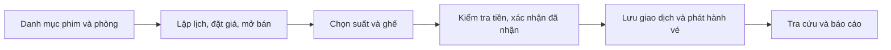

# FRAME — tài liệu sản phẩm và ôn vấn đáp

Đối chiếu mã ngày **12/10/2026**. Đây là tài liệu của sản phẩm C++17/Qt Widgets
offline hiện tại, không phải bản thiết kế tương lai hoặc một DBMS SQL.

## Đọc theo thứ tự

Nếu bắt đầu ôn vấn đáp từ đầu, theo [lộ trình 20 buổi](11-learning-roadmap.md).
Lộ trình dành bốn buổi riêng cho thiết kế cơ sở dữ liệu, có bài thực hành,
câu hỏi và mốc tự kiểm tra; các chương bên dưới là tài liệu đọc kèm.

| Tài liệu | Điều phải nắm |
|---|---|
| `01-requirements.md` | Phạm vi, quyền, ma trận 18 BR và 60 FR, sai lệch đã sửa |
| `02-build-and-demo.md` | Build, dữ liệu thật/demo, cấp Admin, thao tác quầy |
| `03-architecture.md` | Vì sao chia tầng, ai chịu trách nhiệm, một yêu cầu đi qua đâu |
| `04-data-and-storage.md` | Quan hệ dữ liệu, đọc/lưu TXT và cách giữ nhất quán |
| `05-data-structures.md` | Vì sao dùng DLL, hash, BST, matrix; minh họa và đánh đổi |
| `06-services-and-qt.md` | Luồng đăng nhập, lập lịch, bán vé, tra cứu và báo cáo |
| `07-verification.md` | Test, SAT/BAC, đo hiệu năng, hạn chế và an toàn dữ liệu |
| `08-oral-exam.md` | Kịch bản trình bày, câu hỏi khó, bài truy vết cụ thể |
| `09-cpp-reading-guide.md` | Ý nghĩa các lựa chọn C++/Qt: vòng đời, bản sao, sự kiện, lỗi |
| `10-source-index.md` | Bản đồ nối quyết định thiết kế với phần triển khai để vấn đáp |
| `11-learning-roadmap.md` | Lộ trình từ nền tảng tới vấn đáp, thiết kế dữ liệu và bài tự luyện |

Tài liệu không chép lại mã nguồn. Mỗi phần giải thích **bài toán → lựa chọn
thiết kế → cách vận hành → đánh đổi**, có ví dụ nghiệp vụ và sơ đồ Mermaid.
Khi cần trả lời câu hỏi về một dòng cụ thể, mở source trong IDE và dùng
`10-source-index.md` để biết dòng ấy phục vụ quyết định nào; không phải đọc
thêm một bản sao code trong tài liệu.

## Bắt đầu từ bức tranh này

Đây là thứ tự chuẩn bị dữ liệu và phục vụ khách, không phải tất cả màn hình
đều thuộc cùng một người: Admin chuẩn bị danh mục/lịch, tài khoản có quyền
bán phục vụ khách, Admin xem báo cáo.

Sơ đồ cần mở trong trình đọc Markdown hỗ trợ Mermaid. Mỗi sơ đồ có giải
thích bên cạnh; khối tên thành phần là trách nhiệm thiết kế, không phải mã
thực thi. Các khối lệnh ở chương build/demo chỉ để chạy sản phẩm.

## Điều không được trình bày sai

- Đăng nhập chỉ username/password; tên hiển thị thuộc quản lý tài khoản hoặc
  **chế độ cấp Admin khi triển khai**, không phải điều kiện đăng nhập.
- Admin trong UI là `Manager/MANAGER` trong C++; nhân viên là `Seller/SELLER`.
  Bán vé cần `canSellTicket`, không chỉ nhìn vai trò.
- Không có SQL, SQLite, ORM, máy chủ Spring Boot, Trie hay n-gram trong bản này.
- Ghế bán thuộc **cặp suất + ghế**, không phải ghế vật lý bán một lần vĩnh viễn.
- Không giữ chỗ, hoàn tiền, soát vé, ghế VIP, ca thu ngân, thanh toán điện tử.
- Test xanh là bằng chứng cho các ca đã thử, không là chứng minh mọi đầu vào,
  mọi máy hay mất điện. Không tuyên bố ACID tương đương DBMS.

## Cách giữ tài liệu đúng với sản phẩm

Khi thay nghiệp vụ, cập nhật mô tả và sơ đồ của luồng đó, rồi chạy kiểm thử
tương ứng. Sơ đồ mô tả triển khai hiện tại; tính năng chưa làm luôn được ghi
rõ là giới hạn, không vẽ như đã có. Không dùng việc chỉnh tài liệu để tự
phê duyệt yêu cầu mới. [Rà soát yêu cầu](../reviews/requirements-audit.md) lưu lỗi của bản trước sửa;
đọc phần cập nhật đầu file để phân biệt lịch sử và trạng thái hiện tại.
