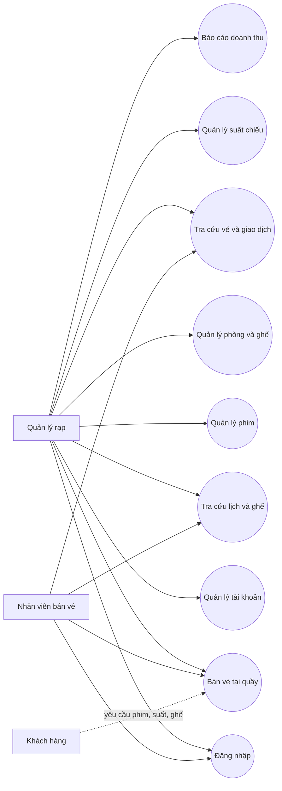
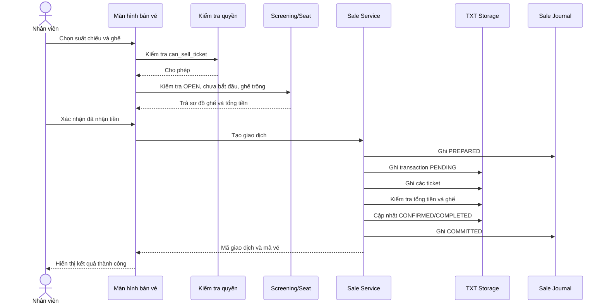

# ĐẶC TẢ USE CASE

## Hệ thống quản lý rạp chiếu phim

| Thông tin | Nội dung |
|---|---|
| Mã tài liệu | UC-CMS-001 |
| Phiên bản | 0.1 - Draft |
| Tài liệu liên quan | `docs/requirements/brd.md`, `docs/requirements/srs.md`, `docs/design/data-design.md`, `docs/design/database-erd.svg` |
| Phạm vi | Luồng nghiệp vụ và thay đổi dữ liệu |

---

# 1. Actor và quyền nghiệp vụ

| Actor | Mô tả | Use Case chính |
|---|---|---|
| Quản lý rạp | Quản lý dữ liệu và hoạt động kinh doanh | Đăng nhập, quản lý danh mục, lập lịch, báo cáo, tra cứu |
| Nhân viên bán vé | Phục vụ khách tại quầy | Đăng nhập, tra cứu lịch, bán vé, tra cứu giao dịch |
| Khách hàng | Đưa ra yêu cầu mua vé | Không thao tác trực tiếp trên hệ thống |
| Hệ thống | Kiểm tra dữ liệu, quyền và tính nhất quán | Khởi động, lưu dữ liệu, tính doanh thu |

## 1.1. Ma trận quyền

| Nghiệp vụ | Quản lý | Nhân viên bán vé |
|---|---:|---:|
| Đăng nhập/đăng xuất | Có | Có |
| Quản lý tài khoản | Có | Không |
| Quản lý phim | Có | Không |
| Quản lý phòng và ghế | Có | Không |
| Quản lý suất chiếu | Có | Không |
| Tra cứu lịch chiếu và ghế | Có | Có |
| Bán vé | Nếu được cấp quyền | Nếu được cấp quyền |
| Tra cứu vé/giao dịch | Có | Có |
| Xem báo cáo doanh thu | Có | Không |

---

# 2. Sơ đồ Use Case tổng quan



---

# 3. Quy ước đặc tả

- **Tiền điều kiện:** Điều kiện phải đúng trước khi bắt đầu.
- **Luồng chính:** Các bước thành công thường xảy ra.
- **Luồng thay thế:** Người dùng chọn hướng xử lý khác nhưng vẫn hợp lệ.
- **Ngoại lệ:** Điều kiện lỗi hoặc vi phạm quy tắc nghiệp vụ.
- **Hậu điều kiện:** Trạng thái hệ thống sau khi Use Case kết thúc.
- `CREATE`: tạo bản ghi mới.
- `UPDATE`: cập nhật bản ghi hiện có.
- `READ`: đọc dữ liệu, không làm thay đổi dữ liệu.

---

# 4. UC-SYS-01 - Khởi động và nạp dữ liệu

| Thuộc tính | Nội dung |
|---|---|
| Actor chính | Hệ thống |
| Trigger | Người dùng mở ứng dụng |
| Tiền điều kiện | Thư mục dữ liệu có thể đọc |
| Hậu điều kiện thành công | Dữ liệu hợp lệ được nạp vào bộ nhớ |
| Hậu điều kiện thất bại | Hệ thống báo lỗi và không cho thao tác làm thay đổi dữ liệu |

## Luồng chính

1. Hệ thống kiểm tra thư mục dữ liệu.
2. Hệ thống đọc header và bản ghi từ các file TXT.
3. Hệ thống kiểm tra mã định danh và ràng buộc duy nhất.
4. Hệ thống kiểm tra khóa ngoại giữa các thực thể.
5. Hệ thống kiểm tra xung đột suất chiếu.
6. Hệ thống kiểm tra giao dịch, vé và tổng tiền.
7. Hệ thống khôi phục journal đã `COMMITTED` và xử lý journal chưa hoàn tất.
8. Hệ thống hiển thị màn hình đăng nhập.

## Luồng thay thế và ngoại lệ

- `A1`: File chưa tồn tại nhưng là file dữ liệu khởi tạo: hệ thống tạo header mặc định.
- `E1`: Header sai hoặc số trường không đúng: báo tên file và dòng lỗi.
- `E2`: Khóa ngoại không tồn tại: báo dữ liệu tham chiếu bị lỗi.
- `E3`: Có hai vé cùng cặp `(screening_id, seat_id)`: từ chối tải dữ liệu để tránh bán trùng ghế.
- `E4`: Journal ở trạng thái `PREPARED` nhưng chưa `COMMITTED`: bỏ giao dịch chưa hoàn tất và giữ dữ liệu hợp lệ trước đó.

## Dữ liệu

```text
READ: users, films, auditoriums, seats, screenings, transactions, tickets, sale_journal
```

---

# 5. UC-AUTH-01 - Đăng nhập

| Thuộc tính | Nội dung |
|---|---|
| Actor chính | Quản lý hoặc nhân viên bán vé |
| Trigger | Người dùng nhập username và mật khẩu |
| Tiền điều kiện | Tài khoản tồn tại và đang hoạt động |
| Hậu điều kiện | Tạo phiên đăng nhập với quyền tương ứng |

## Luồng chính

1. Người dùng mở màn hình đăng nhập.
2. Người dùng nhập username và mật khẩu.
3. Hệ thống tìm tài khoản theo username.
4. Hệ thống kiểm tra tài khoản đang `ACTIVE`.
5. Hệ thống kiểm tra mật khẩu.
6. Hệ thống tạo phiên đăng nhập và nạp quyền.
7. Hệ thống chuyển người dùng đến màn hình phù hợp với vai trò.

## Ngoại lệ

- `E1`: Username không tồn tại hoặc mật khẩu sai: báo thông tin đăng nhập không hợp lệ.
- `E2`: Tài khoản `INACTIVE`: từ chối đăng nhập.
- `E3`: File tài khoản lỗi: yêu cầu xử lý dữ liệu, không đăng nhập.

## Dữ liệu

```text
READ: USER
```

---

# 6. UC-AUTH-02 - Quản lý tài khoản và quyền

| Thuộc tính | Nội dung |
|---|---|
| Actor chính | Quản lý rạp |
| Trigger | Quản lý mở chức năng tài khoản |
| Tiền điều kiện | Quản lý đã đăng nhập |
| Hậu điều kiện | Tài khoản hợp lệ được tạo hoặc cập nhật |

## Luồng chính

1. Quản lý xem danh sách tài khoản.
2. Quản lý chọn thêm mới hoặc chỉnh sửa tài khoản.
3. Quản lý nhập username, tên hiển thị, vai trò và quyền bán vé.
4. Hệ thống kiểm tra username không trùng và các trường bắt buộc.
5. Quản lý xác nhận lưu.
6. Hệ thống ghi dữ liệu vào `users.txt`.

## Ngoại lệ

- `E1`: Username đã tồn tại: từ chối lưu.
- `E2`: Dữ liệu bắt buộc rỗng: yêu cầu nhập lại.
- `E3`: Người dùng không có quyền quản lý: từ chối truy cập.

## Dữ liệu

```text
READ/CREATE/UPDATE: USER
```

---

# 7. UC-MASTER-01 - Quản lý phim

| Thuộc tính | Nội dung |
|---|---|
| Actor chính | Quản lý rạp |
| Trigger | Quản lý mở chức năng phim |
| Tiền điều kiện | Quản lý đã đăng nhập |
| Hậu điều kiện | Phim hợp lệ được lưu với trạng thái phù hợp |

## Luồng chính

1. Quản lý xem danh sách phim.
2. Quản lý chọn thêm, sửa hoặc ngừng khai thác phim.
3. Quản lý nhập mã, tên, thời lượng và phân loại độ tuổi.
4. Hệ thống kiểm tra mã duy nhất, tên không rỗng và thời lượng lớn hơn 0.
5. Hệ thống kiểm tra phim không làm mất tính hợp lệ của suất chiếu đã có vé.
6. Quản lý xác nhận.
7. Hệ thống lưu dữ liệu.

## Luồng thay thế

- `A1`: Chọn tra cứu: hệ thống lọc và hiển thị danh sách, không thay đổi dữ liệu.
- `A2`: Chọn ngừng khai thác: hệ thống chuyển `status` sang `INACTIVE` nếu không có suất chiếu tương lai bị ảnh hưởng.

## Ngoại lệ

- `E1`: Mã phim trùng hoặc trường bắt buộc sai: từ chối lưu.
- `E2`: Phim có suất chiếu tương lai bị ảnh hưởng: không cho ngừng khai thác.
- `E3`: Nhân viên bán vé truy cập: từ chối thao tác.

## Dữ liệu

```text
READ/CREATE/UPDATE: FILM
READ: SCREENING, TICKET
```

---

# 8. UC-MASTER-02 - Quản lý phòng và ghế

| Thuộc tính | Nội dung |
|---|---|
| Actor chính | Quản lý rạp |
| Trigger | Quản lý mở chức năng phòng chiếu |
| Tiền điều kiện | Quản lý đã đăng nhập |
| Hậu điều kiện | Phòng và sơ đồ ghế hợp lệ được lưu |

## Luồng chính

1. Quản lý xem danh sách phòng.
2. Quản lý tạo hoặc chỉnh sửa một phòng.
3. Quản lý nhập tên phòng và sơ đồ ghế.
4. Hệ thống kiểm tra mã phòng duy nhất.
5. Hệ thống kiểm tra mỗi ghế có mã duy nhất trong phòng.
6. Hệ thống tính sức chứa từ số ghế hợp lệ.
7. Quản lý xác nhận lưu.
8. Hệ thống ghi `auditoriums.txt` và `seats.txt`.

## Luồng thay thế và ngoại lệ

- `A1`: Chuyển phòng sang `INACTIVE`: chỉ cho phép nếu không có suất chiếu tương lai bị ảnh hưởng.
- `E1`: Mã ghế trùng trong phòng: từ chối toàn bộ cấu hình.
- `E2`: Sức chứa bằng 0 hoặc sơ đồ không có ghế hợp lệ: từ chối lưu.
- `E3`: Cấu hình đã liên quan đến vé bán: không cho sửa làm mất ghế đã tham chiếu.

## Dữ liệu

```text
READ/CREATE/UPDATE: AUDITORIUM, SEAT
READ: SCREENING, TICKET
```

---

# 9. UC-SHOW-01 - Tạo và mở bán suất chiếu

| Thuộc tính | Nội dung |
|---|---|
| Actor chính | Quản lý rạp |
| Trigger | Quản lý chọn tạo suất chiếu |
| Tiền điều kiện | Phim và phòng đang `ACTIVE` |
| Hậu điều kiện thành công | Suất chiếu hợp lệ được tạo và có thể mở bán |

## Luồng chính

1. Quản lý chọn phim.
2. Quản lý chọn phòng.
3. Quản lý nhập thời điểm bắt đầu và giá vé.
4. Hệ thống lấy thời lượng phim.
5. Hệ thống tính `end_time`.
6. Hệ thống tính `room_available_until = end_time + 15 phút`.
7. Hệ thống kiểm tra xung đột với các suất khác trong cùng phòng.
8. Hệ thống kiểm tra giá vé và thời gian hợp lệ.
9. Quản lý xác nhận tạo.
10. Hệ thống tạo mã suất chiếu và lưu trạng thái `OPEN`.

## Luồng thay thế

- `A1`: Quản lý lưu nháp: tạo suất ở trạng thái `DRAFT`; suất nháp không hiển thị để bán.
- `A2`: Quản lý đóng bán: chuyển trạng thái sang `CLOSED`; không nhận giao dịch mới.
- `A3`: Suất đã kết thúc: hệ thống chuyển hoặc cho phép chuyển sang `COMPLETED`.

## Ngoại lệ

- `E1`: Phim/phòng không tồn tại hoặc không hoạt động: từ chối.
- `E2`: Khoảng thời gian chồng lấn: từ chối, lịch cũ không thay đổi.
- `E3`: Giá vé âm hoặc thời gian không hợp lệ: từ chối.
- `E4`: Có vé đã bán: không cho sửa phim, phòng, thời gian hoặc giá vé.

## Dữ liệu

```text
READ: FILM, AUDITORIUM, SEAT, SCREENING
CREATE/UPDATE: SCREENING
```

---

# 10. UC-SEARCH-01 - Tra cứu lịch chiếu và ghế

| Thuộc tính | Nội dung |
|---|---|
| Actor chính | Nhân viên bán vé hoặc quản lý |
| Actor phụ | Khách hàng cung cấp tiêu chí lựa chọn |
| Trigger | Người dùng nhập ngày, phim hoặc phòng cần tra cứu |
| Tiền điều kiện | Người dùng đã đăng nhập |
| Hậu điều kiện | Không thay đổi dữ liệu |

## Luồng chính

1. Người dùng nhập một hoặc nhiều tiêu chí tìm kiếm.
2. Hệ thống lọc phim và suất chiếu phù hợp.
3. Người dùng chọn một suất chiếu.
4. Hệ thống tải phòng và sơ đồ ghế.
5. Hệ thống đối chiếu vé hợp lệ của suất chiếu.
6. Hệ thống hiển thị ghế còn trống và ghế đã bán.

## Ngoại lệ

- `E1`: Không có kết quả: hiển thị thông báo và cho phép tìm lại.
- `E2`: Suất chiếu không còn mở bán: hiển thị trạng thái, không cho bắt đầu bán.

## Dữ liệu

```text
READ: FILM, AUDITORIUM, SEAT, SCREENING, TICKET, SALE_TRANSACTION
```

---

# 11. UC-SALE-01 - Bán vé tại quầy

| Thuộc tính | Nội dung |
|---|---|
| Actor chính | Người dùng có `can_sell_ticket = 1` |
| Actor phụ | Khách hàng |
| Trigger | Khách hàng yêu cầu mua vé |
| Tiền điều kiện | Người bán đã đăng nhập; suất chiếu `OPEN` và chưa bắt đầu |
| Hậu điều kiện thành công | Giao dịch, vé, ghế đã bán và doanh thu được ghi nhận nhất quán |
| Hậu điều kiện thất bại | Không có giao dịch thành công, vé hợp lệ hoặc doanh thu mới |

## 11.1. Luồng chính

1. Nhân viên tra cứu phim và suất chiếu.
2. Khách hàng chọn một suất chiếu.
3. Nhân viên chọn suất chiếu trên màn hình bán vé.
4. Hệ thống kiểm tra quyền bán vé và trạng thái suất chiếu.
5. Hệ thống hiển thị sơ đồ ghế.
6. Khách hàng chọn một hoặc nhiều ghế còn trống.
7. Hệ thống kiểm tra ghế thuộc phòng của suất chiếu và chưa có vé hợp lệ.
8. Hệ thống hiển thị danh sách ghế, đơn giá và tổng tiền.
9. Nhân viên thông báo tổng tiền cho khách hàng.
10. Khách hàng thanh toán tiền mặt.
11. Nhân viên xác nhận đã nhận đủ tiền.
12. Hệ thống tạo mã giao dịch và mã vé.
13. Hệ thống ghi giao dịch ở trạng thái `PENDING` và journal `PREPARED`.
14. Hệ thống ghi đầy đủ các vé.
15. Hệ thống kiểm tra lại số vé, ghế và tổng tiền.
16. Hệ thống cập nhật thanh toán `CONFIRMED` và giao dịch `COMPLETED`.
17. Hệ thống ghi journal `COMMITTED`.
18. Hệ thống hiển thị mã giao dịch, mã vé và thông tin vé.

## 11.2. Luồng thay thế

- `A1`: Khách hàng thay đổi ghế trước bước 11: nhân viên bỏ ghế cũ, chọn ghế mới; chưa ghi dữ liệu bán.
- `A2`: Khách hàng hủy trước bước 11: kết thúc Use Case, không tạo bản ghi bán.
- `A3`: Khách hàng mua nhiều vé: lặp bước 6-7 cho nhiều ghế; vẫn tạo một giao dịch.
- `A4`: Quản lý bán vé: được thực hiện nếu tài khoản có `can_sell_ticket = 1`.

## 11.3. Ngoại lệ

- `E1`: Suất chiếu đã bắt đầu hoặc không còn `OPEN`: từ chối bán.
- `E2`: Ghế đã bán: từ chối ghế đó, yêu cầu chọn ghế khác.
- `E3`: Ghế bị chọn trùng trong cùng giao dịch: từ chối lựa chọn trùng.
- `E4`: Không đủ số ghế: không cho xác nhận.
- `E5`: Khách chưa thanh toán hoặc nhân viên không xác nhận: không tạo vé và doanh thu.
- `E6`: Ghi file thất bại: đánh dấu giao dịch chưa hoàn tất, không hiển thị thành công và phục hồi theo journal.
- `E7`: Phát hiện dữ liệu hiện tại khác với lúc chọn ghế: tải lại sơ đồ ghế và yêu cầu chọn lại.

## 11.4. Dữ liệu thay đổi

```text
READ: USER, SCREENING, AUDITORIUM, SEAT, TICKET
CREATE: SALE_TRANSACTION, TICKET
UPDATE: SALE_TRANSACTION.status, SALE_TRANSACTION.payment_status
WRITE: sale_journal.txt
DERIVE: revenue từ SALE_TRANSACTION + TICKET hợp lệ
```

## 11.5. Điều kiện bất biến sau thành công

```text
transaction.status = COMPLETED
transaction.payment_status = CONFIRMED
transaction.total_amount = SUM(ticket.unit_price)
COUNT(ticket) >= 1
UNIQUE(screening_id, seat_id) vẫn đúng
```

---

# 12. UC-QUERY-01 - Tra cứu vé và giao dịch

| Thuộc tính | Nội dung |
|---|---|
| Actor chính | Nhân viên bán vé hoặc quản lý |
| Trigger | Người dùng nhập mã vé hoặc mã giao dịch |
| Tiền điều kiện | Người dùng đã đăng nhập |
| Hậu điều kiện | Hiển thị kết quả, không thay đổi dữ liệu |

## Luồng chính

1. Người dùng chọn loại mã cần tra cứu.
2. Người dùng nhập mã vé hoặc mã giao dịch.
3. Hệ thống kiểm tra định dạng mã.
4. Hệ thống tìm bản ghi tương ứng.
5. Hệ thống tải phim, suất chiếu, phòng, ghế, giá, người thực hiện và trạng thái.
6. Hệ thống hiển thị kết quả.

## Ngoại lệ

- `E1`: Mã rỗng hoặc sai định dạng: yêu cầu nhập lại.
- `E2`: Không tìm thấy: hiển thị không có kết quả.
- `E3`: Dữ liệu liên quan không nhất quán: báo lỗi dữ liệu, không tự ý sửa.

## Dữ liệu

```text
READ: SALE_TRANSACTION, TICKET, SCREENING, FILM, AUDITORIUM, SEAT, USER
```

---

# 13. UC-REPORT-01 - Báo cáo doanh thu

| Thuộc tính | Nội dung |
|---|---|
| Actor chính | Quản lý rạp |
| Trigger | Quản lý chọn chức năng báo cáo |
| Tiền điều kiện | Quản lý đã đăng nhập và có quyền báo cáo |
| Hậu điều kiện | Hiển thị số liệu tính từ giao dịch hợp lệ |

## Luồng chính

1. Quản lý chọn khoảng thời gian.
2. Quản lý chọn bộ lọc phim hoặc suất chiếu nếu cần.
3. Hệ thống lấy các giao dịch `COMPLETED` và `CONFIRMED` trong phạm vi.
4. Hệ thống lấy các vé thuộc giao dịch hợp lệ.
5. Hệ thống tính số vé bán.
6. Hệ thống tính số ghế đã bán.
7. Hệ thống tính doanh thu bằng tổng `unit_price`.
8. Hệ thống tính tỷ lệ lấp đầy theo sức chứa phòng.
9. Hệ thống hiển thị báo cáo.

## Ngoại lệ

- `E1`: Khoảng thời gian không hợp lệ: yêu cầu chọn lại.
- `E2`: Không có dữ liệu: hiển thị số liệu 0 và thông báo không có giao dịch.
- `E3`: Nhân viên bán vé truy cập: từ chối.

## Dữ liệu

```text
READ: SALE_TRANSACTION, TICKET, SCREENING, FILM, AUDITORIUM
DERIVE: sold_tickets, revenue, occupancy_rate
```

---

# 14. Sơ đồ tuần tự nghiệp vụ bán vé



Nếu một bước ghi thất bại, hệ thống không trả về kết quả thành công và xử lý journal khi khởi động lại.

---

# 15. Ma trận Use Case và yêu cầu SRS

| Use Case | Yêu cầu SRS |
|---|---|
| UC-SYS-01 | FR-DATA-01..06, NFR-03, NFR-04, NFR-10 |
| UC-AUTH-01 | FR-AUTH-01..04 |
| UC-AUTH-02 | FR-AUTH-05..06 |
| UC-MASTER-01 | FR-FILM-01..06 |
| UC-MASTER-02 | FR-ROOM-01..06 |
| UC-SHOW-01 | FR-SHOW-01..09 |
| UC-SEARCH-01 | FR-SEARCH-01..04 |
| UC-SALE-01 | FR-SALE-01..12, RULE-05..12 |
| UC-QUERY-01 | FR-QUERY-01..05 |
| UC-REPORT-01 | FR-REPORT-01..06 |

---

# 16. Kịch bản kiểm thử ưu tiên

| ID | Use Case | Kịch bản |
|---|---|---|
| UC-T01 | UC-AUTH-01 | Đăng nhập đúng và sai mật khẩu. |
| UC-T02 | UC-MASTER-01 | Tạo phim hợp lệ và từ chối mã phim trùng. |
| UC-T03 | UC-MASTER-02 | Tạo phòng, ghế hợp lệ và từ chối ghế trùng. |
| UC-T04 | UC-SHOW-01 | Tạo suất chiếu hợp lệ. |
| UC-T05 | UC-SHOW-01 | Từ chối hai suất chiếu chồng lấn cùng phòng. |
| UC-T06 | UC-SALE-01 | Bán hai ghế trong một giao dịch thành công. |
| UC-T07 | UC-SALE-01 | Từ chối bán lại ghế đã bán. |
| UC-T08 | UC-SALE-01 | Hủy trước thanh toán, không tạo dữ liệu bán. |
| UC-T09 | UC-SALE-01 | Mô phỏng ghi file thất bại, không ghi nhận thành công. |
| UC-T10 | UC-QUERY-01 | Tra cứu đầy đủ mã giao dịch và mã vé. |
| UC-T11 | UC-REPORT-01 | Báo cáo khớp với các giao dịch `COMPLETED`. |
| UC-T12 | UC-SYS-01 | Đóng/mở lại ứng dụng và bảo toàn dữ liệu. |
